## Learning Outcomes 

By the end of this week, you should be able to:

- Explain the intuition behind Support Vector Machines (SVMs), including separating hyperplanes, margins, and support vectors.
- Distinguish between hard-margin and soft-margin SVMs and explain the role of slack variables and regularization.
- Describe how the kernel trick allows SVMs to construct nonlinear decision boundaries.
- Explain the distinction between supervised and unsupervised learning.
- Describe the objective of K-means clustering and the steps of the K-means algorithm.
- Discuss the convergence properties and limitations of K-means clustering, including sensitivity to initialization and local minima.

# Support Vector Machine

## Linear decision boundaries

In binary classification problems, we have seen examples of classifiers with decision boundaries **linear** in the feature space.

- Logistic regression:

$$\log\frac{P(Y=1\mid X=x)}{P(Y=0\mid X=x)}=\beta_0+\beta^\top x.$$

Hence, $P(Y=1\mid X=x)\ge P(Y=0\mid X=x)$ if and only if

$$\beta_0+\beta^\top x\ge0.$$

The decision boundary is

$$\{x\in\mathbb R^p:\beta_0+\beta^\top x=0\}. $$

## Linear decision boundaries

- LDA:

$$\delta_k(x)=x^\top\Sigma^{-1}\mu_k-\frac12\mu_k^\top\Sigma^{-1}\mu_k+\log\pi_k,\quad\forall k\in\{0,1\}.$$

Hence, $\delta_1(x)\ge\delta_0(x)$ if and only if

$$\left(x-\frac{\mu_0+\mu_1}{2}\right)^\top\Sigma^{-1}(\mu_1-\mu_0)+\log\frac{\pi_1}{\pi_0}\ge0.$$

The decision boundary is

$$\{x\in\mathbb R^p:\alpha_0+\alpha^\top x=0\}$$

for some $\alpha_0$ and $\alpha\in\mathbb R^p$.

## A general formulation of linear classifiers

**Binary classification**: predicting a target with two values, $y\in\{-1,+1\}$, (notational change from the past).

:::{.fragment}
- Consider the linear decision boundary

$$w^\top x+b=0$$

for some weights $w\in\mathbb R^p$ and $b\in\mathbb R$.

- A good decision boundary should satisfy: for a given point $(x,y)$,

$$\begin{aligned}w^\top x+b&>0,&&\text{if }y=1\\w^\top x+b&<0,&&\text{if }y=-1.\end{aligned}$$

::: 

## Separating Hyperplanes

Suppose we are given these data points from two different classes and want to find a linear classifier that separates them.

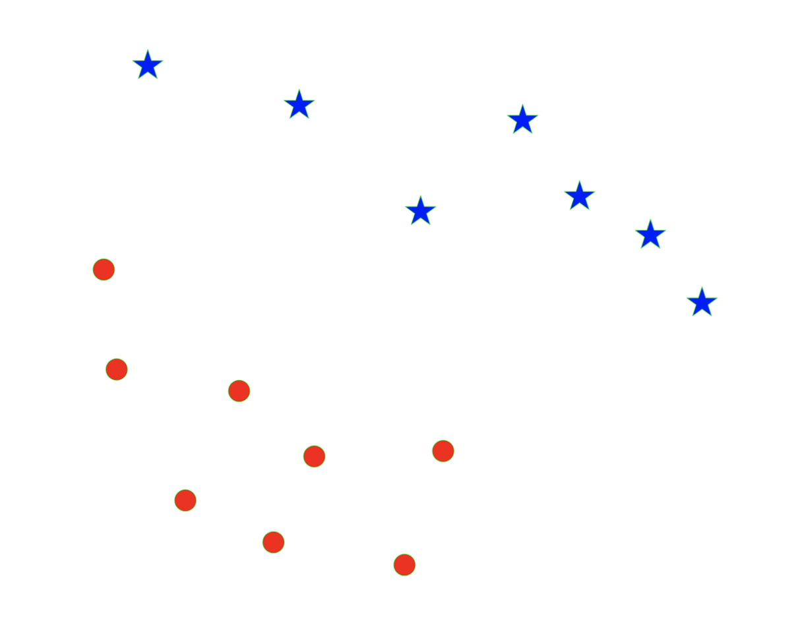{width="70%" fig-align="center"}

## Separating Hyperplanes

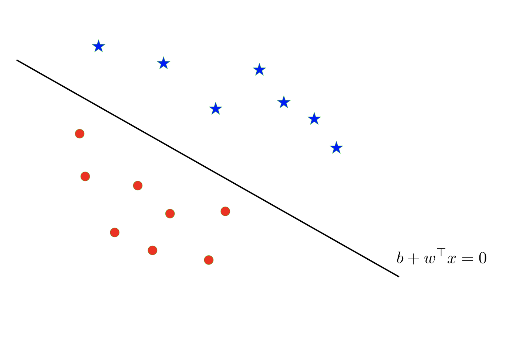{width="70%" fig-align="center"}

- The decision boundary is a line in $\mathbb R^2$
- $\{x\in\mathbb R^p:w^\top x+b=0\}$ is a hyperplane in $(p-1)$ dimensional space.

## Simple Intuition and Potential Issues

To correctly classify all points we require that

$$\operatorname{sign}(w^\top x_i+b)=y_i\qquad\text{for all }i\in[n].$$

- We should find $w$ and $b$ to meet the above goal.

  

:::{.fragment} 

**However:**

  - When the data is separable, there exists multiple solutions of $w$ and $b$. Which to choose?
  - When the data is not separable, it is infeasible.

::: 

## Separable Cases

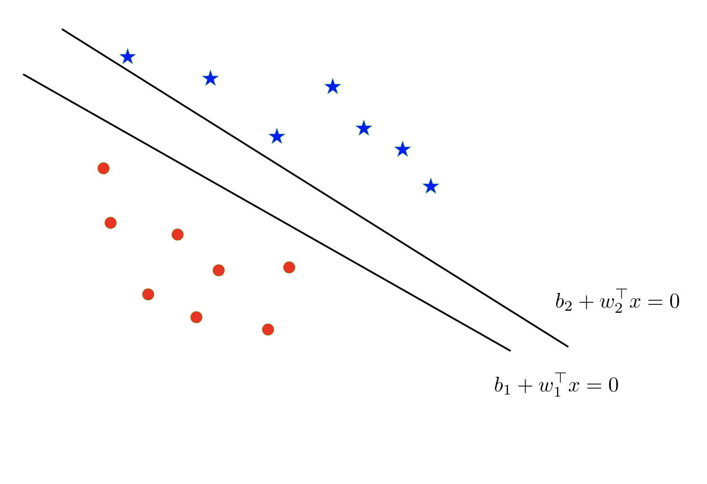{width="70%" fig-align="center"}

There are multiple separating hyperplanes, determined by different parameters $(w,b)$.

## Separable Cases

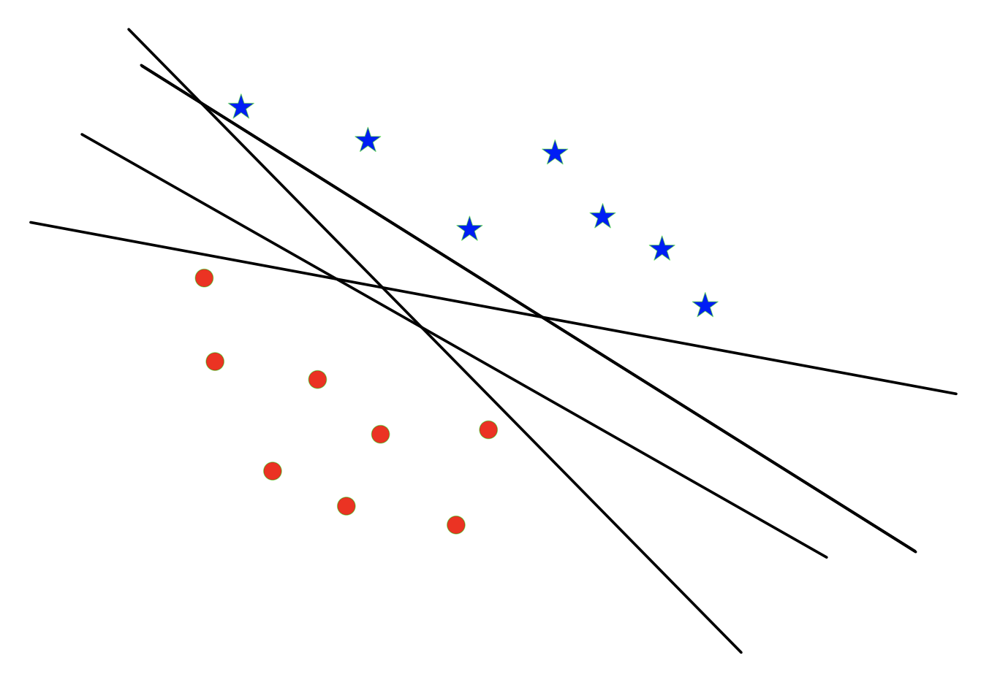{width="70%" fig-align="center"}

## Optimal Separating Hyperplane

**Optimal Separating Hyperplane:** A hyperplane that separates two classes and maximizes the distance to the closest point from either class, i.e., maximize the margin of the classifier.

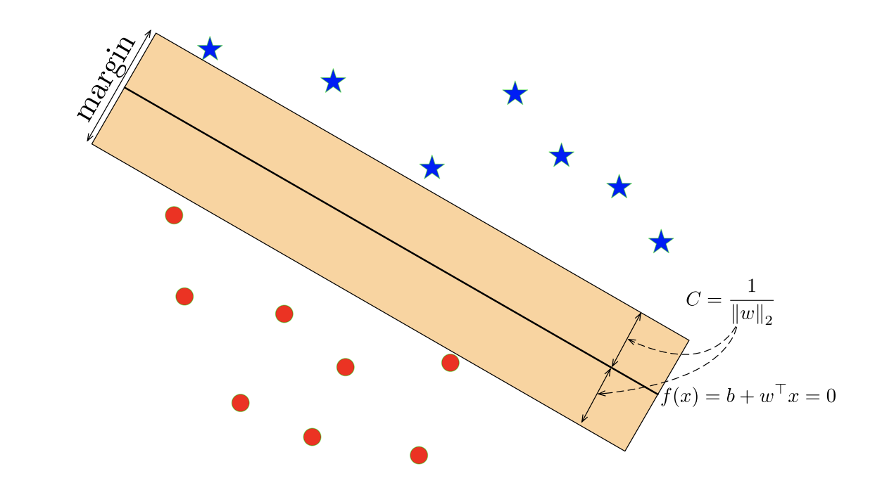{width="70%" fig-align="center"}

Intuitively, ensuring that a classifier is not too close to any data points leads to better generalization on the test data.

## Geometry of Points and Planes

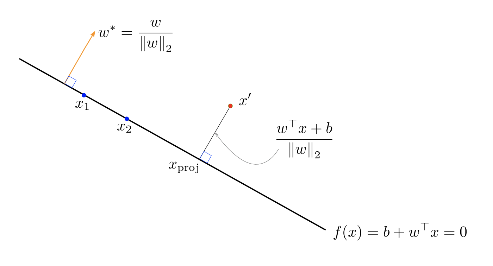{width="70%" fig-align="center"}

Recall that the decision hyperplane is orthogonal (perpendicular) to $w$. I.e., for any two points $x_1$ and $x_2$ on the decision hyperplane we have that

$$w^\top(x_1-x_2)=0.$$

## Geometry of Points and Planes

{width="70%" fig-align="center"}

The vector $w^*=\frac{w}{\|w\|_2}$ is a unit vector pointing in the same direction as $w$.

The same hyperplane could equivalently be defined in terms of $w^*$.

## Geometry of Points and Planes

{width="70%" fig-align="center"}

Question: how to compute the distance from a point $x'$ to the hyperplane $\{x:b+w^\top x=0\}$.

## Distance to a Given Hyperplane

Fix the point $\mathbf{x'}$ as well as $\mathbf{w}$ and $b$ which determine the hyperplane.

- Take the closest point $x_{\mathrm{proj}}$ on the hyperplane, which satisfies

$$\mathbf{w}^\top \mathbf{x}_{\mathrm{proj}}+b=0.$$

- We know that $\mathbf{x'-x}_{\mathrm{proj}}$ is parallel to $\mathbf{w^*=w/\|w}\|_2$
- The distance is

$$
\begin{aligned}
\|\mathbf{x}'-\mathbf{x}_{\mathrm{proj}}\|_2
&=\left|(\mathbf{x}'-\mathbf{x}_{\mathrm{proj}})^\top
\frac{\mathbf{w}}{\|\mathbf{w}\|_2}\right|\\
&=\frac{|\mathbf{w}^\top\mathbf{x}'-\mathbf{w}^\top\mathbf{x}_{\mathrm{proj}}|}{\|\mathbf{w}\|_2}
=\frac{|\mathbf{w}^\top\mathbf{x}'+b|}{\|\mathbf{w}\|_2}.
\end{aligned}
$$

## Maximizing Margin as Optimization Problem

We want to choose $\mathbf{w}$ and $b$ such that:

- correctly classify all points:

$$
\operatorname{sign}(\mathbf{w}^\top \mathbf{x}_i+b)=y_i
\qquad\text{for all }i\in[n]
$$

- The smallest distance of $\mathbf{x}_i$ to $\{\mathbf{x}:\mathbf{w}^\top \mathbf{x}+b=0\}$,

$$
\frac{|\mathbf{w}^\top \mathbf{x}_i+b|}{\|\mathbf{w}\|_2},
$$

is as large as possible.

This leads to the max-margin objective:

$$
\begin{aligned}
\max_{\mathbf{w},b}\ \min_{i\in[n]}
&\frac{|\mathbf{w}^\top \mathbf{x}_i+b|}{\|\mathbf{w}\|_2}\\
\text{s.t. }&y_i(\mathbf{w}^\top \mathbf{x}_i+b)\ge0,
\quad\text{for all }i\in[n].
\end{aligned}
$$

## Maximizing Margin as an Optimization Problem

Equivalently,

$$
\begin{aligned}
\max_{\mathbf{w},b}\ \min_{i\in[n]}
&\frac{y_i^2(\mathbf{w}^\top \mathbf{x}_i+b)^2}{\|\mathbf{w}\|_2^2}\\
\text{s.t. }&y_i(\mathbf{w}^\top \mathbf{x}_i+b)\ge0,
\quad\text{for all }i\in[n].
\end{aligned}
$$

More compactly,

$$
\begin{aligned}
\min_{\mathbf{w},b}\ &\frac{\|\mathbf{w}\|_2^2}{M^2}\\
\text{s.t. }&y_i(\mathbf{w}^\top \mathbf{x}_i+b)\ge M,
\quad\text{for all }i=1,\ldots,n.
\end{aligned}
$$

The constraints are called the [**margin constraints**]{.maroon}.

W.l.o.g. we can set $M=1$. (Why?)

## Maximizing Margin as an Optimization Problem

::::: columns
::: {.column width="57%"}
Max-margin objective:

$$
\begin{aligned}
\min_{\mathbf{w},b}\ &\|\mathbf{w}\|_2^2\\
\text{s.t. }&y_i(\mathbf{w}^\top \mathbf{x}_i+b)\ge1
\qquad i=1,\ldots,n
\end{aligned}
$$
:::

::: {.column width="43%"}
{fig-align="center" width="100%"}
:::
:::::

- Intuitively, if the margin constraint is not tight for $x_i$, we could remove $x_i$ from the training set and the optimal hyperplane would be the same.¹

- The important training points are those with equality constraints, and are called [**support vectors**]{.maroon}.

- Hence, this algorithm is called the (hard-margin) [**Support Vector Machine (SVM)**]{.maroon}. SVM-like algorithms are often called **max-margin** or **large-margin**.

¹This can be rigorously shown via the K.K.T. conditions.

## Computation of the hard-margin SVM

Primal-formulation:

$$
\begin{aligned}
\min_{\mathbf{w},b}\ &\|\mathbf{w}\|_2^2\\
\text{s.t. }&y_i(\mathbf{w}^\top \mathbf{x}_i+b)\ge1
\qquad i=1,\ldots,n
\end{aligned}
$$

- Convex, in fact, a quadratic program. [(Stochastic) Gradient descent]{.maroon} can be directly used.
- In practice, it is more common to solve this optimization problem based on its dual formulation.

## Dual-formulation of the hard-margin SVM

For $\alpha_i\ge0$ for all $i=1,\ldots,n$, write the Lagrangian function

$$
L(\mathbf{w},b,\alpha)=\|\mathbf{w}\|_2^2+\sum_{i=1}^n\alpha_i[1-y_i(\mathbf{w}^\top \mathbf{x}_i+b)],
$$

:::{.fragment}
Taking the derivative w.r.t. $\mathbf{w}$ and $b$ yields

$$
\mathbf{w}=\frac12\sum_{i=1}^n\alpha_i y_i \mathbf{x}_i,
\qquad
\sum_{i=1}^n\alpha_i y_i=0.
$$

::: 

:::{.fragment}
Plugging into $L(\mathbf{w},b,\alpha)$ yields

$$
\begin{aligned}
&\frac14\sum_{i=1}^n\sum_{j=1}^n\alpha_i\alpha_j y_i y_j \mathbf{x}_i^\top \mathbf{x}_j
+\sum_{i=1}^n\alpha_i
-\frac12\sum_{i=1}^n\sum_{j=1}^n\alpha_i\alpha_j y_i y_j \mathbf{x}_i^\top \mathbf{x}_j
-b\sum_{i=1}^n\alpha_i y_i\\
&=\sum_{i=1}^n\alpha_i
-\frac14\sum_{i=1}^n\sum_{j=1}^n\alpha_i\alpha_j y_i y_j \mathbf{x}_i^\top \mathbf{x}_j.
\end{aligned}
$$

::: 

## Dual-formulation of the hard-margin SVM

The dual problem is

$$
\begin{aligned}
\max_\alpha\quad
&\sum_{i=1}^n\alpha_i-\frac14\sum_{i=1}^n\sum_{j=1}^n\alpha_i\alpha_j y_i y_j \mathbf{x}_i^\top \mathbf{x}_j\\
\text{s.t. }&\sum_{i=1}^n\alpha_i y_i=0,\quad\alpha_i\ge0,\quad i=1,\ldots,n.
\end{aligned}
$$

- This is a quadratic program in $\alpha$ and can be easily solved.
- It only depends on $\mathbf{x}_i^\top \mathbf{x}_j$, which is very convenient to extend to cases where some basis functions $\phi(\mathbf{x}_i)$ are used (so-called **kernel trick**.)

## K.K.T. conditions

The K.K.T. conditions ensure the following relationships between the primal and dual formulations.

- Their optimal objective values are equal.
- The optimal solutions $\hat{\mathbf{w}}$ and $\hat\alpha$ satisfy

$$\hat{\mathbf{w}}=\frac12\sum_{i=1}^n\hat\alpha_i y_i \mathbf{x}_i,\qquad\begin{cases}\hat\alpha_i>0,&\text{if }y_i(\mathbf{\hat{w}^\top x}_i+\hat b)=1\\\hat\alpha_i=0,&\text{if }y_i(\mathbf{\hat{w}^\top x}_i+\hat b)>1.\end{cases}$$

- The predicted label for any $\mathbf{x}$ is

$$\operatorname{sign}(\mathbf{\hat{w}^\top x}+\hat b).$$

## Extension to Non-Separable Data Points

How can we apply the max-margin principle if the data are not linearly separable?

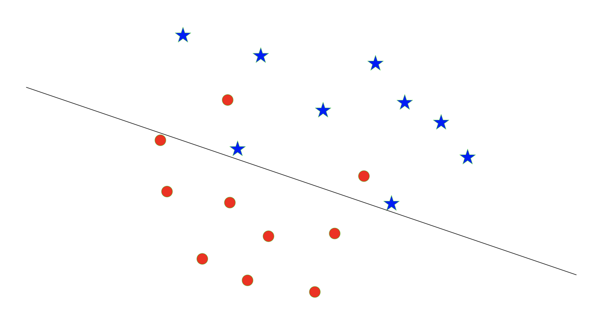{fig-align="center" width="70%"}

## Soft-margin SVM

We introduce slack variables $\zeta=(\zeta_1,\ldots,\zeta_n)$ and consider

$$
\begin{aligned}
\min_{\mathbf{w},b,\zeta}\quad&\|\mathbf{w}\|_2^2\\
\text{s.t. }&y_i(\mathbf{w}^\top \mathbf{x}_i+b)\ge1-\zeta_i,\quad\zeta_i\ge0,\quad\text{for all }i=1,\ldots,n\\
&\sum_{i=1}^n\zeta_i\le K.
\end{aligned}
$$

:::{.fragment} 

- Misclassification occurs if $\zeta_i>1$.
- $\sum_{i=1}^n\zeta_i\le K\ \Rightarrow$ the total number of misclassified points less than $K$.
- $K\ge0$ is a tuning parameter.
- $K=0$ reduces to the hard-margin SVM.

::: 

## Another interpretation of the soft-margin SVM

- Soft-margin SVM is equivalent to, for some $C=C(K)$,

$$
\begin{aligned}
\min_{\mathbf{w},b,\zeta}\quad&\|\mathbf{w}\|_2^2+C\sum_{i=1}^n\zeta_i\\
\text{s.t. }&y_i(\mathbf{w}^\top \mathbf{x}_i+b)\ge1-\zeta_i,\quad\zeta_i\ge0,\quad i=1,\ldots,n.
\end{aligned}
$$

- This is further equivalent to

$$
\min_{\mathbf{w},b}\ \frac1n\sum_{i=1}^n\underbrace{\max\{0,1-y_i(\mathbf{w}^\top \mathbf{x}_i+b)\}}_{\text{hinge loss}}+\lambda\|\mathbf{w}\|_2^2
$$

with $\lambda=1/(nC)$. Hence, the soft-margin SVM can be seen as a linear classifier with the [**hinge loss**]{.maroon} and the ridge penalty.

## Hinge Loss

The hinge loss:

$$
L_{\mathrm{hinge}}(\mathbf{w},b)=\max\{0,1-y_i(\mathbf{w}^\top \mathbf{x}_i+b)\}
$$

We only want to minimize $1-y_i(\mathbf{w}^\top \mathbf{x}_i+b)$ when it is positive.

$$
\begin{aligned}
y_i(\mathbf{w}^\top \mathbf{x}_i+b)\ge1
&\quad\Rightarrow\quad\checkmark\text{ + out of margin}\\
y_i(\mathbf{w}^\top \mathbf{x}_i+b)\in[0,1]
&\quad\Rightarrow\quad\checkmark\text{ but within margin}\\
y_i(\mathbf{w}^\top \mathbf{x}_i+b)<0
&\quad\Rightarrow\quad\times
\end{aligned}
$$

The 0-1 loss

$$
L_{0\text{-}1}(\mathbf{w},b)=\mathbf{1}\{y_i(\mathbf{w}^\top \mathbf{x}_i+b)<0\}.
$$

## Revisiting Loss Functions for Classification

Hinge loss compared with the 0-1 loss:

$$y=\max\{0,1-x\}\qquad\text{v.s.}\qquad y=\mathbf1\{x<0\}.$$

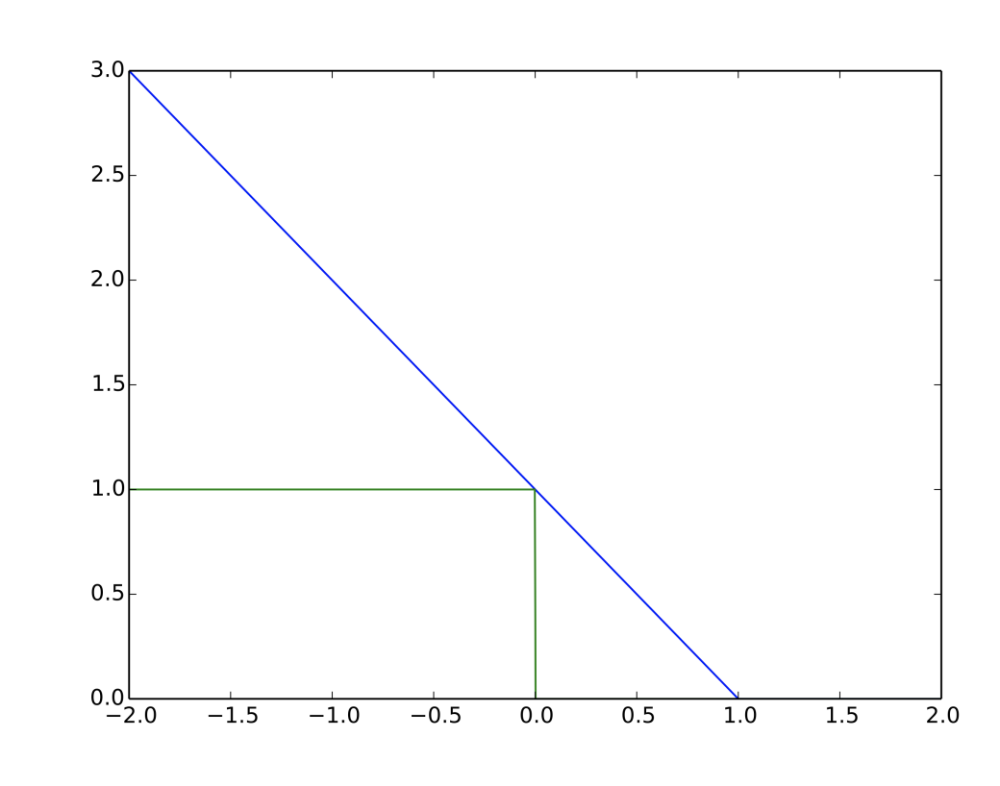{fig-align="center" width="70%"}

Above, the hinge loss is shown in blue, and the 0-1 loss is shown in green.

## Primal-formulation of the soft-margin SVM

Soft-margin SVM is equivalent to, for some $C=C(K)$,

$$
\begin{aligned}
\min_{\mathbf{w},b,\zeta}\quad&\|\mathbf{w}\|_2^2+C\sum_{i=1}^n\zeta_i\\
\text{s.t. }&y_i(\mathbf{w}^\top \mathbf{x}_i+b)\ge1-\zeta_i,\quad\zeta_i\ge0,\quad i=1,\ldots,n.
\end{aligned}
$$

## Dual-formulation of the soft-margin SVM

It can be shown² that the dual-formulation of the soft-margin SVM is

$$
\begin{aligned}
\max_\alpha\quad
&\sum_{i=1}^n\alpha_i-\frac14\sum_{i=1}^n\sum_{j=1}^n\alpha_i\alpha_j y_i y_j \mathbf{x}_i^\top \mathbf{x}_j\\
\text{s.t. }&\sum_{i=1}^n\alpha_i y_i=0,\quad0\le\alpha_i\le C,\quad i=1,\ldots,n.
\end{aligned}
$$

Here $C>0$ is the tuning parameter.

²Chapter 12.2.1 in ESL.

## Kernel SVM: extension to non-linear boundary

Recall

$$
\begin{aligned}
\max_\alpha\quad
&\sum_{i=1}^n\alpha_i-\frac14\sum_{i=1}^n\sum_{j=1}^n\alpha_i\alpha_j y_i y_j \color{red}{\mathbf{x}_i^\top \mathbf{x}_j}\\
\text{s.t. }&\sum_{i=1}^n\alpha_i y_i=0,\quad0\le\alpha_i\le C,\quad i=1,\ldots,n.
\end{aligned}
$$

Represent $\mathbf{x}_i$ in different bases, $h(\mathbf{x}_i)$, to have non-linear boundary (in $\mathbf{x}_i$).

The only change is the objective function

$$
\max_\alpha\ \sum_{i=1}^n\alpha_i-\frac14\sum_{i=1}^n\sum_{j=1}^n\alpha_i\alpha_j y_i y_j \color{red}{h(\mathbf{x}_i)^\top h(\mathbf{x}_j)}.
$$

## Kernel trick

- We can represent the inner-product $h(\mathbf{x}_i)^\top h(\mathbf{x}_j)$ by using

$$
K(\mathbf{x}_i,\mathbf{x}_j)=h(\mathbf{x}_i)^\top h(\mathbf{x}_j),\quad\forall i\ne j\in\{1,\ldots,n\}.
$$

- The function $K$ is called [**kernel**]{.maroon} that quantifies the similarity of two feature vectors.
- Regardless how large the space of $h(\mathbf{x}_i)$ is, all we need to compute is the pairwise kernel

$$
K(\mathbf{x}_i,\mathbf{x}_j),\quad\forall i\ne j\in\{1,\ldots,n\}.
$$

- This is known as the [**kernel trick**]{.maroon}.

## Examples of kernel SVM

- [Linear]{.maroon}: $K(\mathbf{x}_i,\mathbf{x}_j)=\mathbf{x}_i^\top \mathbf{x}_j$ with the corresponding $h(\mathbf{x}_i)=\mathbf{x}_i$.

:::{.fragment}
- [$d$th-Degree polynomial]{.maroon}: $K(\mathbf{x}_i,\mathbf{x}_j)=(1+\mathbf{x}_i^\top \mathbf{x}_j)^d.$

The corresponding $h$ would be polynomials. For example, consider $d=2$, $\mathbf{x}_i=x_i$ and $h(\mathbf{x}_i)=[1,\sqrt2 x_i,x_i^2]$, then

$$
K(\mathbf{x}_i,\mathbf{x}_j)=h(\mathbf{x}_i)^\top h(\mathbf{x}_j)=1+2x_ix_j+x_i^2x_j^2=(1+\mathbf{x}_i^\top \mathbf{x}_j)^2.
$$

::: 

:::{.fragment}
- [Radial basis]{.maroon}: for some $\gamma>0$, $K(\mathbf{x}_i,\mathbf{x}_j)=\exp(-\gamma\|\mathbf{x}_i-\mathbf{x}_j\|_2^2).$

The corresponding $h(\mathbf{x}_i)$ has **infinite** dimensions!

::: 

## Limitations of SVM

- The classifier based on SVM is

$$\operatorname{sign}(\mathbf{\hat{w}^\top x}+\hat b).$$

Hence, SVM does not estimate the posterior probability.

:::{.fragment}
- For multi-class classification problems with $\mathcal C=\{1,2,\ldots,K\}$,
  - It is non-trivial to generalize the notion of a margin to multiclass setting.
  - Many different proposals for multi-class SVMs. We discuss two commonly used ad-hoc approaches.

::: 

## SVM: One-Versus-One

- Construct $\binom K2$ SVMs for each pair of classes.
  - For classes $\{1,2\}$, consider data $(\mathbf{x}_i,y_i)$ with $y_i\in\{1,2\}$. Let

$$z_i=-\mathbf1\{y_i=1\}+\mathbf1\{y_i=2\}.$$

Fit SVM by using $(\mathbf{x}_i,z_i)$ with $y_i\in\{1,2\}$.

  - For classes $\{1,3\}$, consider data $(\mathbf{x}_i,y_i)$ with $y_i\in\{1,3\}$. Let

$$z_i=-\mathbf1\{y_i=1\}+\mathbf1\{y_i=3\}.$$

Fit SVM by using $(\mathbf{x}_i,z_i)$ with $y_i\in\{1,3\}$.

  - Repeat for all pairs.

- For each test point $\mathbf{x}_0$, assign it to the majority class predicted by $\binom K2$ SVMs.

## SVM: One-Versus-All

- Construct $K$ SVMs by choosing each class one at a time.
  - For class $\{1\}$, consider ALL data $(x_i,y_i)$, $i=1,\ldots,n$. Let

$$z_i=2\cdot\mathbf1\{y_i=1\}-1.$$

Fit SVM and let its parameter be $(\hat b^{(1)},\hat{\mathbf{w}}^{(1)})$.

  - For class $\{2\}$, consider ALL data $(x_i,y_i)$, $i=1,\ldots,n$. Let

$$z_i=2\cdot\mathbf1\{y_i=2\}-1.$$

Fit SVM and let its parameter be $(\hat b^{(2)},\hat{\mathbf{w}}^{(2)})$.

  - Repeat for all classes.

- For each test point $x_0$, assign it to the class

$$\arg\max_{k\in\mathcal C}\left(\hat b^{(k)}+\mathbf{x_0^\top\hat{w}}^{(k)}\right).$$

## LDA vs SVM vs LR

1. Since LDA requires additional Gaussianity, SVM is more similar to LR than LDA. When Gaussianity can be justified, LDA has the best performance.

  

2. SVM is less used for multi-class classification problems. 

  

3. SVM does not estimate the conditional probabilities, such as $P(Y=1\mid X)$, but LDA and LR do. 

  

4. When classes are separable, SVM and LDA perform better than LR. When classes are non-separable, LR (with ridge penalty) and SVM are very similar.

# Unsupervised Learning: K-Means Clustering

## Unsupervised learning

- Unsupervised learning is the study of learning without labels. What can we do **without labels**?

- How can we even define what learning means without labels?

In some sense, the ML community does not exactly agree on what it means to do unsupervised learning, but intuitively, unsupervised learning is the task of

  - grouping (clustering)
  - explaining
  - finding structures in data

## Motivating Examples

Some examples of situations where you’d use unupservised learning

1. You want to understand how a scientific field has changed over time. You want to take a large database of papers and model how the distribution of topics changes from year to year. But what are the topics?

2. You’re a biologist studying animal behavior, so you want to infer a high-level description of their behavior from video. You don’t know the set of behaviors ahead of time.

3. You want to reduce your energy consumption, so you take a time series of your energy consumption over time, and try to break it down into separate components (refrigerator, washing machine, etc.).

## Two major unsupervised learning problems

**Common themes:** you have some data, and you want to infer some structure underlying the data.

- Clustering
- Low-dimensional representation

## Clustering

- Sometimes the data form clusters, where samples within a cluster are similar to each other, and samples in different clusters are dissimilar:

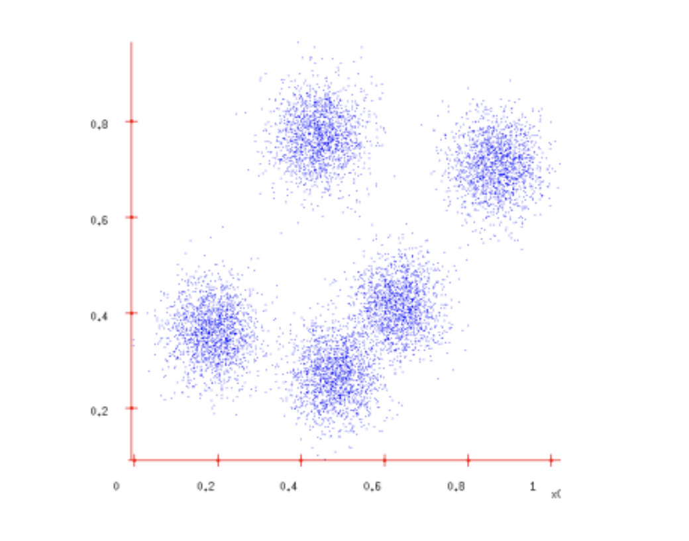{fig-align="center" width="70%"}

- Such a distribution is **multimodal**, since it has multiple **modes**, or regions of high probability mass.

---

## Clustering

- Grouping data points into clusters, with **no observed labels**, is called [**clustering**]{.maroon}. E.g.
  - Clustering machine learning papers based on topic (deep learning, Bayesian models, reinforcement learning, etc.)
  - But topics are never observed (unsupervised).
  
- We will study the most popular clustering algorithm: [**K-means**]{.maroon}.

## Example of results from K-means

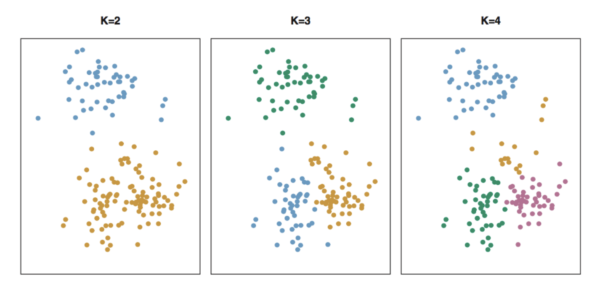{fig-align="center" width="70%"}

- A simulated data set with 150 observations in two-dimensional space. Panels show the results of applying K-means clustering with different values of K.
- The color of each observation indicates the cluster to which it was assigned using the K-means clustering algorithm.
- There is no ordering of the clusters, so the cluster coloring is arbitrary.

## K-means Clustering

[**K-means clustering**]{.maroon} is a simple approach for partitioning a data set into $K$ **distinct, non-overlapping** clusters.

  

Let $C_1,\ldots,C_K$ denote sets that form a partition of $\{1,\ldots,n\}$:

1. Each observation belongs to at least one of the $K$ clusters.
2. No observation belongs to more than one cluster.

$$C_k\cap C_{k'}=\varnothing,\quad\text{for all }k\ne k'.$$

Hence every single observation belongs to **one and only one** cluster. The goal is to find such partition $C_1,\ldots,C_K$ for certain purpose.

## K-means Clustering

- The idea behind K-means clustering is that a good clustering ensures the **within-cluster variation** as small as possible.
- The within-cluster variation for cluster $C_k$ is a measure $W(C_k)$ on the difference among observations within a cluster.
- We aim to find sets $C_1,\ldots,C_K$ by solving

$$\min_{C_1,\ldots,C_K}\sum_{k=1}^K W(C_k).$$

In words, we want to partition the observations into $K$ clusters such that the total within-cluster variation, summed over all $K$ clusters, is as small as possible.

## Definition of the within-cluster variation

- It is common to use the Euclidean distance

$$\begin{aligned}W(C_k)&=\frac1{|C_k|}\sum_{i,i'\in C_k}\sum_{j=1}^p(x_{ij}-x_{i'j})^2\\&=\frac1{|C_k|}\sum_{i,i'\in C_k}\|\mathbf{x_i-x}_{i'}\|_2^2\end{aligned}$$

where $|C_k|$ denotes the number of observations in the $k$th cluster.

- Let $\bar x_k=\frac1{|C_k|}\sum_{i\in C_k}\mathbf{x}_i.$

Verify that

$$W(C_k)=\frac1{|C_k|}\sum_{i\in C_k}\|\mathbf{x}_i-\bar{\mathbf{x}}_k\|_2^2.$$

## Target of the K-means algorithm

- Thus, K-means aims to solve

$$\min_{C_1,\ldots,C_K}\sum_{k=1}^K W(C_k)=\min_{C_1,\ldots,C_K}\sum_{k=1}^K\frac1{|C_k|}\sum_{i\in C_k}\|\mathbf{x}_i-\bar{\mathbf{x}}_k\|_2^2.$$

- This is, however, a very difficult problem to solve exactly. There are almost $K^n$ ways to partition $n$ observations into $K$ clusters.

## A pratical alternating algorithm

High level overview of algorithm:

- **Initialization**: randomly initialize cluster centers
- The algorithm iteratively alternates between two steps:
  - **Assignment step**: Assign each data point to the closest cluster
  - **Re-center step**: Move each cluster center to the mean of the data assigned to it

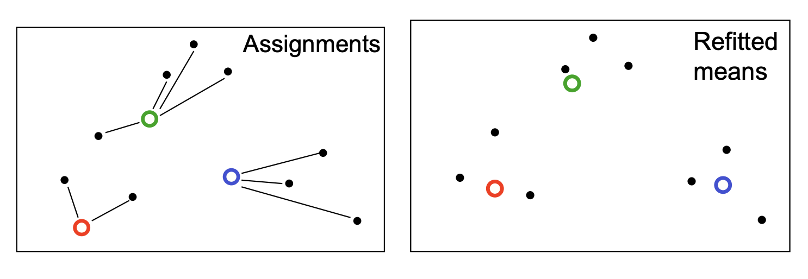{fig-align="center" width="70%"}

##  

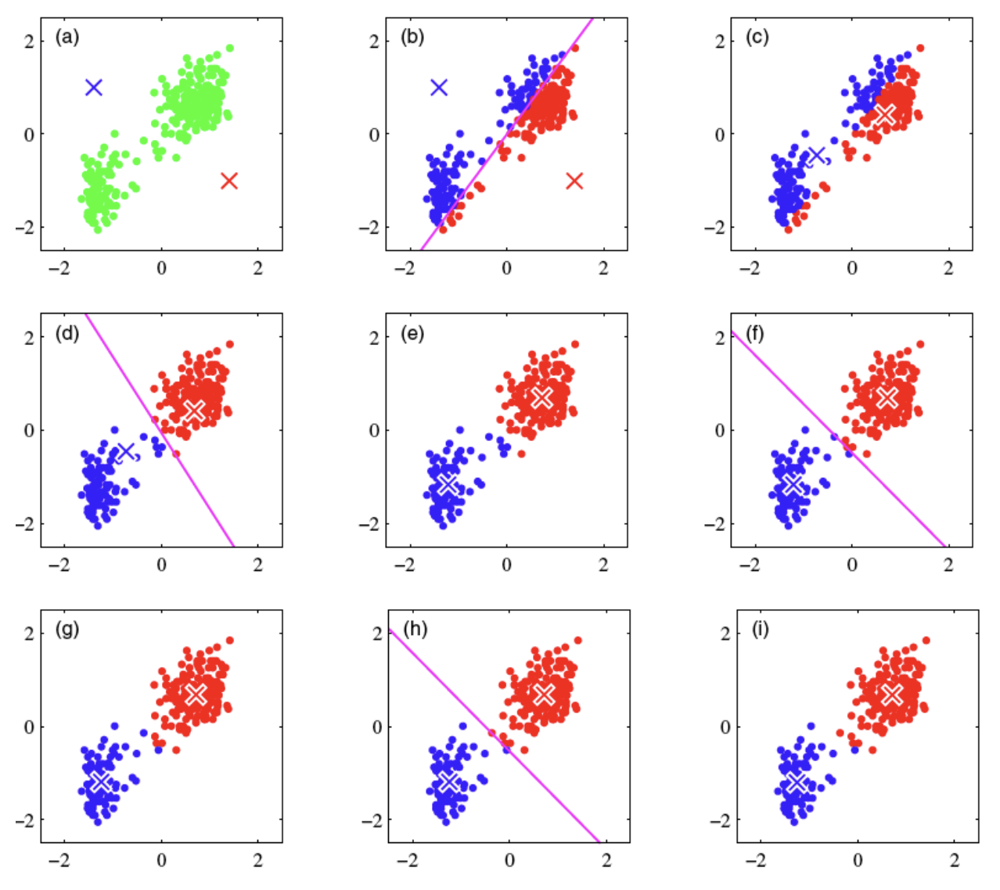{fig-align="center" width="70%"}

Figure from Bishop

Animation of the algorithm: http://shabal.in/visuals/kmeans/5.html.

## K-means algorithm

**Algorithm 10.1** *K-Means Clustering*

1. Randomly assign a number, from 1 to $K$, to each of the observations. These serve as initial cluster assignments for the observations.
2. Iterate until the cluster assignments stop changing:
   a. For each of the $K$ clusters, compute the cluster centroid. The $k$th cluster centroid is the vector of the $p$ feature means for the observations in the $k$th cluster.
   b. Assign each observation to the cluster whose centroid is closest (where closest is defined using Euclidean distance).

## Why K-means Converges

- K-means algorithm reduces the cost at each iteration.

$$\min_{C_1,\ldots,C_K}\sum_{k=1}^K\frac1{|C_k|}\sum_{i\in C_k}\|\mathbf{x}_i-\bar{\mathbf{x}}_k\|_2^2.$$

  - **Assignment step**: fixing the centers, re-assignment will decrease the total within-cluster variation.
  - **Re-centering step**: fixing the assignments, re-centering the data within clusters will reduce the total within-cluster variation.

- **Stopping criterion for convergence**: when the assignments do not change in the assignment step, we have converged (to at least a local minimum).

## Convergence of the K-means algorithm

- Convergence will always happen after a finite number of iterations, since the number of possible cluster assignments is finite

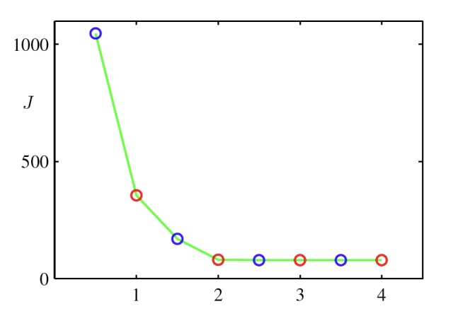{fig-align="center" width="70%"}

- K-means cost function after each assignment step (blue) and refitting step (red). The algorithm has converged after the third refitting step.

## Local Minima

::::: columns
::: {.column width="57%"}
- The cost function is non-convex (so convergence is not equivalent to the global minimum)
- There is nothing to prevent K-means getting stuck at local minima.
- Possible remedy: could try many random starting points
:::

::: {.column width="43%"}
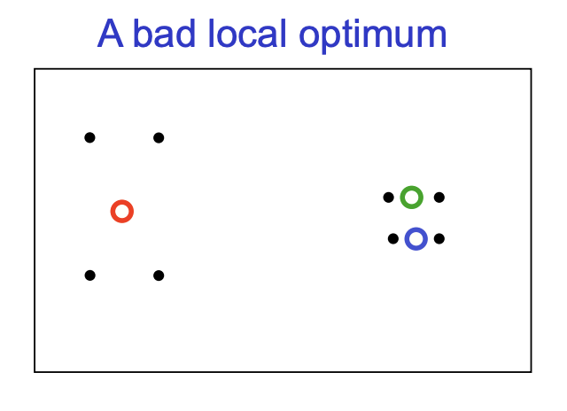{fig-align="center" width="70%"}
:::
:::::

## K-means for Vector Quantization

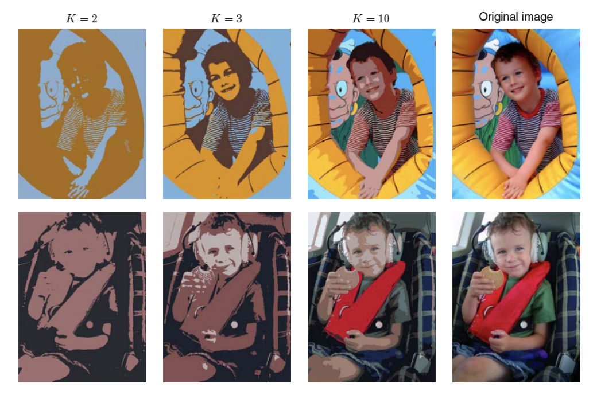{fig-align="center" width="70%"}

Figure from Bishop

- Given image, construct “dataset” of pixels represented by their RGB pixel intensities
- Run K-means, replace each pixel by its cluster center

## K-means for Image Segmentation

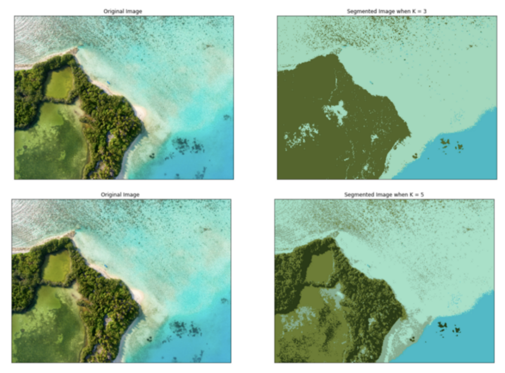{fig-align="center" width="70%"}

- Given image, construct “dataset” of pixels, represented by their HSV pixel intensities
- Run K-means to get superpixels

## Extensions

- **Non-exhaustive clustering**. Allow some of the data points not to belong to any cluster.
- **Overlapping** clustering. Allow some of the data points to belong to more than one clusters.
  - Soft K-means
- Clustering **features** rather than data points. Previously, we consider the clustering for data points.

## Summary 

- **Support Vector Machines (SVMs)** find a decision boundary that maximizes the margin between classes. Support vectors are the observations that determine this boundary.

- **Soft-margin SVMs** allow margin violations, balancing classification performance and model complexity through regularization.

- **Kernel trick** allows SVMs to construct nonlinear decision boundaries using kernel functions.

- **K-means clustering** is an unsupervised learning method that partitions observations into $K$ clusters by minimizing within-cluster variation.

- **K-means algorithm** alternates between assigning observations to the nearest centroid and updating cluster centers. It converges to a local minimum and can be sensitive to initialization.

Next Week: Continuing unsupervised learning
