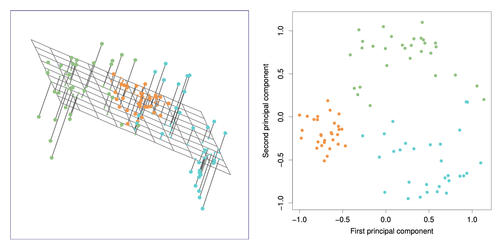
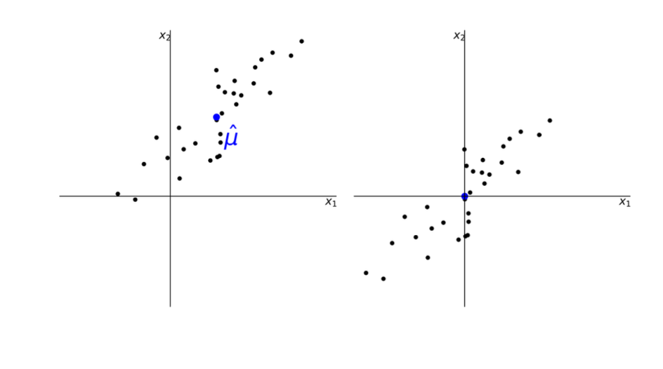
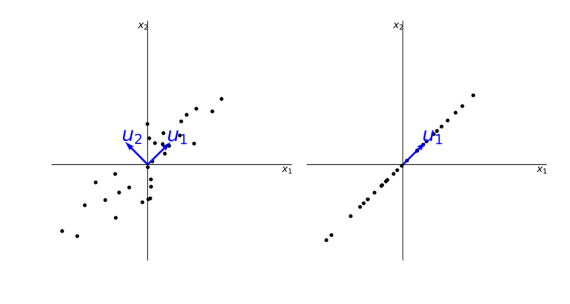
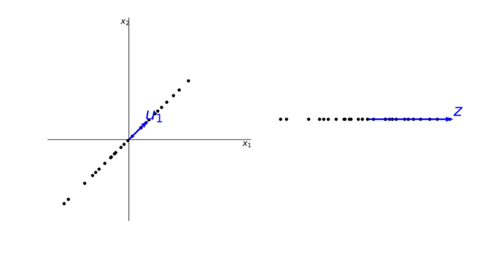
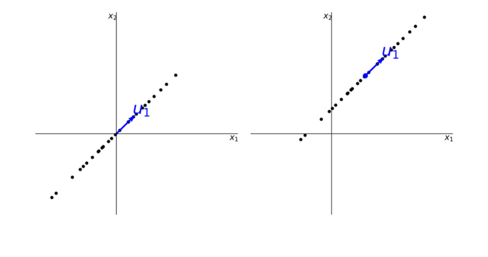
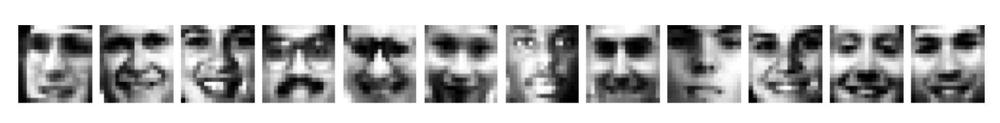
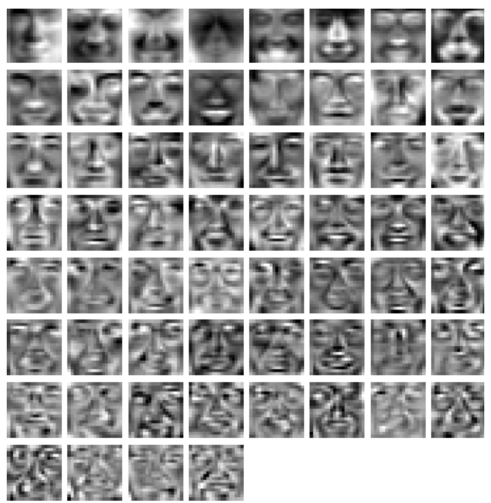
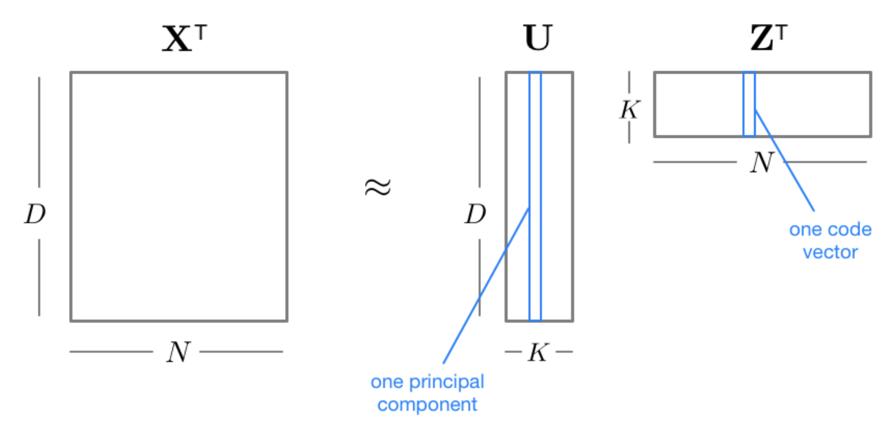
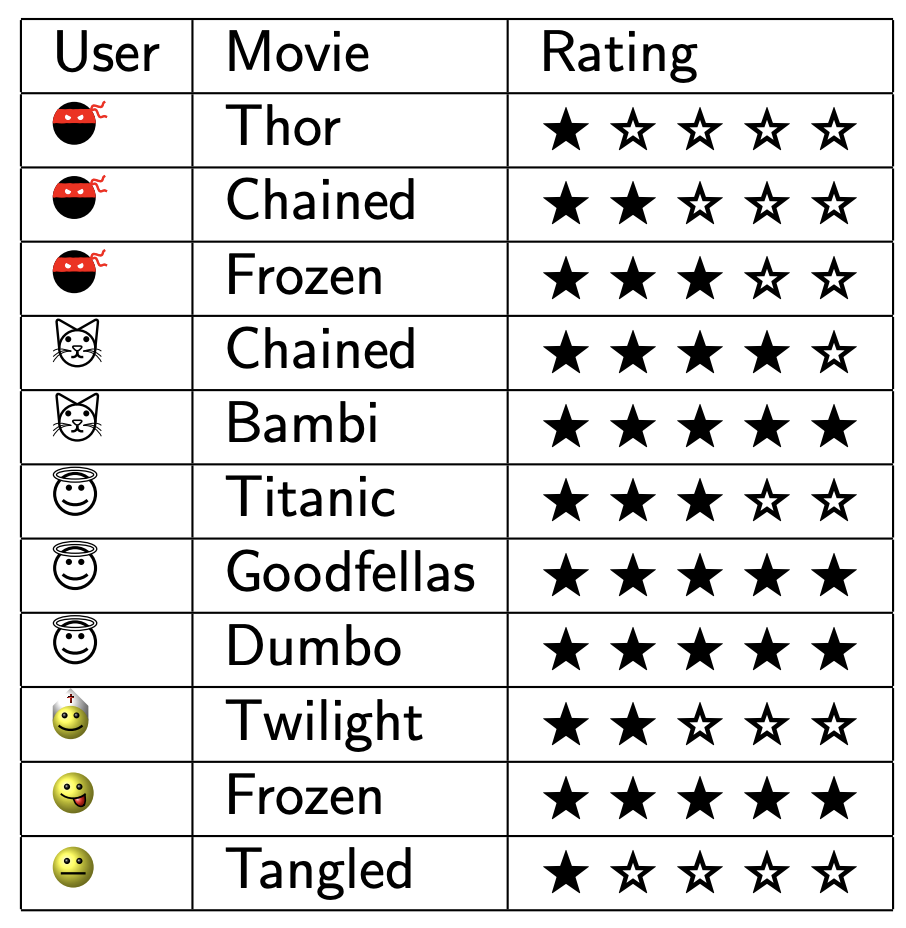
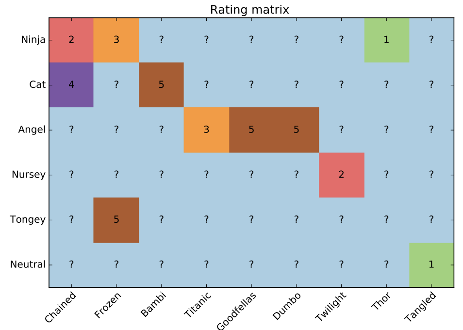

## Last week: K-means clustering

-   **Goal:** Partition observations into $K$ groups so that observations within each cluster are similar.

-   Choose cluster assignments $C_1,\ldots,C_K$ to minimize the within-cluster sum of squares:

$$
\min_{C_1,\ldots,C_K}\sum_{k=1}^K\sum_{i\in C_k}\|\mathbf x_i-\boldsymbol\mu_k\|_2^2.
$$

-   **Algorithm:** Initialize centroids; assign each observation to its closest centroid; update each centroid to the mean of its assigned points; repeat until convergence.

## Choosing the number of clusters $K$

::::: columns
::: {.column width="50%"}
**Elbow method**

-   Fit K-means for a range of $K$ values.
-   Plot within-cluster sum of squares (WCSS) against $K$.
-   Look for the **elbow**: a point where increasing $K$ yields diminishing improvements.
-   The elbow may be ambiguous.
:::

::: {.column width="50%"}

:::{.fragment}
**Silhouette index**

-   For observation $i$, let $a(i)$ be its average distance to points in its own cluster and $b(i)$ the smallest average distance to another cluster.

$$s(i)=\frac{b(i)-a(i)}{\max\{a(i),b(i)\}}.$$

-   Choose $K$ with a relatively **high average silhouette** (typically compare $K\ge2$).
-   Values near $1$ suggest well-separated points; near $0$ suggest overlap; negative values suggest possible misassignment.
:::
::: 

:::::

## Learning Outcomes

By the end of this lecture, you should be able to:

- Explain the purpose of **Principal Component Analysis (PCA)** and how it reduces the dimensionality of data.
- Describe how principal components are constructed, including the roles of loading vectors, PC scores, and variance maximization.
- Explain how PCA can be used to reconstruct observations.
- Explain how matrix completion can predict missing entries, using recommendation systems such as Netflix as an example.
- Describe the main idea behind alternating least squares (ALS) for matrix completion.

# Principal Component Analysis

## PCA: What is it, and why do we need it?

-   With many measured features, visualization and interpretation become difficult.
-   Features often move together: they may contain redundant information.
-   PCA constructs new, [**uncorrelated linear combinations**]{.maroon} of the original variables, ordered by how [much variation they capture]{.maroon}.
-   We hope a small number of components retains most of the variation in the data.

  
  

:::{.fragment}

**PCA is unsupervised. It summarizes variation in $\mathbf X$; it does not use an outcome $Y$**

::: 

## Recall: Multivariate data

- Let $\mathcal D=\{\mathbf x^{(1)},\ldots,\mathbf x^{(N)}\}\subset\mathbb R^D$ be $N$ observations with $D$ features.
- Arrange the observations as **rows** of a matrix:

$$
\mathbf X=\begin{bmatrix}
(\mathbf x^{(1)})^\top\\
(\mathbf x^{(2)})^\top\\
\vdots\\
(\mathbf x^{(N)})^\top
\end{bmatrix}\in\mathbb R^{N\times D}.
$$

## Recall: Mean and covariance estimators

- Sample mean:

$$\hat{\boldsymbol\mu}=\frac1N\sum_{i=1}^N\mathbf x^{(i)}.$$

- Sample covariance:

$$\hat{\boldsymbol\Sigma}=\frac{1}{N-1}\sum_{i=1}^N(\mathbf x^{(i)}-\hat{\boldsymbol\mu})(\mathbf x^{(i)}-\hat{\boldsymbol\mu})^\top.$$

- The mean tells us **where** the data is located; covariance characterizes its **spread and direction**.

## Goal: A low-dimensional representation

- Even when data is high dimensional, its important features can be captured by a lower-dimensional subspace.

{width="70%" fig-align="center"}

- Find a low-dimensional representation of your data

  - computational efficiency,
  - interpretability and visualization,
  - potentially improved generalization.

## Goal: A low-dimensional representation 

- Given a dataset $\mathcal{D} = \{\mathbf{x^{(1)}, ..., x^{(N)}}\} \subset \mathbb R^D$, find a $K$-dimensional subspace $S \subset \mathbb R^D$ with $K<D$ that represents centered observations well.

  

:::{.fragment}
- **PCA steps:**
  1. Center the data.
  2. Project onto $S$ to obtain low-dimensional coordinates.
  3. Add the mean back to reconstruct the observations approximately.
  
::: 

## Step 1: Center the features

For each feature $j$, subtract its sample mean:

$$
\bar x_j=\frac1n\sum_{i=1}^n x_{ij},\qquad
x_{ij}^{c}=x_{ij}-\bar x_j.
$$

-   Centering removes effects of **location**: PCA should identify directions of variation, not directions toward the mean.
-   Let $\mathbf X_c$ be the resulting centered matrix.

## Step 1: Center the features

-   Subtracting the mean translates the data so its center is at the origin.
-   Its orientation and pairwise differences do not change.

{width="70%" fig-align="center"}

## Should we standardize as well?

-   PCA is sensitive to **units of measurement**.
-   A feature measured on a large numeric scale can dominate the directions of greatest variance.
-   Standardize when features have very different scales and comparable relative importance:

$$
x_{ij}^{\mathrm{std}}=\frac{x_{ij}-\bar x_j}{s_j}.
$$

## Step 2: Project onto the subspace spanned by $\mathbf u_1$

{width="60%" fig-align="center"}

- Let $\mathbf u_1$ be the unit direction of greatest variance, and let $\mathbf u_2$ be orthogonal to it. 

- With orthonormal directions $\mathbf Q=[\mathbf u_1\ \mathbf u_2]$:

$$
\operatorname{Proj}_{\mathbf u_1}
=\mathbf Q\begin{pmatrix}1&0\\0&0\end{pmatrix}\mathbf Q^\top
=\mathbf u_1\mathbf u_1^\top.
$$

## Step 2: Project onto the subspace spanned by $\mathbf u_1$

{width="55%" fig-align="center"}

- Coordinates $z=\mathbf u_1^\top(\mathbf x-\hat{\boldsymbol\mu})$ along the direction $\mathbf{u_1}$ are [lower dimensional representations]{.maroon} of $\mathbf{x}$.  

- The projection $\mathbf u_1\mathbf u_1^\top(\mathbf x-\hat{\boldsymbol\mu})$ maps the centered observation back onto the principal component direction in the original feature space.

## Step 3: Add back mean 

{width="70%" fig-align="center"}

Now we have an approximation of our original observation using only one score instead of all original features. 

## What Just Happened? 

We've done [Principal Component Analysis (PCA)]{.maroon}! 

  
  

To get a [low dimensional reconstruction]{.maroon} for $\mathbf{x}$: 

1. Subtract mean: $\mathbf{x - \hat \mu}$ 
2. Project on $\mathcal S$: $\mathbf{u_1u_1^{\top}(x - \hat \mu)}$
3. Add back mean to get the low dimensional reconstruction: $\tilde{\mathbf x}=\hat{\boldsymbol\mu}+\mathbf u_1\mathbf u_1^\top(\mathbf x-\hat{\boldsymbol\mu}).$ 

  
Now let's get into the details. 

## What are principal components?

Consider a linear combination of the $D$ centered features:

$$
Z_{1}=u_{11}X_1^c+u_{21}X_2^c+\cdots+u_{D1}X_D^c.
$$

-   $Z_{1}$ is the **first principal component**.
-   The numbers $u_{11},\ldots,u_{D1}$ are its **loadings**.
-   The loading vector $\mathbf u_1=(u_{11},\ldots,u_{D1})^\top$ gives a **direction** in feature space.

## The principal component scores

For observation $i$, its value along the first component is:

$$
z_{1}^{(i)}=\sum_{j=1}^D u_{j1}x_{j,c}^{(i)}
=(\mathbf{x}_c^{(i)})^\top\mathbf{u}_1.
$$

-   $z_{1}^{(i)}$ is the **score** for observation $i$ on PC1.
-   **Loadings** describe the component; **scores** describe the observations after projection.

## The first principal component

The first PC finds the linear combination with the **largest variance**:

$$
\boxed{
\max_{u_{11},\ldots,u_{D1}}
\frac1N\sum_{i=1}^N
\left(\sum_{j=1}^Du_{j1}x_{j,c}^{(i)}\right)^2
\quad\text{subject to}\quad
\sum_{j=1}^Du_{j1}^2=1.
}
$$

-   Because the data are centered, the mean score is zero, so the objective is proportional to the sample variance of PC1 scores.

## The first principal component

We show this optimization problem in matrix notation. 

Let $\hat{\boldsymbol\Sigma}=\frac{1}{N-1}\mathbf X_c^\top\mathbf X_c$ be the sample covariance matrix.

- Recall that the first principal component finds the direction $\mathbf u_1$ along which the projected data has the **greatest variance**.

- Mathematically, we solve:

$$
\max_{\mathbf u_1}
\mathbf u_1^\top\hat{\boldsymbol\Sigma}\mathbf u_1
\quad \text{subject to} \quad
\mathbf u_1^\top\mathbf u_1=1.
$$

:::{.fragment}
- $\mathbf u_1^\top\hat{\boldsymbol\Sigma}\mathbf u_1$ is the **variance of the projected observations**.
- The constraint $\mathbf u_1^\top\mathbf u_1=1$ ensures that we are optimizing over **directions**, rather than magnitudes.
::: 

## The first principal component

- Using Lagrangian multipliers, we solve the optimization problem and find:

$$
\hat{\boldsymbol\Sigma}\mathbf u_1
=\lambda_1\mathbf u_1
$$

- Thus, $\mathbf u_1$ is the **eigenvector corresponding to the largest eigenvalue** $\lambda_1$ of the covariance matrix.
- The eigenvalue $\lambda_1$ represents the **variance captured by PC1**.
- The second principal component is obtained using the eigenvector corresponding to the **second-largest eigenvalue**, which can be chosen orthogonal to $\mathbf u_1$.

  

:::{.fragment}
**PCA finds directions of maximum variance by computing the eigenvectors of the sample covariance matrix.**
::: 

## General principal components

- The $m$th principal component is the linear combination:

$$
z_m^{(i)}=\sum_{j=1}^D u_{jm}x_{j,c}^{(i)}
=(\mathbf x_c^{(i)})^\top\mathbf u_m.
$$

- The loading vector $\mathbf u_m$ is the **eigenvector corresponding to the $m$th largest eigenvalue** of the covariance matrix:

$$
\hat{\boldsymbol\Sigma}\mathbf u_m=\lambda_m\mathbf u_m.
$$

## General principal components

- Each PC captures the [**greatest remaining variance**]{.maroon}, subject to being orthogonal to the previous components:

$$
\max_{\mathbf u_m}\quad
\mathbf u_m^\top\hat{\boldsymbol\Sigma}\mathbf u_m
\quad\text{subject to}\quad
\begin{cases}
\|\mathbf u_m\|_2=1,\\
\mathbf u_m^\top\mathbf u_\ell=0,\quad \ell<m.
\end{cases}
$$

- The eigenvalue $\lambda_m$ gives the **variance explained by PC$m$**, with $\lambda_1\geq\lambda_2\geq\cdots\geq 0$.

- Because the loading vectors are orthogonal eigenvectors of the covariance matrix, the resulting principal components are [**uncorrelated**]{.maroon}

## Reconstructing the original observations

- After projecting onto the first $M$ principal components, we obtain the **score vector**:

$$
\mathbf z^{(i)}=\mathbf U^\top(\mathbf x^{(i)}-\hat{\boldsymbol\mu}).
$$

- We can use these scores and the loading vectors to **approximately reconstruct** the original observation:

$$
\tilde{\mathbf x}^{(i)}
=\hat{\boldsymbol\mu}+\mathbf U\mathbf z^{(i)}
=\hat{\boldsymbol\mu}+
\sum_{m=1}^M z_m^{(i)}\mathbf u_m.
$$

- The reconstruction $\tilde{\mathbf x}^{(i)}$ is back in the original $D$-dimensional feature space.
- The more principal components we retain, the more variation we preserve and the smaller the [reconstruction error]{.maroon}.

## Putting it Together 

- **Loading vector $\mathbf u_m$:** Defines the **direction** in feature space along which the $m$th principal component captures variance.
  - $\mathbf u_1$ points in the direction of greatest variance.
  - Subsequent loading vectors are orthogonal and capture the greatest remaining variance.

:::{.fragment}
- **Individual loadings $u_{jm}$:** The entries of $\mathbf u_m$, describing how each original feature contributes to that direction.
::: 

:::{.fragment}
- **Principal component $Z_m$:** The new variable obtained by projecting the centered features onto the loading vector:
::: 

:::{.fragment}
- **PC score $z_m^{(i)}$:** The value of principal component $m$ for observation $i$: $z_m^{(i)}=(\mathbf x_c^{(i)})^\top\mathbf u_m.$
::: 

:::{.fragment}
- **Reconstruction $\tilde{\mathbf x}^{(i)}$:** Approximate the original observation using the first $M$ PC scores and loading vectors, then add back the mean: $\tilde{\mathbf x}^{(i)}=\hat{\boldsymbol\mu}+\sum_{m=1}^M z_m^{(i)}\mathbf u_m.$
::: 

## PCA: Minimizing Reconstruction Error

- We have defined PCA to find directions that **maximize the variance** of the projected data.

- Equivalently, PCA finds the $M$-dimensional representation that **minimizes reconstruction error**:

$$
\min_{\operatorname{rank}(\hat{\mathbf X}_c)\leq M}
\|\mathbf X_c-\hat{\mathbf X}_c\|_F^2.
$$

- Recall that the reconstructed observation is:

$$
\tilde{\mathbf x}_c^{(i)}
=\sum_{m=1}^M z_m^{(i)}\mathbf u_m.
$$

- Since orthogonal projections decompose the variation into two parts:

$$
\|\mathbf x_c^{(i)}\|_2^2
=
\|\tilde{\mathbf x}_c^{(i)}\|_2^2
+
\|\mathbf x_c^{(i)}-\tilde{\mathbf x}_c^{(i)}\|_2^2.
$$

## Example

- Consider running PCA on 2429 19x19 greyscale images (CBCL data) 

- We can get a good reconstruction with only 3 components 

{width="70%" fig-align="center"}

:::{.fragment}
- [PCA for pre-processing:]{.maroon} we can apply a classifier to latent representation

  - Original data is 361 dimensional
  - For face recognition, PCA with 3 components obtains 79% accuracy on face/non-face discrimination on test data, which is an improvement compared to other models (ex. Gaussian mixture models, we will not cover them in this course).
  
::: 

## Example

Principal components of face images ("eigenfaces") 

{width="70%" fig-align="center"}

## PCA to matrix factorization

-   PCA approximates a **fully observed** centered data matrix with a low-rank product:

$$\mathbf X_c\approx\mathbf Z\mathbf U^\top.$$

-   What if most entries of the matrix are **missing**, as with user–movie ratings?
-   This leads to **matrix completion**: learn low-dimensional factors using only observed entries.

# Matrix Factorization and Completion

## From PCA to general matrix factorization

-   PCA is a special structured low-rank factorization: $\mathbf X_c\approx\mathbf Z\mathbf U^\top$.
-   More generally, write a data matrix as a product of two small matrices, without requiring the PCA orthogonality constraints.
-   For recommender systems, factors represent **users and items**, rather than observations and principal component directions.

## Some recommender systems in action 

{width="70%" fig-align="center"}

## Some recommender systems in action 

{width="70%" fig-align="center"}

## Recommender systems: The Netflix problem

- Users watch movies and rate them out of 5 stars 

  

- Users only rate a few items, so we would like to infer their preference for unrated items

  

- Recommendation systems may reflect shared interests as well as individual preferences.

## PCA as a Matrix Factorization

- Recall PCA: project data onto a low-dimensional subspace defined by the top eigenvectors of the data covariance matrix.

- We consider a generalization, **matrix factorization**:
  - View PCA as a matrix factorization problem.
  - Extend to matrix completion, where the data matrix is only partially observed.

## PCA as Matrix Factorization

- Recall PCA: each input vector $\mathbf x^{(i)}\in\mathbb R^D$ is approximated as $\hat{\boldsymbol\mu}+\mathbf U\mathbf z^{(i)}$,

$$
\mathbf x^{(i)}\approx\tilde{\mathbf x}^{(i)}
=\hat{\boldsymbol\mu}+\mathbf U\mathbf z^{(i)}.
$$

where:

- $\hat{\boldsymbol\mu}=\frac1N\sum_i\mathbf x^{(i)}$ is the data mean.
- $\mathbf U\in\mathbb R^{D\times K}$ is the orthogonal basis for the principal subspace (loading vectors).
- $\mathbf z^{(i)}\in\mathbb R^K$ is the code vector.
- $\tilde{\mathbf x}^{(i)}\in\mathbb R^D$ is the reconstruction or approximation of $\mathbf x^{(i)}$.

- Assume for simplicity that the data is centered: $\hat{\boldsymbol\mu}=\mathbf0$. Then the approximation looks like

$$
\mathbf x^{(i)}\approx\tilde{\mathbf x}^{(i)}
=\mathbf U\mathbf z^{(i)}.
$$

## PCA as Matrix Factorization

- PCA (on centered data): input vector $\mathbf x^{(i)}$ is approximated as $\mathbf U\mathbf z^{(i)}$:

$$
\mathbf x^{(i)}\approx\mathbf U\mathbf z^{(i)}.
$$

- Write this in matrix form. We have $\mathbf X\approx\mathbf Z\mathbf U^\top$, where $\mathbf X$ and $\mathbf Z$ have one row per data point.

$$
\mathbf X=
\begin{bmatrix}
(\mathbf x^{(1)})^\top\\
(\mathbf x^{(2)})^\top\\
\vdots\\
(\mathbf x^{(N)})^\top
\end{bmatrix}
\in\mathbb R^{N\times D} \quad \text{and} \quad 
\mathbf Z=
\begin{bmatrix}
(\mathbf z^{(1)})^\top\\
(\mathbf z^{(2)})^\top\\
\vdots\\
(\mathbf z^{(N)})^\top
\end{bmatrix}
\in\mathbb R^{N\times K}.
$$

- We can write the squared reconstruction error as

$$
\sum_{i=1}^N
\|\mathbf x^{(i)}-\mathbf U\mathbf z^{(i)}\|_2^2
=
\|\mathbf X-\mathbf Z\mathbf U^\top\|_F^2.
$$

- $\|\cdot\|_F$ denotes the **Frobenius norm**

## PCA as Matrix Factorization

- So PCA is approximating $\mathbf X\approx\mathbf Z\mathbf U^\top$, or equivalently $\mathbf X^\top\approx\mathbf U\mathbf Z^\top.$

{width="60%" fig-align="center"}

- Based on the sizes of the matrices, this is a **rank-$K$ approximation**.

- Since $\mathbf U$ was chosen to minimize reconstruction error, this is the [**optimal rank-$K$ approximation**]{.maroon}, in terms of error $\|\mathbf X^\top-\mathbf U\mathbf Z^\top\|_F^2.$

## The Netflix problem

**movie recommendation**.

{width="60%" fig-align="center"}

## Matrix Completion

**Matrix completion problem:** Transform the table into an $N$ users by $M$ movies matrix $\mathbf R$.

::::: columns
::: {.column width="50%"}

{width="100%" fig-align="center"}

:::

::: {.column width="50%"}

- **Data:** Users rate some movies. $R_{\text{user,movie}}$ is very sparse.

- **Task:** Predict missing entries, i.e., how a user would rate a movie they haven't previously rated.

- **Evaluation Metric:** Squared error (used by Netflix Competition). Is this a reasonable metric?

::: 

:::::

## Matrix Completion

- In our current setting, **latent factor models** attempt to explain the ratings by characterizing both movies and users on a number of factors $K$ inferred from the ratings patterns.

- That is, we seek representations for movies and users as vectors in $\mathbb R^K$ that can ultimately be translated to ratings.

:::{.fragment}
- For simplicity, we can associate these factors (i.e., the dimensions of the vectors) with idealized concepts like:
  - Comedy
  - Drama
  - Action
  - But also uninterpretable dimensions
  
::: 

:::{.fragment}
**Can we use the sparse ratings matrix $\mathbf R$ to find these latent factors automatically?**
::: 

## Matrix Completion

- Let the representation of user $i$ in the $K$-dimensional space be $\mathbf u_i$ and the representation of movie $j$ be $\mathbf z_j$.
  - Intuition: maybe the first entry of $\mathbf u_i$ says how much the user likes horror films, and the first entry of $\mathbf z_j$ says how much movie $j$ is a horror film.

:::{.fragment}
- Assume the rating user $i$ gives to movie $j$ is given by a dot product: $R_{ij}\approx\mathbf u_i^\top\mathbf z_j.$

- In matrix form, if

$$
\mathbf U=
\begin{bmatrix}
\mathbf u_1^\top\\
\vdots\\
\mathbf u_N^\top
\end{bmatrix}
\qquad\text{and}\qquad
\mathbf Z^\top=
\begin{bmatrix}
\mathbf z_1 & \cdots & \mathbf z_M
\end{bmatrix},
$$

then:

$$
\boxed{\mathbf R\approx\mathbf U\mathbf Z^\top.}
$$

- This is a **matrix factorization problem!**
::: 

## Matrix Completion

- Recall PCA: to enforce $\mathbf X^\top\approx\mathbf U\mathbf Z^\top$, we minimized

$$
\min_{\mathbf U,\mathbf Z}
\|\mathbf X^\top-\mathbf U\mathbf Z^\top\|_F^2
=
\sum_{i,j}
(x_{ji}-\mathbf u_i^\top\mathbf z_j)^2.
$$

:::{.fragment}
- What's different about the Netflix problem?
  - **Most entries are missing!**
  - We only want to count the error for the observed entries.
::: 

## Matrix Completion

- Let $\mathcal O=\{(i,j):\text{entry }(i,j)\text{ of matrix }\mathbf R\text{ is observed}\}$.

- Using the squared error loss, matrix completion requires solving:

$$
\boxed{
\min_{\mathbf U,\mathbf Z}
\frac12\sum_{(i,j)\in\mathcal O}
(R_{ij}-\mathbf u_i^\top\mathbf z_j)^2.
}
$$

- The objective is **non-convex** in $\mathbf U$ and $\mathbf Z$ jointly, and in fact it is generally NP-hard to minimize the above cost function exactly.

:::{.fragment}
- As a function of either $\mathbf U$ or $\mathbf Z$ individually, the problem is convex and easy to optimize.
::: 

:::{.fragment}
[**Alternating Least Squares (ALS):**]{.maroo} Fix $\mathbf Z$ and optimize $\mathbf U$, followed by fixing $\mathbf U$ and optimizing $\mathbf Z$, and so on until convergence.
::: 

## Alternating Least Squares

- Want to minimize the squared error cost with respect to the factor $\mathbf U$. (The case of $\mathbf Z$ is exactly symmetric.)

- We can decompose the cost into a sum of independent terms:

$$
\sum_{(i,j)\in\mathcal O}
(R_{ij}-\mathbf u_i^\top\mathbf z_j)^2
=
\sum_i
\underbrace{
\sum_{j:(i,j)\in\mathcal O}
(R_{ij}-\mathbf u_i^\top\mathbf z_j)^2
}_{\text{only depends on }\mathbf u_i}.
$$

This can be minimized independently for each $\mathbf u_i$.

:::{.fragment}
- This is a **linear regression problem in disguise**. Its optimal solution is:

$$
\boxed{
\mathbf u_i=
\left(
\sum_{j:(i,j)\in\mathcal O}
\mathbf z_j\mathbf z_j^\top
\right)^{-1}
\sum_{j:(i,j)\in\mathcal O}
R_{ij}\mathbf z_j.
}
$$
::: 

## Alternating Least Squares

**ALS for Matrix Completion problem**

1. Initialize $\mathbf U$ and $\mathbf Z$ randomly.
2. Repeat until convergence:
   - For $i=1,\ldots,N$, update:

$$
\mathbf u_i=
\left(
\sum_{j:(i,j)\in\mathcal O}
\mathbf z_j\mathbf z_j^\top
\right)^{-1}
\sum_{j:(i,j)\in\mathcal O}
R_{ij}\mathbf z_j.
$$

   - For $j=1,\ldots,M$, update:

$$
\mathbf z_j=
\left(
\sum_{i:(i,j)\in\mathcal O}
\mathbf u_i\mathbf u_i^\top
\right)^{-1}
\sum_{i:(i,j)\in\mathcal O}
R_{ij}\mathbf u_i.
$$

## Summary

-   **K-means** partitions observations into groups, with $K$ chosen using diagnostics such as elbow or silhouette scores.
-   **PCA** finds directions retaining maximal variance and provides low-dimensional scores.
-   **Matrix factorization** represents a data matrix using lower-dimensional factors.
-   **Matrix completion** learns factors from observed entries to predict missing values (e.g., Netflix ratings).
-   **ALS** alternates between updating the two sets of latent factors.

Announcements: Assignment 2 is now available on the course website (due Dec. 2nd)