## What We Will Cover

- **Fully-connected neural networks**
  - Single-layer neural networks
  - Multiple-layer neural networks
  
  

- **Training of the neural networks**
  
    
  
- **Special structured neural networks**
  - Convolutional neural networks
  - Recurrent neural networks

## Some Background 

- Neural networks rose to fame in the late 1980s. 

- Although initially there was a lot of excitement, once random forests, boosting, and SVM came along, many people stopped caring about neural networks 

- A core group of people kept the excitement and continued advancing the field, until the re-emergence of neural networks in 2010 under the name *deep learning*

## Introduction to (Single-Layer) Neural Networks

A neural network takes an input vector of $p$ variables, $X=(X_1,\ldots,X_p)$, and builds a [non-linear]{.maroon} function $f(X)$ to predict the response $Y$.

  
  

:::{.fragment}
A single-layer neural network has the following components: 

- **Input layer:** The original predictors $X_1,\ldots,X_p$.
- **Hidden layer:** $K$ hidden units, each receiving information from the inputs.
- **Output layer:** Combines the hidden units to produce a prediction $f(X)$.
::: 

## Architecture of a Single-Layer Network

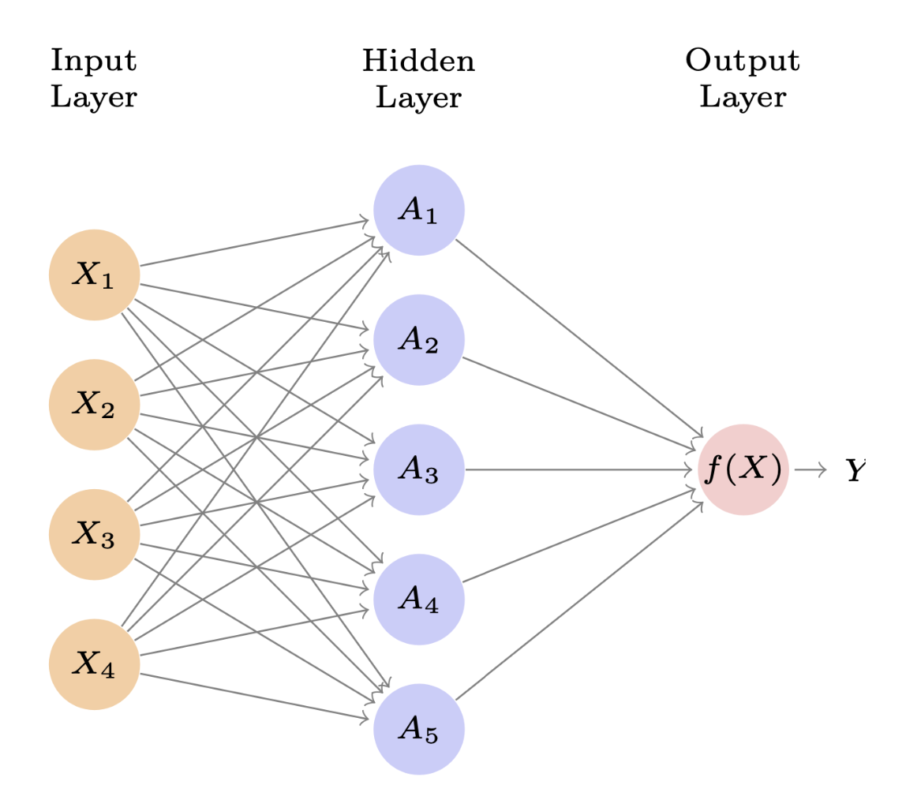{width="70%" fig-align="center"} 

## The Hidden Layer 

Each hidden unit computes a [transformation of the original predictors]{.maroon}.

For hidden unit $k$:

$$
A_k=h_k(X)=g\left(w_{k0}+\sum_{j=1}^{p}w_{kj}X_j\right)
$$

where:

- $w_{k0}$ is an intercept.
- $w_{kj}$ are weights assigned to the predictors.
- $g(\cdot)$ is a nonlinear [**activation function**]{.maroon}.

 

Each hidden unit first computes a linear combination of the predictors, then applies the activation function.

## Hidden Units as New Features

Recall that in generalized additive models and splines, we used transformations of predictors to capture nonlinear relationships.

Neural networks follow a similar idea:

- Each hidden unit creates a new feature $A_k=h_k(X)$.
- These features are [nonlinear transformations]{.maroon} of linear combinations of the original predictors.
- Unlike traditional basis functions, the transformations $h_k(X)$ are [learned from the data]{.maroon} through the weights $w_{kj}$.

 

The hidden layer can therefore be viewed as constructing $K$ new features from the original predictors.

## The Output Layer

Once the $K$ activations have been computed, they are combined to produce the prediction:

$$\begin{aligned}f(x)&=\beta_0+\sum_{i=1}^K\beta_iA_i\\&=\beta_0+\sum_{i=1}^K\beta_i g\left(w_{i0}+\sum_{j=1}^pw_{ij}x_j\right).\end{aligned}$$

- $g(\cdot)$: activation function
- $K$: number of hidden units
- $w_{ij}$: hidden-layer weights
- $\beta_i$: output-layer weights

$$
X \xrightarrow{w} \text{linear combinations}
\xrightarrow{g} \text{hidden layer}
\xrightarrow{\beta} \text{output}
$$

## Activation Functions

The activation function $g(\cdot)$ introduces **nonlinearity** into the neural network. 

:::{.fragment}
Common activation functions include:

- **Sigmoid:** maps into $(0,1)$

  $$g(z)=\frac{1}{1+e^{-z}}$$
::: 

:::{.fragment}
- **Tanh:** maps into $(-1,1)$

  $$g(z)=\tanh(z)$$
::: 

:::{.fragment}
- **ReLU (rectified linear unit):**

  $$g(z)=\max(0,z)$$

ReLU is a common choice because of its simple computation.
::: 

## Activation Functions: Sigmoid versus ReLU

Sigmoid: $g(z)=\frac{1}{1+e^{-z}}$ vs. ReLU: $g(z)=\max(0,z)$

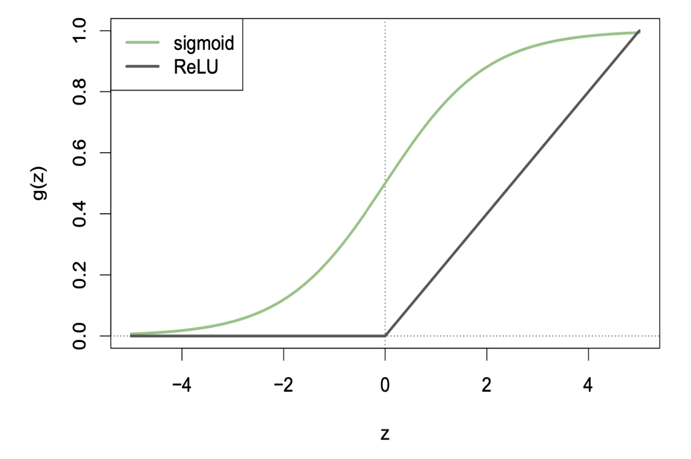{width="70%" fig-align="center"}

Why *neural* networks? An analogy is made with neurons being active (“firing”) or inactive (“silent”).

## Training Neural Networks

Our neural network contains unknown parameters:

  

- $w_{kj}$: weights used to construct the hidden units.
- $\beta_k$: coefficients used to combine the hidden units.

  

We denote all these parameters by the vector $\mathbf \theta$ and we estimate them by [minimizing a loss function]{.maroon}, depending on the prediction task.

## Training Neural Networks 

**Regression:** For a quantitative response, we typically minimize the mean squared error:

$$
\min_\theta \frac{1}{n}\sum_{i=1}^n
\left(y_i-f(x_i;\theta)\right)^2
$$

:::{.fragment}
**Classification:** For $m$ classes, the network produces $m$ outputs, which are converted into probabilities using [**softmax**]{.maroon}:

$$
\widehat p_\ell(X)=
\frac{\exp\{f_\ell(X;\theta)\}}
{\sum_{k=1}^m \exp\{f_k(X;\theta)\}}
$$

We then minimize the negative multinomial log-likelihood:

$$
\min_\theta -\frac{1}{n}\sum_{i=1}^n
\sum_{\ell=1}^m
\mathbf{1}\{y_i=\ell\}\log\widehat p_\ell(x_i)
$$
::: 

## Multilayer Neural Networks

In a [**multilayer neural network**]{.maroon}, each hidden layer constructs new features from the activations of the previous layer, allowing the network to learn increasingly complex representations of the predictors.

:::{.fragment}
For the first layer, with $K_1$ hidden units:

$$A_i^{(1)}=g\left(w_{i0}^{(1)}+\sum_{j=1}^pw_{ij}^{(1)}X_j\right),\qquad i=1,\ldots,K_1.$$

::: 

:::{.fragment}
For layer $\ell=2,\ldots,D$:

$$A_i^{(\ell)}=g\left(w_{i0}^{(\ell)}+\sum_{j=1}^{K_{\ell-1}}w_{ij}^{(\ell)}A_j^{(\ell-1)}\right),$$

where $i=1,\ldots,K_\ell$.

::: 

## Multilayer Neural Networks

If we have $D$ hidden layers in total, each hidden layer $\ell$ contains $K_\ell$ hidden units with the coefficient parameters $\mathbf W^{(\ell)}\in\mathbb R^{K_\ell\times K_{\ell-1}}$ and the intercept $\mathbf W_0^{(\ell)}\in\mathbb R^{K_\ell}$

  

:::{.fragment}
The number of parameters across these layers is

$$\sum_{\ell=1}^D K_\ell(K_{\ell-1}+1).$$

- We have $K_0=p$. 
- $K_D$ depends on whether it is a regression problem or a classification problem.
::: 

## Neural Networks in Pattern Recognition

- Digit recognition problems helped accelerate the development of neural networks in the late 1980s.

  

- Recognizing visual patterns is relatively easy for humans, whose visual system is highly developed. 

  

- These tasks are not so simple for machines, and it has taken more than 30 years to refine the neural-network architectures to match human performance.

## MNIST Digit Recognition

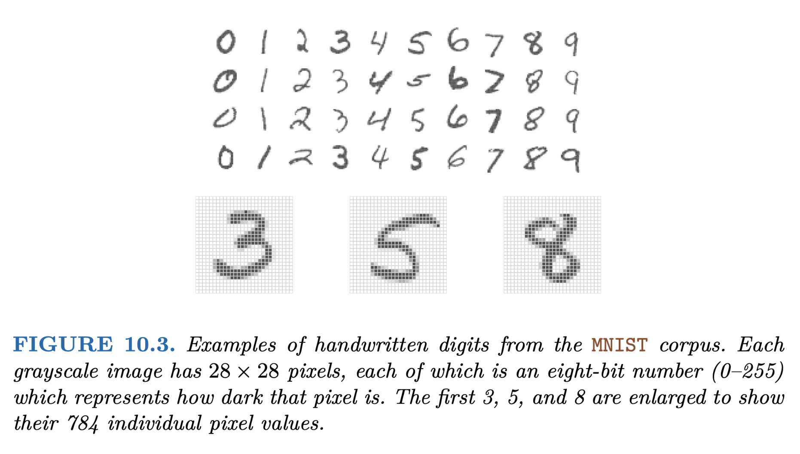{width="100%" fig-align="center"}

## A Multilayer Network

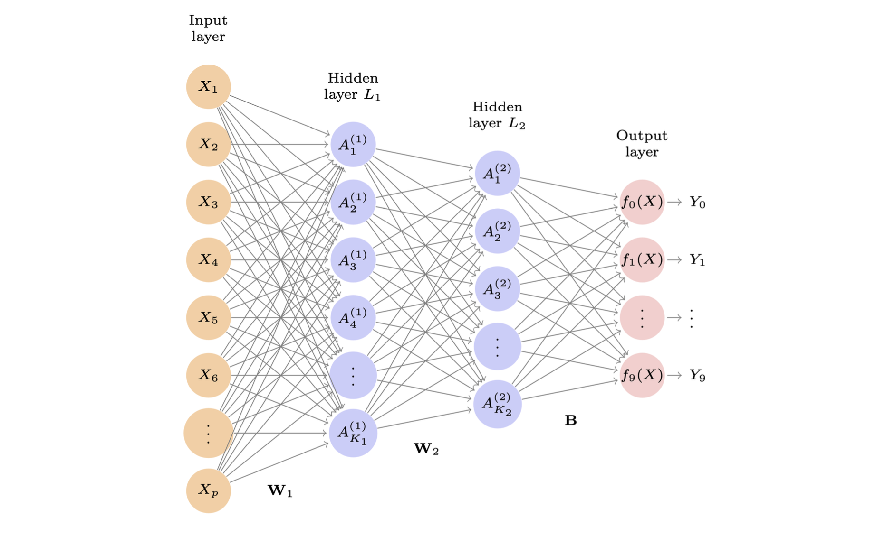{width="100%" fig-align="center"}

## MNIST Results

1. $n = 60,000$, $p = 784$, $K_1 = 256$, $K_2 = 128$ 

2. $\mathbf W_1\in\mathbb R^{784\times 256}$, $\mathbf W_2\in\mathbb R^{256\times 128}$, $\mathbf B\in\mathbb R^{128\times 10}$ 

3. $Y_i = \frac{e^{f_i(X)}}{\sum_{\ell =0}^9 e^{f_\ell(X)}}$, for $i \in \{0,...,9\}$

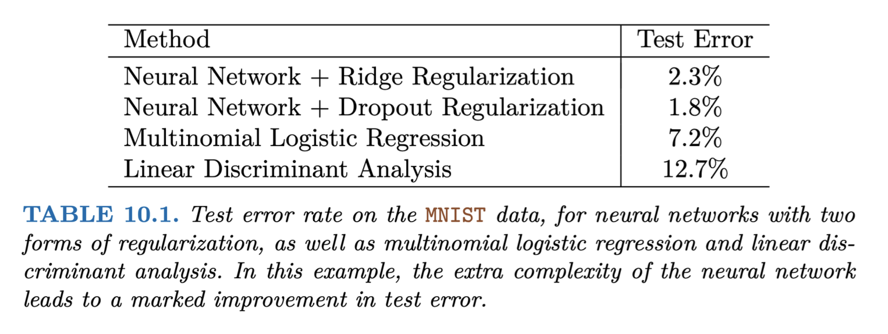{width="70%" fig-align="center"}

## Training Neural Networks

Techniques for training neural networks include:

- **(Stochastic) gradient descent**

  - Backpropagation
  
- **Regularization**

  - Weight penalization
  - Early stopping
  - Dropout

## Training a Neural Network

Training minimizes a loss function $J(\theta)$ over parameters $\theta$.

For **regression**:

$$J(\theta)=\frac1n\sum_{i=1}^n\{y_i-f(x_i;\theta)\}^2.$$

:::{.fragment}
For **$m$-class classification**:

$$J(\theta)=-\frac1n\sum_{i=1}^n\sum_{\ell=1}^m\mathbf1\{y_i=\ell\}\log f_\ell(x_i;\theta).$$

where $f_\ell(x_i;\theta)$ is the predicted probability of class $\ell$.
::: 

  

:::{.fragment}
These loss functions are generally **nonconvex in $\theta$**, due to the composition of linear transformations with nonlinear activation functions.
::: 

## Gradient Descent and Backpropagation

Update parameters using gradient-based optimization:

$$
\theta^{(t+1)} = \theta^{(t)} - \eta \cdot \left. \frac{\partial \mathcal{J}(\theta)}{\partial \theta} \right|_{\theta=\theta^{(t)}}
$$

where $\eta>0$ is the **learning rate**.

  

- In practice, stochastic gradient descent (SGD) and its variants are commonly used.

  

:::{.fragment}

- Computing the gradient uses the so-called [**backpropagation**]{.maroon} trick:

  1. Forward pass: compute loss
  2. Backward pass: update weights
  
::: 

## Forward Propagation

Consider a network with two hidden layers (biases omitted here), for observation $i$:

$$J_i(\theta)=\frac12\left[y_i-\sum_{k=1}^{K_2}\beta_k g\left(\sum_{j=1}^{K_1}W_{kj}^{(2)}g\left(\sum_{\ell=1}^p W_{j\ell}^{(1)}x_{i\ell}\right)\right)\right]^2.$$

  

:::{.fragment}
$$\theta=(W^{(1)},W^{(2)},\beta),$$

$$W^{(1)}\in\mathbb R^{K_1\times p},\quad W^{(2)}\in\mathbb R^{K_2\times K_1},\quad\beta\in\mathbb R^{K_2}.$$

  

**Goal:** compute $\partial J_i/\partial W^{(1)}$, $\partial J_i/\partial W^{(2)}$ and $\partial J_i/\partial\beta$.

::: 

## Backpropagation: Key Idea

Let the pre-activation values be

$$z_{ij}^{(1)}=\sum_{\ell=1}^pW_{j\ell}^{(1)}x_{i\ell},\qquad z_{ik}^{(2)}=\sum_{j=1}^{K_1}W_{kj}^{(2)}g(z_{ij}^{(1)}).$$

Write $e_i=f(x_i;\theta)-y_i$. **Using the chain rule**:

$$\frac{\partial J_i}{\partial\beta_k}=e_i\,g(z_{ik}^{(2)}),$$

$$\frac{\partial J_i}{\partial W_{kj}^{(2)}}=e_i\,\beta_k g'(z_{ik}^{(2)})g(z_{ij}^{(1)}),$$

$$\frac{\partial J_i}{\partial W_{j\ell}^{(1)}}=e_i\left[\sum_{k=1}^{K_2}\beta_k g'(z_{ik}^{(2)})W_{kj}^{(2)}\right]g'(z_{ij}^{(1)})x_{i\ell}.$$

## Backpropagation per Iteration

For each training step $t$:

1. **Forward propagation:** compute activations from input to output.

   $$z_{ij}^{(1)}(\theta^{(t)})\;\longrightarrow\;z_{ik}^{(2)}(\theta^{(t)})\;\longrightarrow\;f(x_i;\theta^{(t)}).$$

2. **Backward propagation:** compute gradients from output to input.

   $$\frac{\partial J_i}{\partial\beta}\;\longrightarrow\;\frac{\partial J_i}{\partial W^{(2)}}\;\longrightarrow\;\frac{\partial J_i}{\partial W^{(1)}}.$$

3. **Parameter update:** use gradients averaged over a minibatch to obtain $\theta^{(t+1)}$.

## Overfitting in Neural Networks

Deep networks often contain many parameters.

- They can easily **overfit** the training data.
- Regularization is therefore important.

  

Common techniques include:

- **Weight decay (ridge-style penalty):**

  $$J(\theta)+\lambda\lVert\theta\rVert_2^2.$$

- **Early stopping:** stop training when the validation error starts to increase.
- **Dropout:** randomly deactivate hidden units during training.

## On Regularization

- Different layers can use different penalty strengths $\lambda$.
  - Hidden-layer weights are often penalized.
  - Output-layer weights may or may not be penalized.
  - Intercepts are generally not penalized.
  
    
  
- Lasso regularization is another option, either alongside or instead of ridge. 

  

- Optimization by SGD may exhibit implicit regularization; its behavior in deep networks remains an active research topic.

## Early Stopping

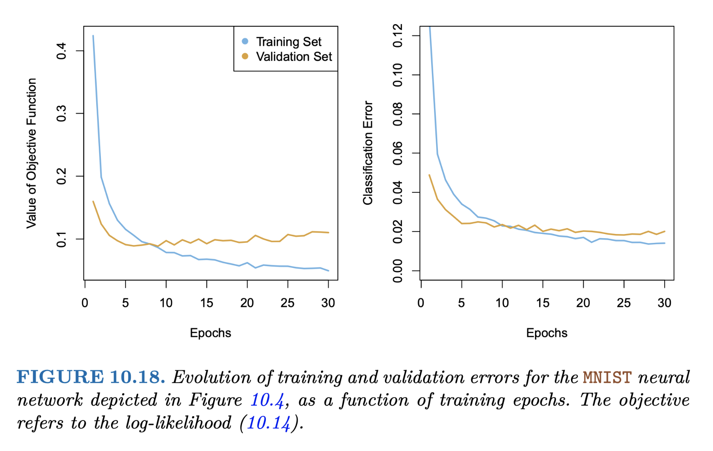{width="70%" fig-align="center"}

**Idea:** use validation performance to choose when to stop, rather than continuing until training loss is minimized.

## Dropout

Inspired partly by random forests, **dropout** randomly deactivates a fraction $\phi$ of hidden units when fitting the model.

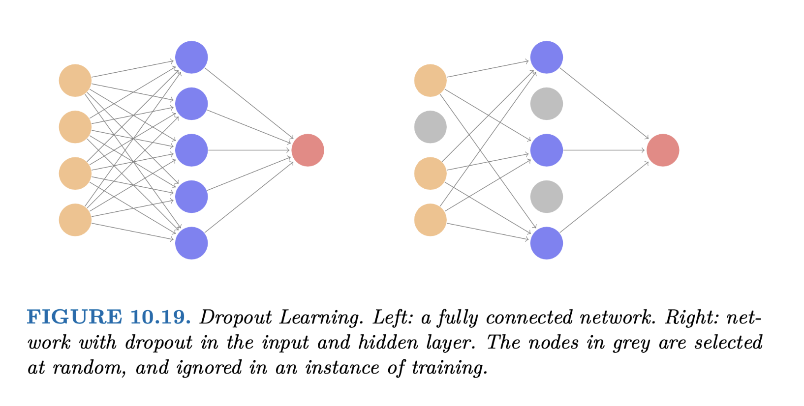{width="70%" fig-align="center"}

## More on Dropout

- Reduces the tendency of nodes to become overly specialized; acts as **regularization**.
- A new dropout mask is sampled when processing each training batch.
- During training, the surviving activations may be scaled by $1/(1-\phi)$ to compensate (**inverted dropout**).
- In practice, dropped units have activation set to zero; the overall architecture is unchanged.
- Dropout is normally switched off during prediction.

## Things to Tune

- **Network size:** number of hidden layers and hidden units per layer.
  - Large networks can be used with regularization to control overfitting.
  
   
  
  
- **Regularization:** dropout fraction $\phi$, lasso/ridge penalty strength $\lambda$, possibly varying by layer. 

  

- **Optimization:** batch size, number of epochs, learning rate, and early-stopping point.

## More Structured Neural Networks

Examples of specialized architectures:

- [Recurrent neural networks (RNNs)]{.maroon}
- [Convolutional neural networks (CNNs)]{.maroon}
- Residual networks
- Graph neural networks
- Autoencoders
- Generative adversarial networks (GANs)
- Transformers (attention-based networks)

## Document Classification

**IMDb sentiment classification**: a dataset of 25,000 labeled reviews (review, sentiment).

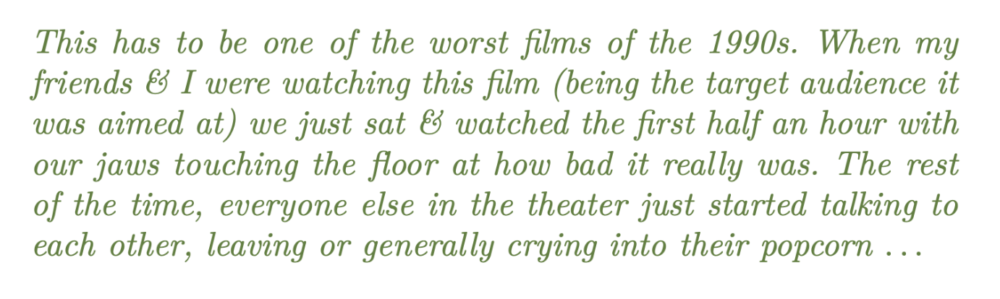{width="70%" fig-align="center"}

**Goal:** classify each review as positive or negative.

## Feature Representation

Construct a dictionary of the **10,000 most frequent words** in the training reviews.

For each review, construct a feature vector of word indicators:

$$x_i\in\{0,1\}^{10,000}.$$

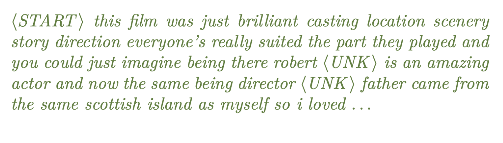{width="70%" fig-align="center"}

This *bag-of-words* representation does not preserve word order.

## IMDb Results

**Lasso versus a two-hidden-layer network** with 16 units in each layer: both achieve accuracy around 88% in this example.

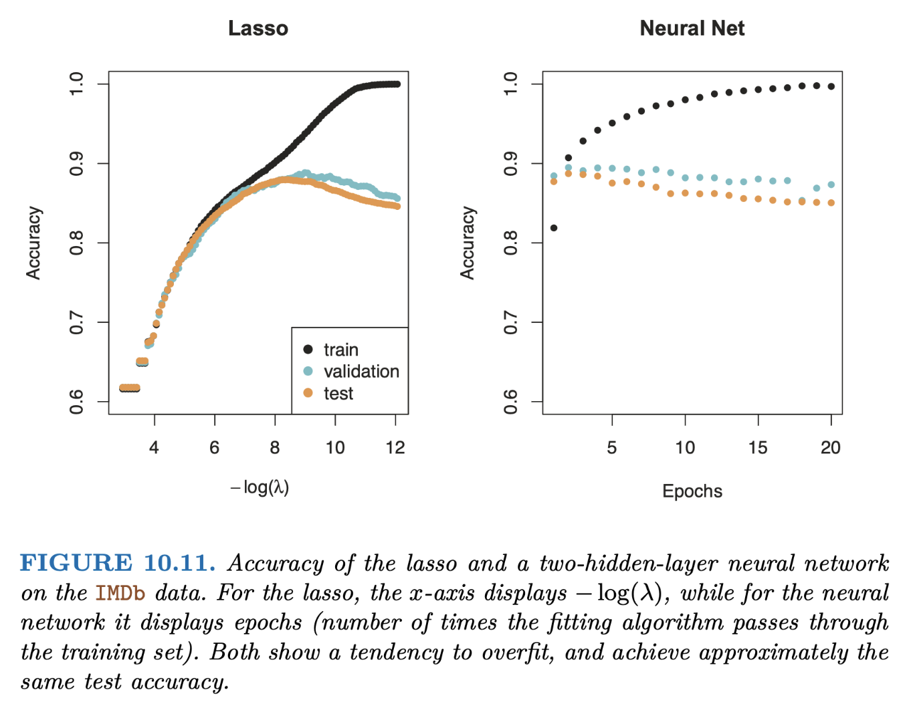{width="70%" fig-align="center"}

## Room for Improvement

A bag-of-words representation ignores **word context and order**.

1. **Bag of $n$-grams:** record short consecutive word sequences.
   - For example, “blissfully long” and “blissfully short” may express different sentiments.
   
     
   
2. **Sequence models:** process documents as ordered words, accounting for preceding or following words.
   - Recurrent neural networks and long short-term memory (LSTM)
   - Transformers and models such as BERT

## Recurrent Neural Networks (RNNs)

RNNs are useful for data with a natural **sequence structure**:

1. **Documents:** movie reviews, news articles, social posts.
2. **Time series:** weather, financial variables, market volumes and prices.
3. **Recordings:** speech, audio transcription, language translation, music.
4. **Handwriting:** handwriting recognition and optical character recognition (OCR).

## RNNs: Sequential Inputs

The input for observation $i$ is a sequence:

$$X_i=\{X_{i1},\ldots,X_{iL}\},$$

with associated response $Y_i$.

  

Each $X_{i\ell}$ may be:

- A number or numerical vector
- A token, word, image, or other object

  

The **order** of the observations has meaning. The goal is to use that sequential structure to better predict $Y_i$.

## Word Embedding

For document classification, represent review $i$ as a sequence of $L$ words:

$$X_i=\{X_{i1},\ldots,X_{iL}\},$$

with sentiment label $Y_i$.

  

A [**word embedding**]{.maroon} represents each word $X_{i\ell}$ as a vector in a Euclidean space.

  

Other tokenizations are possible, including characters or phrases.

## One-Hot Encoding versus Word Embedding

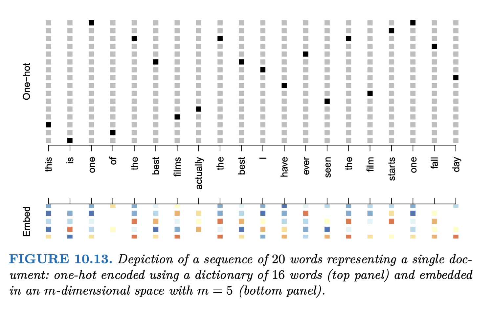{width="70%" fig-align="center"}

**One-hot vectors** are sparse indicators; **embeddings** use lower-dimensional, dense vectors.

## Word Embedding: Vector Arithmetic

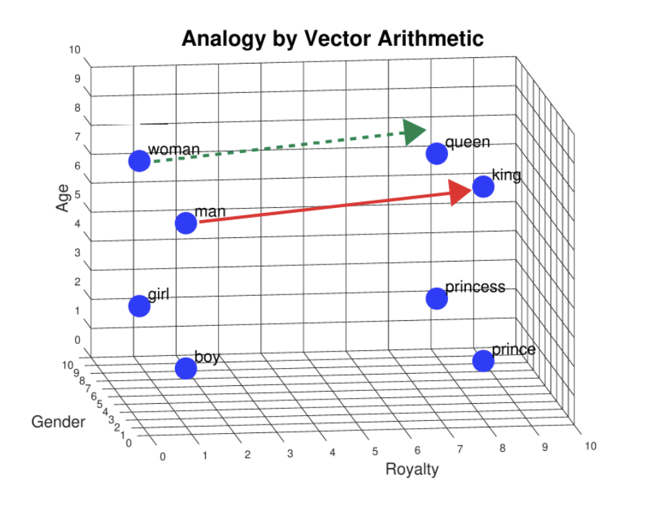{width="70%" fig-align="center"}

Famous illustrative analogies include relationships such as **woman − man + king ≈ queen**.

- **word2vec:** Mikolov, Chen, Corrado and Dean (2013)
- **GloVe:** Pennington, Socher and Manning (2014)

## An Illustration of RNNs

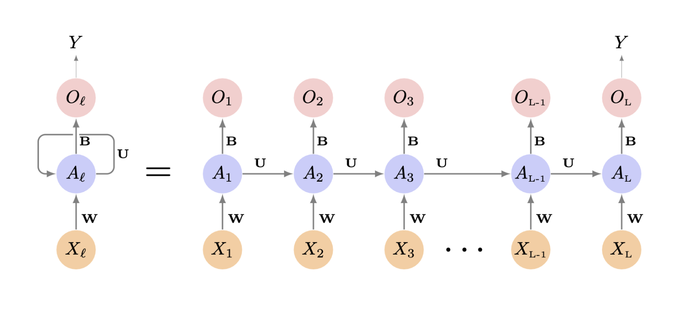{width="70%" fig-align="center"}

- Parameters $W$, $B$ and $U$ are **shared across time steps**.
- Hidden activations $A_1,\ldots,A_L$ evolve sequentially.

## Specifications of RNNs

- An illustrative network uses **one recurrent layer** with $K=32$ hidden units.
  - Its embedding matrix is $E\in\mathbb R^{1000\times m}$, with $m=32$.
  - The source reports about **76% IMDb test accuracy** for this example with dropout.
  
    
  
- **Long short-term memory (LSTM)** introduces a mechanism to help retain information over longer intervals. 

  

- *Historical context*: the original source notes that some RNN configurations exceeded 95% accuracy on IMDb by early 2020. This is not a current benchmark.

## Convolutional Neural Networks (CNNs)

CNNs are designed for data with **spatial structure**, such as images.

:::{.fragment}
A grayscale image can be represented as a matrix:

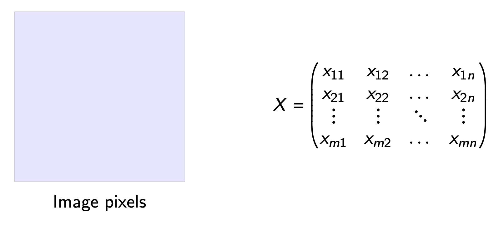{width="70%" fig-align="center"}
:::

## Key Ideas of CNNs

- Detect **low-level features**, such as edges, corners and patches of color.
- Combine these to form **higher-level features**, such as parts of eyes or ears.
- Use the presence or absence of higher-level features for prediction.

  
  

The main components include:

- **Convolutional layers**
- **Pooling layers**

## Illustration of a CNN

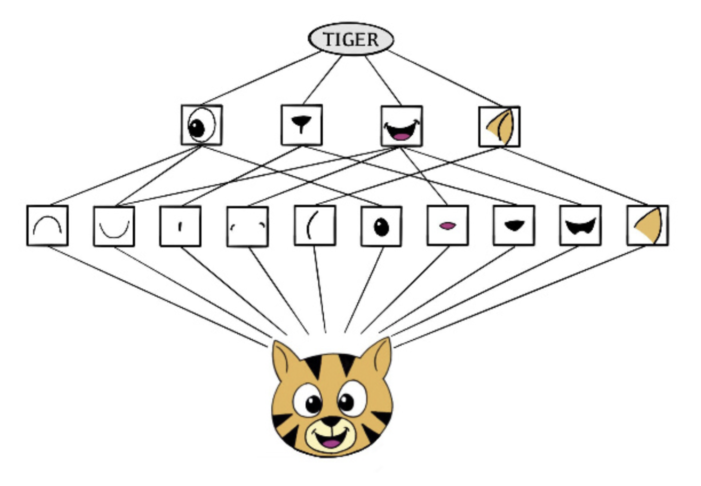{width="70%" fig-align="center"}

## Convolution Operation

A convolution filter extracts **local features** of an image.

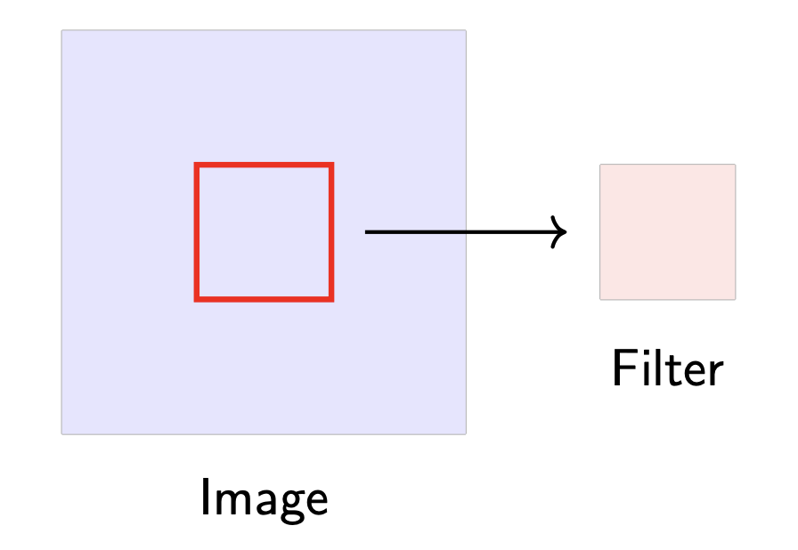{width="70%" fig-align="center"}

For a $2\times2$ filter,

$$W=\begin{pmatrix}w_{11}&w_{12}\\w_{21}&w_{22}\end{pmatrix},\qquad z_{ij}=g(\langle W,X_{ij}\rangle).$$

A learned filter might detect a corner or an edge.

## Feature Map

Applying a filter across the image produces a **feature map**.

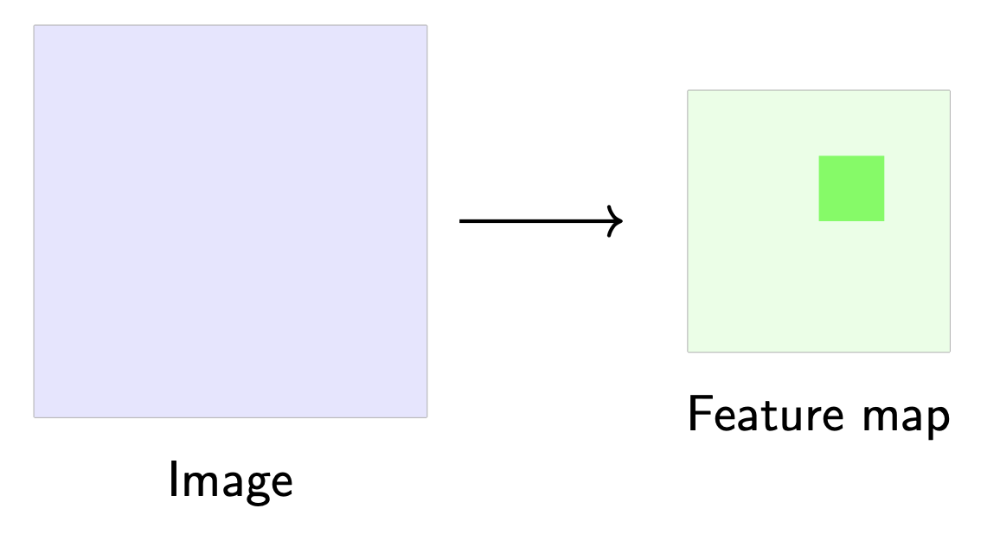{width="70%" fig-align="center"}

- The feature map highlights regions matching the filter.
- **Padding** can be used to control the output size.

## Example of a Convolution Step

Consider the image and filter:

$$X=\begin{pmatrix}1&2&1\\0&3&2\\4&1&0\end{pmatrix},\qquad W=\begin{pmatrix}1&0\\0&-1\end{pmatrix}.$$

**First patch:**

$$\langle\begin{pmatrix}1&2\\0&3\end{pmatrix},W\rangle=1(1)+2(0)+0(0)+3(-1)=-2.$$

**Second patch:**

$$\langle\begin{pmatrix}2&1\\3&2\end{pmatrix},W\rangle=2(1)+1(0)+3(0)+2(-1)=0.$$

The first row of the feature map is $(-2,0)$.

## Example of a Convolution Step (Continued)

For the same image $X$ and filter $W$:

**Third patch:**

$$\langle\begin{pmatrix}0&3\\4&1\end{pmatrix},W\rangle=0(1)+3(0)+4(0)+1(-1)=-1.$$

**Fourth patch:**

$$\langle\begin{pmatrix}3&2\\1&0\end{pmatrix},W\rangle=3(1)+2(0)+1(0)+0(-1)=3.$$

Therefore, the final **feature map** is

$$\boxed{\begin{pmatrix}-2&0\\-1&3\end{pmatrix}}.$$

## Example of a Convolutional Filter

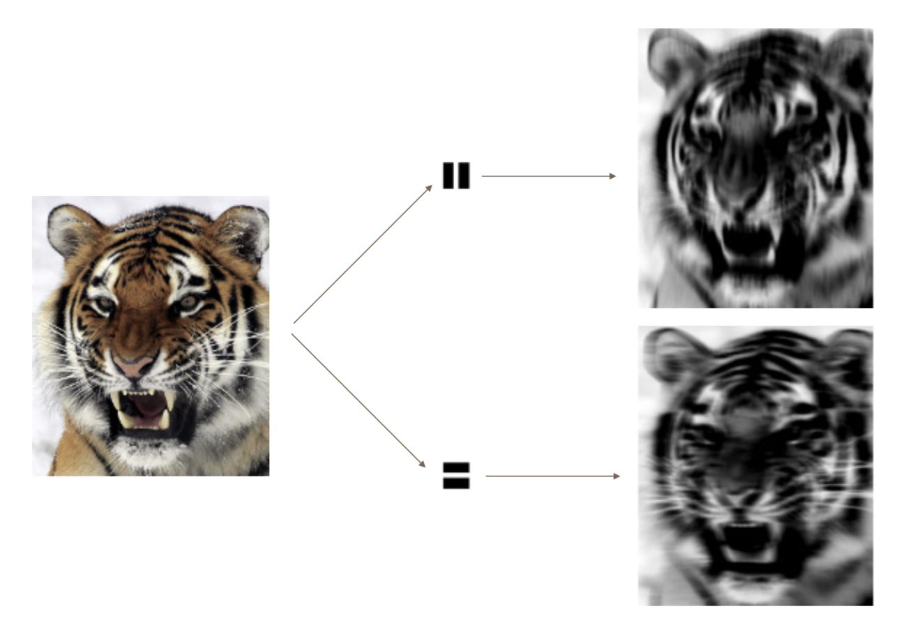{width="70%" fig-align="center"}

Original example: a $192\times179$ tiger image filtered using $15\times15$ vertical and horizontal patterns.

## Pooling Layer

**Pooling** summarizes a large feature map using a smaller one.

With **non-overlapping $2\times2$ max pooling**:

$$\begin{pmatrix}1&2&5&3\\3&0&1&2\\2&1&3&4\\1&1&2&0\end{pmatrix}\quad\longrightarrow\quad\begin{pmatrix}3&5\\2&4\end{pmatrix}.$$

For example, a $32\times16$ image is reduced to $16\times8$.

## Typical CNN Architecture

**Pipeline:**

$$\text{Image}\longrightarrow\text{Convolution}\longrightarrow\text{Pooling}\longrightarrow\text{Fully connected}\longrightarrow\text{Output}.$$

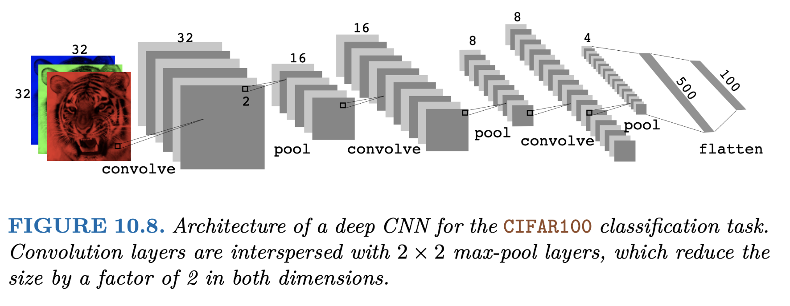{width="70%" fig-align="center"}

## Filters and RGB Images

An RGB image $X$ has dimension $d_1\times d_2\times3$, with three color **channels**.

A filter $Z$ can have dimensions $k_1\times k_2\times3$. Its output combines convolutions from all channels:

$$X^{(1)}*Z^{(1)}+X^{(2)}*Z^{(2)}+X^{(3)}*Z^{(3)}.$$

- If $Z^{(1)}=Z^{(2)}=Z^{(3)}$, the same spatial filter is applied to each channel and the results are summed.
- If $k_1=k_2=1$, the filter computes $w_1X^{(1)}+w_2X^{(2)}+w_3X^{(3)}$ at each location.
- With **five filters**, the output has five feature maps.

## Example: ResNet-50 on ImageNet

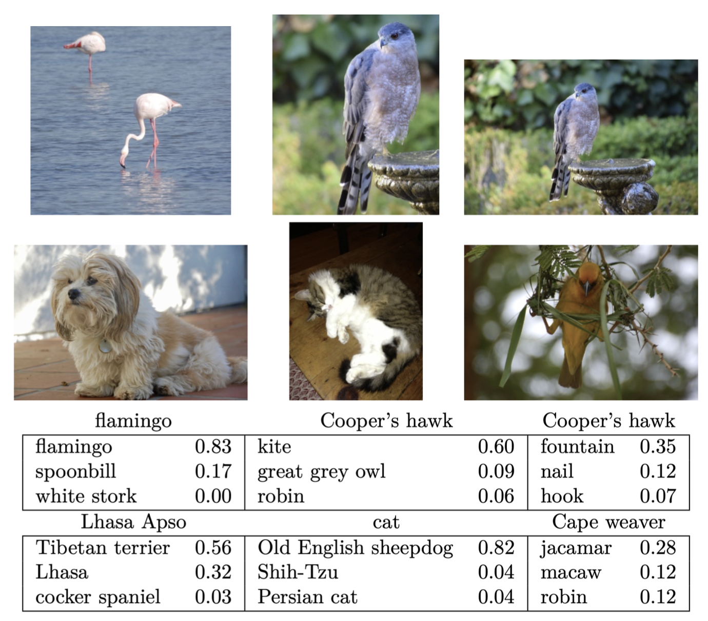{width="70%" fig-align="center"}

## More Comments on CNNs

CNNs use the spatial structure of images and have been highly successful in computer vision.

- **Fewer parameters** than similarly sized fully connected architectures, due to local filters and shared weights.
- **Local feature detection** that supports downstream tasks.
- Some robustness to small translations (depending on architecture and training).

Architecture design still requires tuning the number, type and sizes of layers.

Dropout, lasso and ridge-style regularization can also be used.

## When to Use Deep Learning

**Examples of successes**

- classification of MNIST dataset
- **CNNs:** image classification, medical imaging, computer vision.
- **RNNs:** sequential data, forecasting, speech and language tasks.

But should we replace all older statistical tools with deep learning?

  

:::{.fragment}
[**Occam's Razor**]{.maroon} Principle: When faced with several methods that give roughly equivalent performance, pick the simplest.

Simpler models are easier to fit and understand. 
::: 

:::{.fragment}
We expect deep learning to be an attractive choice when the sample size is extremely large, and when interpretability is not a high priority. 
::: 

## Summary

- **Neural networks** learn nonlinear relationships by constructing new features through hidden layers and activation functions.

- **Training:** We minimize a loss function using gradient descent, with **backpropagation** efficiently computing gradients using the chain rule.

- **Regularization:** Ridge/LASSO penalties, early stopping, and dropout help prevent overfitting.

- **Recurrent neural networks (RNNs):** Designed for sequential data, using shared weights and hidden states to capture information from previous inputs.

- **Convolutional neural networks (CNNs):** Designed for spatial data, using convolutional filters to detect local patterns and pooling to reduce dimensionality.

 

Announcements: Assignment due Dec. 2nd through Crowdmark 

Final exam information available on the course website

