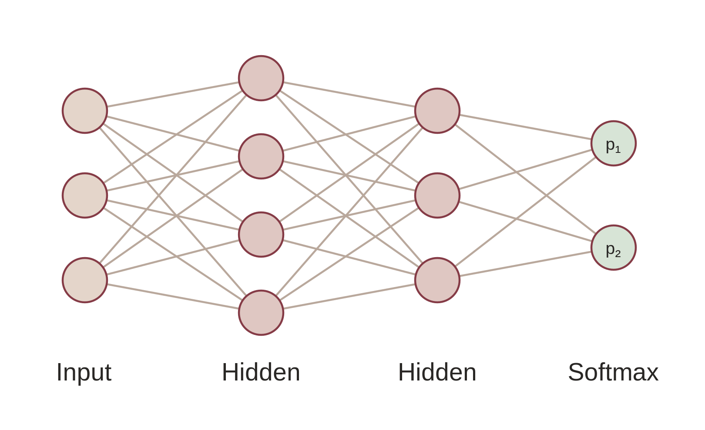
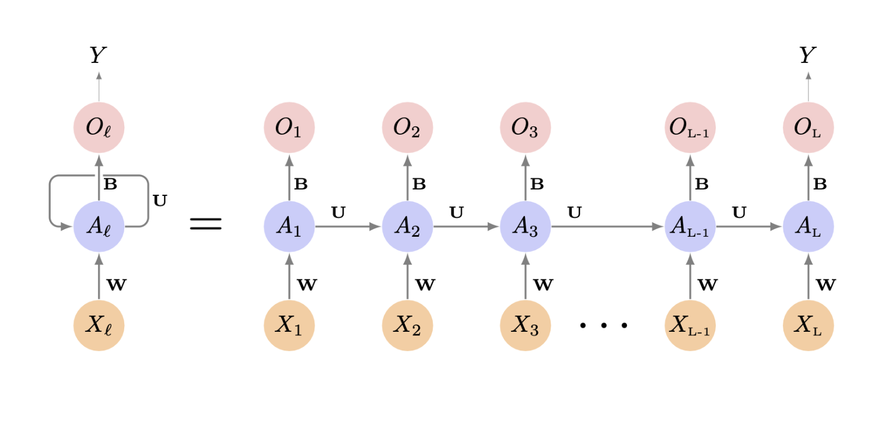
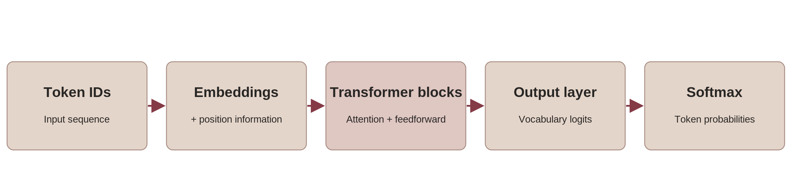

## Today's lecture

-   What is a large language model (LLM)?
-   How do transformers incorporate context?
-   How are LLMs trained?
-   What are the ethics behind LLMs

<br>

[Our goal:]{.maroon} understand LLMs using statistical learning concepts we already know.

## Recall: Neural networks for classification

Suppose we want to classify an email as **spam** or **not spam**, using numerical features such as its length and the frequency of certain words.

::::: columns
::: {.column width="48%"}
-   Input: numerical features $\mathbf x$.
-   Hidden layers: learn nonlinear representations of $\mathbf x$.
-   Output: class probabilities (softmax).
-   Training: minimize negative log-likelihood using gradient descent with backpropogation.
:::

::: {.column width="52%"}
{width="100%" fig-align="center"}
:::
:::::

::: fragment
**What if we wanted to use the actual sequence of words rather than a fixed set of summary features?**
:::

## Sequence Inputs

Consider the following sentences:

::: {style="text-align: center;"}

The dog chased the cat.

The cat chased the dog.

:::

<br> 
<br> 

:::{.fragment}
A model using only word counts would **not** be able to distinguish between these two sentences.

<br> 

They contain exactly the same words, but have different meanings.

<br> 

We need a neural network that can account for the **sequential structure** of the input. Recall the recurrent neural network (RNN).
:::

## Recall: Recurrent Neural Networks (RNNs)

An RNN processes a sequence one element at a time. 

{width="100%" fig-align="center"}

:::{.fragment}
- Information from previous words must be passed from one hidden state to the next.
- Important information from earlier words may be lost when processing long sequences.
::: 

## Language Modelling

Instead of predicting whether an entire email is spam, suppose we want to [**predict the next word**]{.maroon}:

::: {style="text-align: center;"}

*The student studied for the final ...*

:::

<br> 

:::{.fragment}
An RNN could use its hidden state $a_t$ to produce a probability distribution over a vocabulary of $M$ possible words.

- The output layer contains $M$ units.
- Using the softmax function, each output unit represents the predicted probability of a possible next word.
:::

<br> 

::: {.fragment}
This is still **multiclass classification**, but now the classes are possible next words (e.g., *exam*, *assignment*, *week*).

Modern large language models (LLMs) perform this same prediction task, but typically use a different neural network architecture: the [**transformer**]{.maroon}.

:::

## Language Modelling

A [**large language model (LLM)**]{.maroon} is a large neural network trained to model language. It is an example of deep learning.

:::{.fragment}
A [**token**]{.maroon} is a unit of text processed by the model. It can be an entire word, part of a word, or a punctuation mark.
:::

<br>

:::{.fragment}
Let $x_1,\ldots,x_T$ denote a sequence of $T$ tokens. We can express the probability of observing this sequence as:

$$
P(x_1,\ldots,x_T)=\prod_{t=1}^{T}P(x_t\mid x_1,\ldots,x_{t-1}).
$$

For example,

$$
P(\text{I, love, statistics}) = P(\text{I})P(\text{love}\mid\text{I})P(\text{statistics}\mid\text{I, love}).
$$
::: 

::: {.fragment}

Rather than modelling the probability of an entire sequence directly, we train a neural network to [predict the probability distribution of the next token given the preceding tokens]{.maroon}.
::: 


## Language Modelling

For a vocabulary of $M$ tokens, the output layer produces logits $z_1,\ldots,z_M$ and applies softmax:

$$
\hat p_j=\frac{\exp(z_j)}{\sum_{k=1}^{M}\exp(z_k)},
\qquad j=1,\ldots,M.
$$

<br>
<br> 

:::: {.columns}

::: {.column width="45%"}

*The capital of Canada is ...*


:::

::: {.column width="55%"}

```{=html}
<div style="display:grid; grid-template-columns:100px 1fr 50px;
align-items:center; gap:12px; font-size:0.8em;">

  <div>Ottawa</div>
  <div style="background:#94616a; height:24px; width:75%;"></div>
  <div>0.75</div>

  <div>Toronto</div>
  <div style="background:#94616a; height:24px; width:12%;"></div>
  <div>0.12</div>

  <div>located</div>
  <div style="background:#94616a; height:24px; width:6%;"></div>
  <div>0.06</div>

  <div>a</div>
  <div style="background:#94616a; height:24px; width:4%;"></div>
  <div>0.04</div>

  <div>Other</div>
  <div style="background:#94616a; height:24px; width:3%;"></div>
  <div>0.03</div>

</div>
```

:::

::::

<br> 

*Note:* These probabilities are illustrative. "Other" represents the combined probability of all remaining tokens in the vocabulary.

## Tokenization

As mentioned, a [**token**]{.maroon} is not necessarily a word. It can be a word, part of a word, punctuation, or another unit of text.

<br> 

:::{.fragment}
For example, a hypothetical tokenizer might split:

::: token-line
[The]{.token} [model]{.token} [learn]{.token} [s]{.token} [quickly]{.token} [.]{.token}
:::

and assign these tokens integer IDs:

$$ (12,\ 81,\ 35,\ 7,\ 92,\ 4). $$
<br> 
::: 

:::{.fragment}
*Note*: Token IDs are labels, not numerical measurements.
:::

<br> 

:::{.fragment}
Just like word embeddings, we can represent each token using a [**token embedding**]{.maroon}: a low-dimensional 
numerical vector.
:::

## Transformers for an LLM

::: {style="text-align: center;"}

So why do we use [**transformers**]{.maroon} rather than an RNN? 

:::

Recall: RNNs may lose important information from earlier tokens when processing long sequences.

[**Transformers**]{.maroon}, which are another specialized architecture of neural networks, use **attention** to directly access information from previous tokens and assign greater weight to the most relevant ones.

<br>

Consider the sentence:

::: {style="text-align: center;"}

The animal did not cross the street because **it** was tired. 

:::

::: fragment
What does *it* refer to?

To interpret the token *it*, information from earlier tokens such as *animal* may be especially useful.

The attention mechanism allows the model to learn which tokens to **pay more attention to** in order to better understand the context.
:::

## Transformers for an LLM

Recall that each token is initially represented by a numerical vector (its **token embedding**).

The goal of attention is to construct a new numerical representation of each token that incorporates information from its context.

To construct this new representation for token $t$, we compute a weighted average:

$$
\mathbf a_t=\sum_{i=1}^{t}\alpha_{ti}\mathbf v_i,
\qquad \sum_{i=1}^{t}\alpha_{ti}=1,
\quad \alpha_{ti}\geq 0.
$$

::: {.fragment}

- $\mathbf v_i$ is a transformation of the numerical representation of token $i$.
- $\alpha_{ti}$ is the attention weight assigned to token $i$ when processing token $t$.
- These weights depend on the context and are computed using parameters learned during training.

:::

::: {.fragment}

[**Before attention:**]{.maroon} A numerical vector representing the token itself (its initial embedding).

[**After attention:**]{.maroon} A numerical vector representing the token within its context (a contextual representation).

:::


## Large Language Model

{width="92%" fig-align="center"}

## Large Language Model 

[**Parameters to be estimated:**]{.maroon}

- Token embeddings (entries of the embedding matrix).
- Parameters used to compute the attention weights $\alpha_{ti}$.
- Weights and biases in the feedforward neural networks.
- Weights and biases in the output layer.

These parameters are learned during training by minimizing a *loss function*.

<br>

[**Hyperparameters to be selected or tuned:**]{.maroon}

- Dimension of the token embeddings.
- Number of transformer blocks.
- Number of attention heads.
- Number of hidden units in the feedforward neural networks.
- Learning rate, batch size, and regularization.

## Training an LLM

Let $\boldsymbol\theta$ denote all trainable parameters of the model.

Recall that we are trying to [predict the next token]{.maroon}. 

We can estimate the parameters by minimizing the average negative log-likelihood:

$$
\mathcal L(\boldsymbol\theta)=
-\frac{1}{T}\sum_{t=1}^{T}
\log p_{\boldsymbol\theta}(x_t\mid x_1,\ldots,x_{t-1}).
$$

::: {.fragment}
**Where have we seen this before?**

This is the negative log-likelihood for multiclass classification (also known as multiclass cross-entropy).
:::

## Training an LLM

During [**pretraining**]{.maroon}, the model learns to predict the next token by minimizing the loss function over large collections of text.

Recall how we train a neural network:

- **Forward pass:** obtain predicted probabilities and compute the loss.
- **Backpropagation:** compute the gradients of the loss function.
- **Gradient-based optimization:** update the parameters.

::: {.fragment}
During [**post-training**]{.maroon}, the pretrained model can be further trained to follow instructions and align with human preferences.
:::


## Ethical Considerations: Bias and Fairness

Recall that machine learning models learn patterns from 
their training data.

- What happens if the training data are not representative 
  of the population?
- What happens if the training data contain historical 
  biases or stereotypes?

<br>

:::{.fragment}

LLMs are trained on large collections of text produced 
by humans. As a result, they can learn and reproduce 
biases that exist in society.


<br>

**Discussion:** Suppose a company uses an AI system to 
screen job applications. If the model was trained using 
historical hiring decisions, what potential problems 
could arise?
::: 

## Ethical Considerations: Reliability

Recall that the objective of a language model is to 
estimate

$$
P_{\boldsymbol{\theta}}(x_{t+1}\mid x_1,\ldots,x_t).
$$

The model is trained to predict plausible subsequent tokens, not explicitly to verify whether its statements are factually correct.

:::{.fragment}

- LLMs can generate incorrect information that appears 
  convincing.
- They can fabricate references, statistical results, 
  and explanations.
- A fluent response does not necessarily imply a 
  correct response.

This phenomenon is commonly referred to as 
**hallucination**.

:::

## Ethical Considerations: The Data Itself

**Training Data and Consent**

- Where does the training data come from?
- Did the individuals who produced these data consent 
  to their use?
- Who owns the content used to train these models?

:::{.fragment}
**Privacy**

- What happens when users provide sensitive or 
  confidential information to an AI system?
- Can a model memorize and reproduce information 
  from its training data?
::: 

:::{.fragment}
**Transparency and Accountability**

- Can we explain why a model generated a particular 
  response?
- Who is responsible when an AI-generated decision 
  causes harm?
:::

## Summary

- Large language models are neural networks trained to model language through tasks such as next-token prediction.

- Many of the underlying concepts are familiar: softmax, minimizing a loss function, and gradient descent

- Transformers use attention mechanisms to capture contextual relationships between tokens.

- LLMs generate text by repeatedly predicting and selecting subsequent tokens.

- Despite their capabilities, LLMs have important ehtical considerations involving reliability, bias, privacy and interpretability.

<br>

::: {style="text-align: center;"}

**Understanding how machine learning models work is fundamental to understanding their limitations and using them responsibly.**

:::

