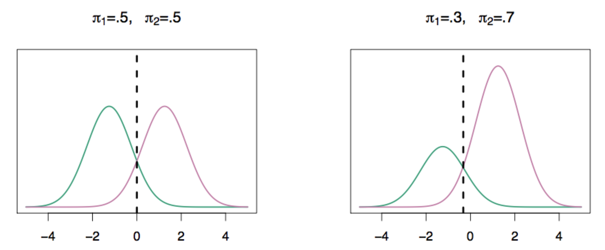
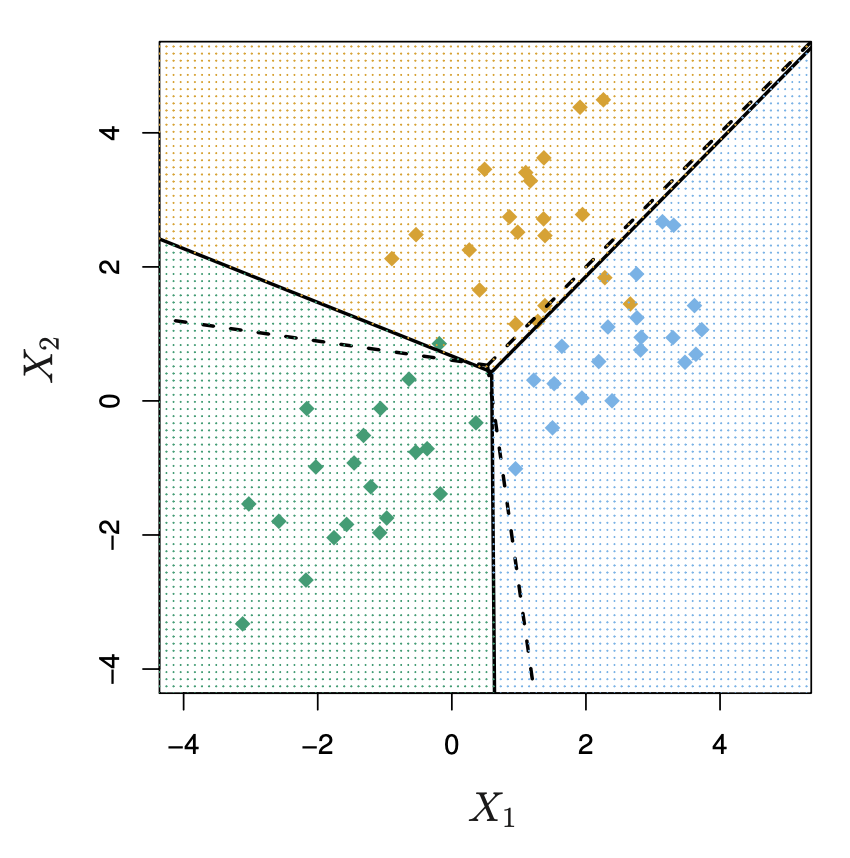
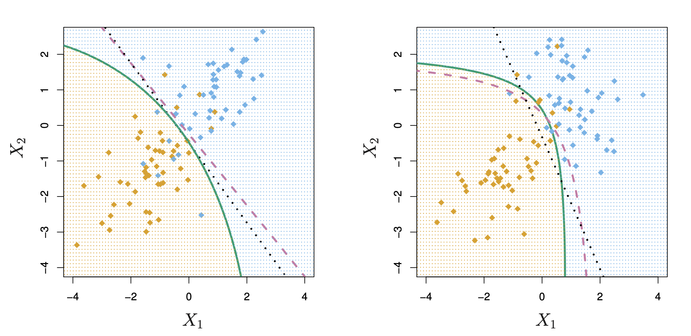

## Review

In the last lecture, we have learned the logistic regression for binary classification $Y\in\{0,1\}$.

  - Estimating the Bayes rule at any observation $x\in\mathcal X$ is equivalent to estimate the conditional probability $\mathbb P(Y=1\mid X=x)$.
  - Logistic regression parametrizes the conditional probability by

$$
\mathbb P(Y=1\mid X=x)=\frac{e^{\beta_0+x^\top\beta}}{1+e^{\beta_0+x^\top\beta}}.
$$

- We estimate the coefficients by using MLE which can be solved by (stochastic) gradient descent.

## Motivating Example 

Recall our motivating example, where we are trying to predict the medical condition of a patient in the emergency room on the basis of her symptoms. 

There are three possible diagnoses: stroke, drug overdose, and epileptic seizure. 

We define $Y$ as follows: 

$$ 
Y = \begin{cases} 
  1 \quad \text{if stroke}; \\ 
  2 \quad \text{if drug overdose}; \\ 
  3 \quad \text{if epileptic seizure}.
\end{cases}
$$

[How do we extend the ideas we discussed last week to the case where we have more than two classes?]{.maroon}

## Extension to multi-class classification

When $Y\in\{0,1,\ldots,K-1\}$ for $K>2$, we need to estimate

$$p_k(x):=\mathbb P(Y=k\mid X=x),\qquad\forall\ 1\leq k\leq K-1.$$

:::{.fragment}
Logistic regression assumes

$$
\begin{aligned}
p_1(x)&=\frac{e^{\beta_0^{(1)}+x^\top\beta^{(1)}}}{1+\sum_{k=1}^{K-1}e^{\beta_0^{(k)}+x^\top\beta^{(k)}}}.\\
&\vdots\\
p_{K-1}(x)&=\frac{e^{\beta_0^{(K-1)}+x^\top\beta^{(K-1)}}}{1+\sum_{k=1}^{K-1}e^{\beta_0^{(k)}+x^\top\beta^{(k)}}}
\end{aligned}
$$

and $p_0(x)=1-p_1(x)-\cdots-p_{K-1}(x)$.
::: 

:::{.fragment}
So essentially, we select a single class (wlog, the Kth class) to serve as baseline. 
::: 

## Classification

Equivalently, for $k = 1, ..., K-1$

$$
\begin{aligned}
\log\left(\frac{p_1(x)}{p_0(x)}\right)&=\beta_0^{(1)}+\beta_1^{(1)}x_1+\cdots+\beta_p^{(1)}x_p\\
\log\left(\frac{p_2(x)}{p_0(x)}\right)&=\beta_0^{(2)}+\beta_1^{(2)}x_1+\cdots+\beta_p^{(2)}x_p\\
&\vdots\\
\log\left(\frac{p_{K-1}(x)}{p_0(x)}\right)&=\beta_0^{(K-1)}+\beta_1^{(K-1)}x_1+\cdots+\beta_p^{(K-1)}x_p
\end{aligned}
$$

  

:::{.fragment}
Choice of the baseline ($Y=0$) is arbitrary.

So classification can be done immediately once $\beta^{(k)}$'s are estimated. 
::: 

## Interpretation of Coefficients 

When we fit models with different baselines (i.e. different $Y=0$), the coefficient estimates will [differ]{.maroon}. 

However, the [predictions, log odds between any pair of classes, and the other key model outputs will remain the same]{.maroon}. 

:::{.fragment}
The interpretation of the coefficients must be done with care since the coefficients are tied to the choice of baseline. 

  

**Motivating Example:** if we set epileptic seizure to be the baseline, then a one unit increase in $x$ is associated with a $\beta_0^{(1)}$ increase in the log odds of [stroke over epileptic seizure]{.maroon}. 
::: 

## How to estimate coefficients?

[A naive approach]{.maroon}: separate binary logistic regressions

$$\log\left(\frac{p_k(x)}{p_0(x)}\right)=\beta_0^{(k)}+\beta_1^{(k)}x_1+\cdots+\beta_p^{(k)}x_p,\qquad\forall\ 1\leq k\leq K-1.$$

Partition the data into $\{\mathcal D_{(1)}^{\mathrm{train}},\ldots,\mathcal D_{(K-1)}^{\mathrm{train}}\}$ with $\mathcal D_{(k)}^{\mathrm{train}}$ containing all data with $y\in\{0,k\}$ for $1\leq k\leq K-1$.

  

**1.** For each $1\leq k\leq K-1$, use $\mathcal D_{(k)}^{\mathrm{train}}$ to perform binary logistic regression to estimate $\beta^{(k)}$ and estimate $\frac{p_k(x)}{p_0(x)}$

**2.** Assign class label by comparing

   $$1,\ \frac{p_1(x)}{p_0(x)},\ \frac{p_2(x)}{p_0(x)}\ldots,\ \frac{p_{K-1}(x)}{p_0(x)}$$

## Why naive?

- Estimation of $\beta^{(k)}$
  - only uses $\mathcal D_{(k)}^{\mathrm{train}}$ containing data points in class $\{0,k\}$
  - ignore all data points in other classes

  

- The event $\{y_i=k\}$ is dependent on all other $\{y_i=k'\}$ for $k'\neq k$. Intuitively, this dependence helps to estimate $\beta^{(k)}$ by pooling data from all classes.

  

- What should we use instead?

## MLE for multi-class logistic regression

The conditional log-likelihood of $y_1,\ldots,y_n\mid x_1,\ldots,x_n$ at $(\beta^{(1)},\ldots,\beta^{(K-1)})$, with no intercepts, is [proportional to]{.maroon}

$$
\begin{aligned}
&\sum_{i=1}^n\log\left(\prod_{k=0}^{K-1}p_k(x_i)^{\mathbf 1\{y_i=k\}}\right)\\
&=\sum_{i=1}^n\sum_{k=0}^{K-1}\mathbf 1\{y_i=k\}\log(p_k(x_i))\\
&=\sum_{i=1}^n\left[\mathbf 1\{y_i=0\}\log(p_0(x_i))+\sum_{k=1}^{K-1}\mathbf 1\{y_i=k\}\log(p_k(x_i))\right]\\
&=\sum_{i=1}^n\left[\sum_{k=1}^{K-1}\mathbf 1\{y_i=k\}x_i^\top\beta^{(k)}-\sum_{k=0}^{K-1}\mathbf 1\{y_i=k\}\log\left(1+\sum_{k=1}^{K-1}e^{x_i^\top\beta^{(k)}}\right)\right]\\
&=\sum_{i=1}^n\left[\sum_{k=1}^{K-1}\mathbf 1\{y_i=k\}x_i^\top\beta^{(k)}-\log\left(1+\sum_{k=1}^{K-1}e^{x_i^\top\beta^{(k)}}\right)\right]
\end{aligned}
$$

## Gradient of $\ell(\beta^{(k)})$

For any $1\leq k\leq K-1$,

$$
\begin{aligned}
\frac{\partial\ell(\beta^{(1)},\ldots,\beta^{(K-1)})}{\partial\beta^{(k)}}
&=\sum_{i=1}^n\left[\mathbf 1\{y_i=k\}x_i-\frac{x_i e^{x_i^\top\beta^{(k)}}}{1+\sum_{k=1}^{K-1}e^{x_i^\top\beta^{(k)}}}\right]\\
&=\sum_{i=1}^n\left[\mathbf 1\{y_i=k\}-\frac{e^{x_i^\top\beta^{(k)}}}{1+\sum_{k=1}^{K-1}e^{x_i^\top\beta^{(k)}}}\right]x_i
\end{aligned}
$$

:::{.fragment}
The binary case ($K=2$)

$$
\begin{aligned}
\frac{\partial\ell(\beta)}{\partial\beta}
&=\sum_{i=1}^n\left[\mathbf 1\{y_i=1\}-\frac{e^{x_i^\top\beta}}{1+e^{x_i^\top\beta}}\right]x_i\\
&=\sum_{i=1}^n\left[y_i-\frac{e^{x_i^\top\beta}}{1+e^{x_i^\top\beta}}\right]x_i.
\end{aligned}
$$
::: 

## Gradient descent

The log-likelihood we just showed is concave, thus, it's negative is convex. 

Therefore, for $1\leq k\leq K$, we update

$$
\hat\beta_{(t+1)}^{(k)}=\hat\beta_{(t)}^{(k)}+\alpha\sum_{i=1}^n\left[\mathbf 1\{y_i=k\}-\frac{e^{x_i^\top\hat\beta_{(t)}^{(k)}}}{1+\sum_{k=1}^{K-1}e^{x_i^\top\hat\beta_{(t)}^{(k)}}}\right]x_i.
$$

Remark:

- the gradient update uses data points from [**all classes**]{.maroon}!
- better estimation than the naive approach

## An alternative to Logistic Regression

- When the classes are well-separated, the parameter estimates for the logistic regression model are surprisingly unstable[^paper].
  - Discriminant analysis does not suffer from this problem.

  

- When $n$ is small and we know more about the data, such as the distribution of $X\mid Y=k$
  - Discriminant analysis has better performance than the logistic regression model.

  

- Logistic Regression sometimes does not handle multi-class classification well
  - Discriminant analysis is more suitable for multi-class classification problems.
  
 
  

[^paper]: [A paper on this.](https://statisticalhorizons.com/wp-content/uploads/Allison.StatComp.pdf)

# Discriminant Analysis

## Discriminant Analysis

Suppose we're trying to classify whether a student is an undergraduate or graduate student based on their age.

  

**Logistic regression**: Given that a student is 25 years old, what is the probability that they're a graduate student?

$$\mathbb P(Y=1\mid X= x)$$
  - We know the student's **age** ($X$), we want to predict their **student status** ($Y$)

:::{.fragment}    
[**Discriminant Analysis**]{.maroon}: What does the distribution of ages look like among undergraduate students? What about among graduate students?

$$X\mid Y=k,\qquad\forall k\in\mathcal C.$$

  - We look at the distribution of the predictors within each class.
  
::: 

## Discriminant Analysis

When we generalize the previous example:  

- Logistic regression directly parametrizes

$$\mathbb P(Y=k\mid X=\boldsymbol x),\qquad\forall k\in\mathcal C.$$
   
- By contrast, [**Discriminant Analysis**]{.maroon} parametrizes the distribution of

$$X\mid Y=k,\qquad\forall k\in\mathcal C.$$

  - Normal distributions are oftentimes used.

## Discriminant Analysis

What does parametrizing $X\mid Y=k$ buy us?

  - By Bayes' theorem,

$$\mathbb P(Y=k\mid X=\boldsymbol x)=\frac{\mathbb P(X=\boldsymbol x\mid Y=k)\mathbb P(Y=k)}{\mathbb P(X=\boldsymbol x)}.$$

:::{.fragment}
  - Thus, to compare two classes $k,k'\in\mathcal C$ with $k\neq k'$

$$
\begin{gathered}
\mathbb P(Y=k\mid X=\boldsymbol x)\geq\mathbb P(Y=k'\mid X=\boldsymbol x)\\
\Longleftrightarrow\ \mathbb P(X=\boldsymbol x\mid Y=k)\mathbb P(Y=k)\geq\mathbb P(X=\boldsymbol x\mid Y=k')\mathbb P(Y=k')
\end{gathered}
$$
::: 

## Notation for discriminant analysis

Suppose we have $K$ classes, $\mathcal C=\{0,1,2,\ldots,K-1\}$. For any $k\in\mathcal C$,

  - We write

$$\pi_k:=\mathbb P(Y=k)$$

as the [prior probability]{.maroon} that a randomly chosen observation comes from the $k$th class.

:::{.fragment}
  - Write

$$f_k(x):=\mathbb P(X=\boldsymbol x\mid Y=k)$$

as the [conditional density function]{.maroon} of $X=x$ from class $k$.
::: 

:::{.fragment}
- In discriminant analysis, [parametric assumption]{.maroon} is assumed on [$f_k(\boldsymbol x)$]{.maroon}.
::: 

## The Bayes rule

- By the Bayes' theorem,

$$p_k(x):=\mathbb P(Y=k\mid X=\boldsymbol x)=\frac{\pi_k f_k(\boldsymbol x)}{\sum_{\ell\in\mathcal C}\pi_\ell f_\ell(\boldsymbol x)}$$

is called the [posterior probability]{.maroon}, i.e. the probability that an observation belongs to the $k$th class given its feature.

:::{.fragment}
- According to the Bayes classifier, we should classify a new point $x$ according to

$$\mathop{\arg\max}_{k\in\mathcal C}p_k(\boldsymbol x)=\mathop{\arg\max}_{k\in\mathcal C}\frac{\pi_k f_k(\boldsymbol x)}{\sum_{\ell\in\mathcal C}\pi_\ell f_\ell(\boldsymbol x)}=\mathop{\arg\max}_{k\in\mathcal C}\pi_k f_k(\boldsymbol x).$$
::: 

## Discriminant Analysis for $p=1$

Assume that

$$X\mid Y=k\sim N(\mu_k,\sigma_k^2),\qquad\forall k\in\mathcal C,$$

namely,

$$f_k(x)=\frac{1}{\sqrt{2\pi}\sigma_k}e^{-\frac{1}{2\sigma_k^2}(x-\mu_k)^2}.$$

:::{.fragment}
[**Linear Discriminant Analysis (LDA)**]{.maroon} further assumes

$$\sigma_0^2=\sigma_1^2=\cdots=\sigma_{K-1}^2=\sigma^2.$$
::: 

## Linear Discriminant Analysis for $p=1$

As a result,

$$p_k(x)=\frac{\pi_k f_k(x)}{\sum_{\ell\in\mathcal C}\pi_\ell f_\ell(x)}=\frac{\pi_k e^{-\frac{1}{2\sigma^2}(x-\mu_k)^2}}{\sum_{\ell\in\mathcal C}\pi_\ell e^{-\frac{1}{2\sigma^2}(x-\mu_\ell)^2}}.$$

:::{.fragment}
The Bayes rule classifies $X=x$ to

$$
\begin{aligned}
\mathop{\arg\max}_{k\in\mathcal C} p_k(x)&=\mathop{\arg\max}_{k\in\mathcal C}\log(p_k(x))\\
&=\mathop{\arg\max}_{k\in\mathcal C}\underbrace{\frac{\mu_k}{\sigma^2}x-\frac{\mu_k^2}{2\sigma^2}+\log\pi_k}_{\delta_k(x)}\qquad\text{(verify!)}
\end{aligned}
$$
::: 

  

:::{.fragment}
The name LDA is due to the fact that the [discriminant function $\delta_k(x)$]{.maroon} is a linear function in $x$.
::: 

## Linear Discriminant Analysis for $p=1$

As an example, let $K=2$:

$$\mathop{\arg\max}_{k\in\{0,1\}} p_k(x)=\mathop{\arg\max}_{k\in\{0,1\}}\left[\frac{\mu_k}{\sigma^2}x-\frac{\mu_k^2}{2\sigma^2}+\log\pi_k\right]$$

:::{.fragment}
In this example, let's also allow the priors are equal $\pi_0=\pi_1$ and suppose $\mu_1\geq\mu_0$. 

Then the Bayes classifier assigns $X=x$ to

$$\begin{cases}0&\text{if }x<\frac{\mu_0+\mu_1}{2}\\1&\text{if }x\geq\frac{\mu_0+\mu_1}{2}\end{cases}$$
::: 

:::{.fragment}
The line $x=(\mu_0+\mu_1)/2$ is called the [**Bayes decision boundary**]{.maroon}.
::: 

## Example of LDA in binary classification

Consider $\mu_0=-1.5$, $\mu_1=1.5$, and $\sigma=1$. The curves are $p_0(x)$ (green) and $p_1(x)$ (red). The dashed vertical lines are the Bayes decision boundary.

$$f^*(x)=\begin{cases}0&\text{if }x<\frac{\mu_0+\mu_1}{2}=0\\1&\text{if }x\geq\frac{\mu_0+\mu_1}{2}=0\end{cases}$$

{width="60%" fig-align="center"}

## Compute the Bayes classifier

If we know $\mu_0,\ldots,\mu_{K-1}$, $\sigma^2$ and $\pi_0,\ldots,\pi_{K-1}$, then we can construct the Bayes rule

$$\mathop{\arg\max}_{k\in\mathcal C}\delta_k(x)=\mathop{\arg\max}_{k\in\mathcal C}\left\{\frac{\mu_k}{\sigma^2}x-\frac{\mu_k^2}{2\sigma^2}+\log\pi_k\right\}.$$

However, we typically don't know these parameters. We need to use the [training data to estimate them]{.maroon}!

## Estimation under LDA

Given training data $(x_1,y_1),\ldots,(x_n,y_n)$, for all $k\in\mathcal C$,

We have

$$n_k=\sum_{i=1}^n\mathbf 1\{y_i=k\}.$$

We estimate $\pi_k$ by $\hat\pi_k=\frac{n_k}{n}.$

:::{.fragment}
We estimate $\mu_k$ and $\sigma^2$ by

$$\begin{aligned}\hat\mu_k&=\frac{1}{n_k}\sum_{1\leq i\leq n:y_i=k}x_i\\\hat\sigma^2&=\frac{1}{n}\sum_{k=1}^K\sum_{1\leq i\leq n:y_i=k}(x_i-\hat\mu_k)^2.\end{aligned}$$
::: 

:::{.fragment}
- These are actually the MLEs (verify!).
::: 

## The LDA classifier

We estimate $\delta_k(x)$ by the plug-in estimator

$$\hat\delta_k(x)=\frac{\hat\mu_k}{\hat\sigma^2}x-\frac{\hat\mu_k^2}{2\hat\sigma^2}+\log\hat\pi_k.$$

The LDA classifier assigns $x$ to

$$\mathop{\arg\max}_{k\in\mathcal C}\hat\delta_k(x).$$

**How about the case when $p>1$**?

## Linear Discriminant Analysis for $p>1$

Recall that the posterior probability has the form

$$\mathbb P(Y=k\mid X=x)=\frac{\pi_k f_k(x)}{\sum_{\ell\in\mathcal C}\pi_\ell f_\ell(x)},$$

:::{.fragment}
Now, we assume

$$X\mid Y=k\sim N_p(\mu_k,\Sigma),\qquad\forall k\in\mathcal C,$$

that is,

$$f_k(x)=\frac{1}{(2\pi)^{p/2}|\Sigma|^{1/2}}e^{-\frac12(x-\mu_k)^\top\Sigma^{-1}(x-\mu_k)}.$$
::: 

## Linear Discriminant Analysis for $p>1$

The discriminant function becomes

$$\delta_k(x)=x^\top\Sigma^{-1}\mu_k-\frac12\mu_k^\top\Sigma^{-1}\mu_k+\log\pi_k$$

compared to the univariate case

$$\delta_k(x)=\frac{\mu_k}{\sigma^2}x-\frac{\mu_k^2}{2\sigma^2}+\log\pi_k.$$

:::{.fragment}
The Bayes decision boundaries are the set of $x$ for which

$$\delta_k(x)=\delta_\ell(x),\qquad\forall k\neq\ell,$$

which are again [affine hyperplanes]{.maroon} in $\mathbb R^p$.
::: 

## Example

{width="50%" fig-align="center"}

There are three classes (orange, green and blue) with two features $X_1$ and $X_2$. Dashed lines are the Bayes decision boundaries. Solid lines are their estimates based on the LDA.

## Estimation under LDA for $p>1$

Given the training data $(x_1,y_1),\ldots,(x_n,y_n)$, for any $k\in\mathcal C$,

We have

$$n_k=\sum_{i=1}^n\mathbf 1\{y_i=k\}.$$

We estimate $\pi_k$ by $\hat\pi_k=\frac{n_k}{n}.$

The slight difference is to estimate $\mu_k$ and $\Sigma$ by

$$\begin{aligned}\hat\mu_k&=\frac{1}{n_k}\sum_{1\leq i\leq n:y_i=k}x_i\\\hat\Sigma&=\frac{1}{n}\sum_{k=1}^K\sum_{1\leq i\leq n:y_i=k}(x_i-\hat\mu_k)(x_i-\hat\mu_k)^\top.\end{aligned}$$

## A plugin rule for estimating discriminant functions

We use the plugin estimator

$$\hat\delta_k(x)=x^\top\hat\Sigma^{-1}\hat\mu_k-\frac12\hat\mu_k^\top\hat\Sigma^{-1}\hat\mu_k+\log\hat\pi_k,\qquad\forall k\in\mathcal C.$$

The resulting LDA classifier is

$$\mathop{\arg\max}_{k\in\mathcal C}\hat\delta_k(x).$$

One can also estimate $p_k(x)$ for each $k\in\mathcal C$ (using Bayes theorem as we discussed earlier in the lecture - verify!).

## Logistic Regression v.s. LDA: similarity

For binary classification of LDA , one can show that

$$\begin{aligned}\log\left(\frac{p_1(x)}{1-p_1(x)}\right)&=\log\left(\frac{p_1(x)}{p_0(x)}\right)\\&=c_0+c_1x_1+\cdots+c_px_p,\end{aligned}$$

where the $c_0,c_1,\ldots,c_p$ depends on $\pi_0,\pi_1,\mu_0,\mu_1$ and $\Sigma$.

  

:::{.fragment}
The log-odds under LDA is also a linear form in both the parameters and the features.
::: 

## Logistic Regression v.s. LDA: differences

1. LDA makes more assumption by specifying $X\mid Y$.

  

:::{.fragment}
2. The parameters are estimated differently.

   - Logistic regression uses the conditional likelihood based on $\mathbb P(Y\mid X)$ (known as discriminative learning).
   - LDA uses the full likelihood based on $\mathbb P(X,Y)$ (known as generative learning).
   
::: 

  

:::{.fragment}
3. If classes are well-separated, then logistic regression is not advocated.
::: 

## Other forms of Discriminant Analysis

LDA specifies

$$X\mid Y=k\sim N(\mu_k,\Sigma),\qquad\forall k\in\mathcal C.$$
  

Other discriminant analyses change the specifications for $X\mid Y=k$.

  

:::{.fragment}
[**Quadratic discriminant analysis**]{.maroon} (QDA) assumes

$$X\mid Y=k\sim N(\mu_k,\Sigma_k),\qquad\forall k\in\mathcal C,$$

by allowing different $\Sigma_k$ across all classes.
::: 

## Quadratic Discriminant Analysis: $p=1$

Assume that

$$X\mid Y=k\sim N(\mu_k,\sigma_k^2),\qquad\forall k\in\mathcal C,$$

namely,

$$f_k(x)=\frac{1}{\sqrt{2\pi}\sigma_k}e^{-\frac{1}{2\sigma_k^2}(x-\mu_k)^2}.$$

:::{.fragment}
As a result,

$$p_k(x)=\frac{\pi_k f_k(x)}{\sum_{\ell\in\mathcal C}\pi_\ell f_\ell(x)}=\frac{\frac{\pi_k}{\sigma_k}e^{-\frac{1}{2\sigma_k^2}(x-\mu_k)^2}}{\sum_{\ell\in\mathcal C}\frac{\pi_\ell}{\sigma_\ell}e^{-\frac{1}{2\sigma_\ell^2}(x-\mu_\ell)^2}}.$$
::: 

## Decision boundary of QDA

The Bayes rule classifies $X=x$ to

$$
\begin{aligned}
\mathop{\arg\max}_{k\in\mathcal C}p_k(x)&=\mathop{\arg\max}_{k\in\mathcal C}\log(p_k(x))\\
&=\mathop{\arg\max}_{k\in\mathcal C}\log\left[\frac{\pi_k}{\sigma_k}e^{-\frac{1}{2\sigma_k^2}(x-\mu_k)^2}\right]\\
&=\mathop{\arg\max}_{k\in\mathcal C}\underbrace{-\frac{x^2}{2\sigma_k^2}+\frac{\mu_k}{\sigma_k^2}x-\frac{\mu_k^2}{2\sigma_k^2}+\log\pi_k-\log(\sigma_k)}_{\delta_k(x)}
\end{aligned}
$$

  

:::{.fragment}
The name QDA is due to the fact that $\delta_k(x)$ is [quadratic]{.maroon} in $x$.
::: 

## Quadratic Discriminant Analysis: $p\geq1$

$$X\mid Y=k\sim N_p(\mu_k,\Sigma_k)$$

The discriminant function becomes

$$
\begin{aligned}
\delta_k(x)&=\log\left[\frac{\pi_k}{|\Sigma_k|^{1/2}}e^{-\frac12(x-\mu_k)^\top\Sigma_k^{-1}(x-\mu_k)}\right]\\
&=x^\top\Sigma_k^{-1}\mu_k-\frac12\mu_k^\top\Sigma_k^{-1}\mu_k+\log\pi_k-\frac12x^\top\Sigma_k^{-1}x-\frac12\log|\Sigma_k|.
\end{aligned}
$$

  

:::{.fragment}
The [decision boundary]{.maroon} between any class $k$ and class $\ell$

$$\{x\in\mathbb R^p:\delta_k(x)=\delta_\ell(x)\}$$

is [quadratic]{.maroon} in $x$
::: 

## Decision boundaries of LDA and QDA

{width="70%" fig-align="center"}

Decision boundaries of the Bayes classifier (purple dashed), LDA (black dotted), and QDA (green solid) in two scenarios. 

## Estimation of QDA

Given training data $(x_1,y_1),\ldots,(x_n,y_n)$, for any $k\in\mathcal C$,

We have

$$n_k=\sum_{i=1}^n\mathbf 1\{y_i=k\}.$$

We estimate $\pi_k$ by $\hat\pi_k=\frac{n_k}{n}.$

We estimate $\mu_k$ and $\Sigma_k$ by

$$\begin{aligned}\hat\mu_k&=\frac{1}{n_k}\sum_{1\leq i\leq n:y_i=k}x_i\\\hat\Sigma_k&=\frac{1}{n_k}\sum_{1\leq i\leq n:y_i=k}(x_i-\hat\mu_k)(x_i-\hat\mu_k)^\top.\end{aligned}$$

Plugin estimator for $\delta(x)$.

## Potential problems for LDA and QDA in high dimension

**LDA:** we have

$$(K-1)+pK+\frac{p(p+1)}{2}$$

number of parameters to estimate.

**QDA:** we have

$$(K-1)+pK+\frac{p(p+1)}{2}K$$

number of parameters to estimate.

The estimation error is large when $p$ is large comparing to $n$.

## Naive Bayes

Other discriminant analyses: different density of $X\mid Y=k$, including non-parametric approaches.

Instead of assuming the $X\mid Y=k$ follow a family of particular distributions, 
[**Naive Bayes**]{.maroon} assumes

$$X_1,\ldots,X_p\text{ are independent given }Y=k$$

so that

$$f_k(x)=\prod_{j=1}^p f_{k,j}(x_j)$$

- It is easy to deal with both quantitative and categorical features.

- Despite the strong independence assumption within class, naive Bayes often produces good classification results.

## Naive Bayes

For Gaussian density

$$X_j\mid Y=k\sim N(\mu_{k,j},\sigma_{k,j}^2),$$

this means that $\Sigma_k=\operatorname{diag}(\sigma_{k,1}^2,\sigma_{k,2}^2,\ldots,\sigma_{k,p}^2)$ and

$$f_k(x)=\prod_{j=1}^p\frac{1}{\sigma_{k,j}\sqrt{2\pi}}e^{-\frac{1}{2\sigma_{k,j}^2}(x_j-\mu_{k,j})^2}$$

The discriminant function is

$$\delta_k(x)=-\frac12\sum_{j=1}^p\frac{(x_j-\mu_{kj})^2}{\sigma_{kj}^2}+\log\pi_k-\frac12\sum_{j=1}^p\log\sigma_{kj}^2.$$

- Derive the MLE by yourself!

## Summary 

- **Multiclass logistic regression** extends binary logistic regression by modelling the log-odds of each class relative to a chosen baseline class.

- **Discriminant analysis** takes a different approach: instead of modelling $Y \mid X$ directly, it models the distribution of $X \mid Y=k$ and then uses Bayes' theorem for classification.

- **LDA** assumes the classes have different means but share the same covariance matrix, leading to **linear decision boundaries**.

- **QDA** allows each class to have its own covariance matrix, giving more flexibility and **quadratic decision boundaries**.

- **Naive Bayes** simplifies the modelling of $X\mid Y$ by assuming the predictors are conditionally independent within each class.

 

[The best classification method depends on the structure of the data and the assumptions we are willing to make.]{.maroon}

**Next Class**: Tree based methods