## Learning Outcomes

By the end of this week, you should be able to:

1. Explain how [decision trees]{.maroon} partition the feature space to make predictions for regression and classification.

2. Describe how [recursive binary splitting]{.maroon} constructs decision trees and how splitting criteria differ between regression and classification.

3. Explain how [cost-complexity pruning]{.maroon} and cross-validation help prevent overfitting.

4. Evaluate the [advantages and limitations]{.maroon} of decision trees compared to linear models.

5. Describe the [bootstrap procedure]{.maroon} and how it can be used to estimate the uncertainty of a statistical estimator.

# Tree-Based Methods

## Tree-Based Methods
-   Tree-based methods can be applied for both regression and classification.

-   Since the method can be summarized in a tree structure, these types of approaches are known as [**decision tree methods**]{.maroon}.

  

:::{.fragment}
-   Tree-based methods are simple and useful for interpretation.

-   However, they typically are not competitive with the best supervised learning approaches.

-   We will (later) introduce bagging, random forests, and boosting to combine multiple decision trees to improve the performance.
:::

## Example of Decision Trees {.smaller}

Make predictions by splitting on features according to a tree structure.

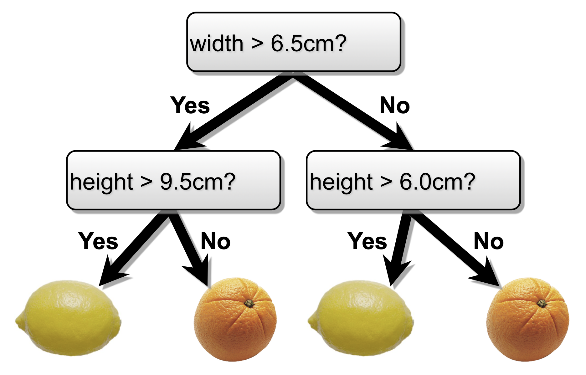{width="60%" fig-align="center"}

## Example of Decision Trees {.smaller}

Make predictions by splitting on features according to a tree structure.

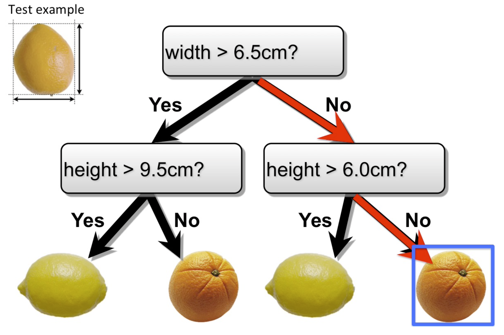{width="60%" fig-align="center"}

## Example of Decision Trees—Discrete features {.smaller}

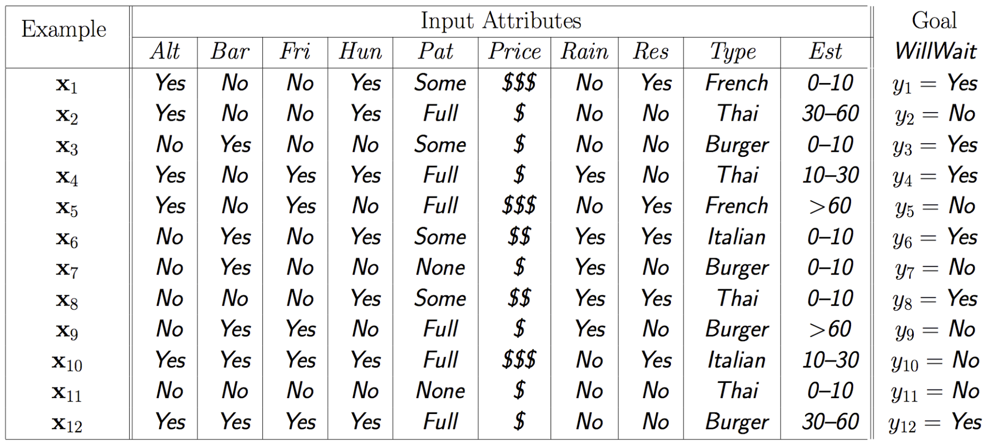{width="70%" fig-align="center"}

## Example of Decision Trees—Discrete features {.smaller}

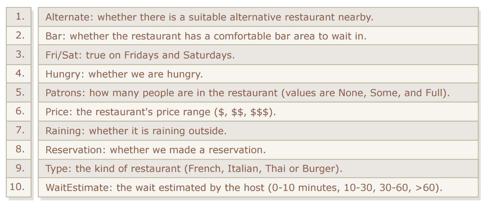{width="70%" fig-align="center"}

## Example of Decision Trees—Discrete features {.smaller}

Split discrete features into a partition of possible values.

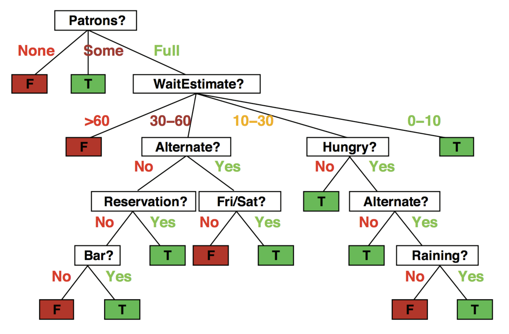{width="60%" fig-align="center"}

## Example of Decision Trees—Continuous features {.smaller}

For continuous features, we partition the range by checking whether that attribute is greater than or less than some threshold. 

Decision boundary is made up of rectangles.

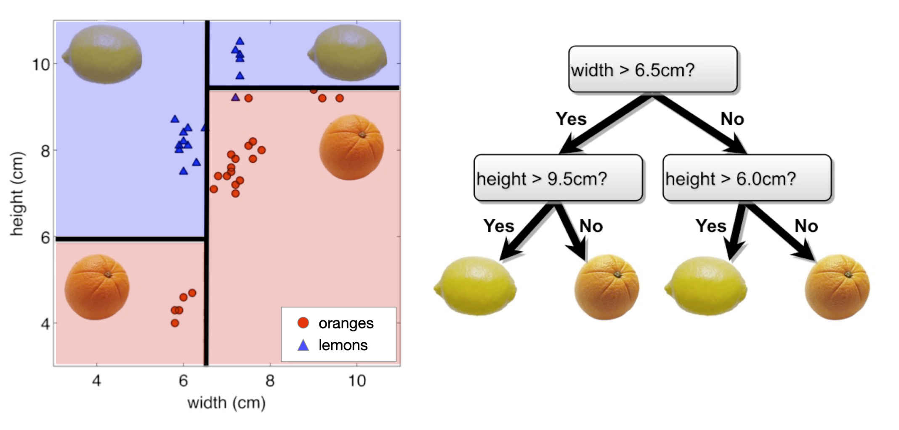{width="60%" fig-align="center"}

## Terminology of Decision Trees {.smaller}

{width="40%" fig-align="center"}

:::{.incremental}
- An [internal node]{.maroon} means an attribute, i.e., a feature. 
- [Branching]{.maroon} is determined by the [attribute value]{.maroon}. 
- Children of a node partition the range of the attribute from the parent. 
- [Leaf nodes]{.maroon} are [predicted outputs]{.maroon}.
:::

## Decision Trees—Classification and Regression {.smaller}

-   Let $J$ be the total number of paths from root to a leaf.
-   Each path, $j\in\{1,2,\ldots,J\}$, defines a region $R_j$ of the feature space.
-   Let $\{(x_1^{(j)},y_1^{(j)}),\ldots,(x_k^{(j)},y_k^{(j)})\}$ be the training data points that fall into $R_j$

  

:::{.fragment}
-   **Regression tree:**
    -   continuous output
    -   leaf value $y^{R_j}$ typically set to the mean value in $\{y_1^{(j)},\ldots,y_k^{(j)}\}$
    
::: 

:::{.fragment}
-   **Classification tree:**
    -   discrete output
    -   leaf value $y^{R_j}$ typically set to the majority label in $\{y_1^{(j)},\ldots,y_k^{(j)}\}$
    
:::

## Regression Decision Trees {.smaller}

We want to predict the salary of a baseball player, based on (1) the number of years that he has played in the leagues and (2) the number of hits that he made in the previous year.

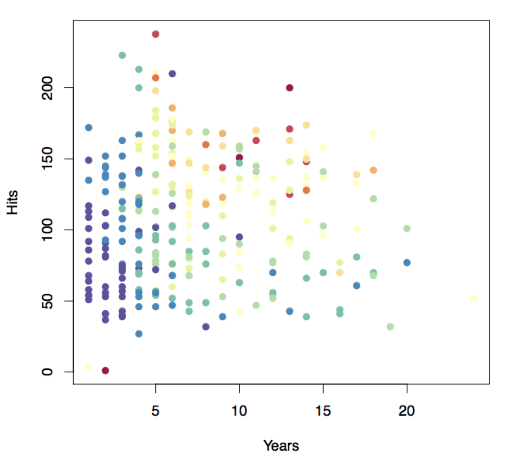{width="60%" fig-align="center"}

Salary is color-coded from low (blue, green) to high (yellow, red).

## What does a fitted decision tree look like? {.smaller}

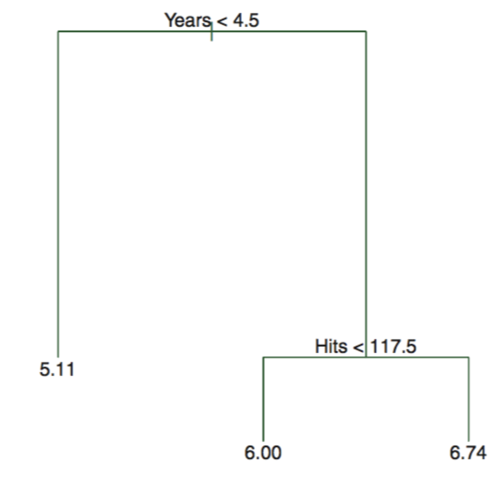{width="60%" fig-align="center"}

At a given internal node, the label (of the form $X_j<t$) indicates the left-hand branch emanating from that split, and the right-hand branch corresponds to $X_j\ge t$. The number in each leaf (external node) is the mean of the response for the observations that fall there.

## Partitioned regions for the Hitters data set {.smaller}

Overall, the tree stratifies or segments the players into three regions of feature space:

:::::::: columns
::::: {.column width="45%"}
$$R_1=\{X\mid\mathrm{Years}<4.5\}$$

$$R_2=\{X\mid\mathrm{Years}\ge4.5,\ \mathrm{Hits}<117.5\}$$

$$R_3=\{X\mid\mathrm{Years}\ge4.5,\ \mathrm{Hits}\ge117.5\}.$$
:::::

:::: {.column width="55%"}
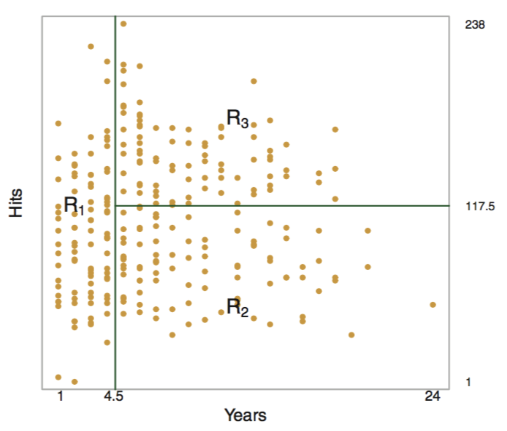{width="100%" fig-align="center"}
:::
::::

## Interpretation of Results {.smaller}

-   Years is the most important factor in determining Salary, and players with less experience earn lower salaries than more experienced players.

  

-   Given that a player is less experienced, the number of Hits that he made in the previous year seems to play little role in his Salary.

  

:::{.fragment}
-   But among players who have been in the major leagues for five or more years, the number of Hits made in the previous year does affect Salary, and players who made more Hits last year tend to have higher salaries.
::: 

  

:::{.fragment}
-   Surely an over-simplification, but compared to a regression model, it is easier to interpret, and has a nice graphical representation.
::: 

## How to Build a Regression Tree? {.smaller}

-   **Step 1:** We divide the feature space, i.e., the set of possible values for $X_1,X_2,\ldots,X_p$, into $J$ distinct and non-overlapping regions, $R_1,R_2,\ldots,R_J$.

  
  

:::{.fragment}
-   **Step 2:** For every observation that falls into the region $R_j$, we make the same prediction, which is simply the mean of the response values for the training observations in $R_j$.
::: 

## How to Construct Regions $R_1, R_2, \ldots, R_J$? {.smaller}

-   In theory, the splitted regions could have any shape. However, we choose to divide the feature space into multi-dimensional rectangles for ease of interpretation of the resulting predictive model.

:::{.fragment}
-   The goal is to find rectangles $R_1,R_2,\ldots,R_J$ that minimize the residual sum of squares (RSS), given by

$$\sum_{j=1}^{J}\sum_{i\in R_j}(y_i-\bar y_{R_j})^2,$$

where

$$\bar y_{R_j}=\frac{1}{|R_j|}\sum_{i\in R_j}y_i$$

is the mean response for the training observations in $R_j$.
::: 

## How to Construct Regions $R_1, R_2, \ldots, R_J$? {.smaller}

-   Unfortunately, it is computationally infeasible to enumerate all possible partitions of the feature space into $J$ boxes.

  

-   For this reason, we take a [top-down, greedy]{.maroon} approach that is known as [**recursive binary splitting**]{.maroon}.

  

:::{.fragment}
-   The approach is [top-down]{.maroon} because it begins at the top of the tree and then successively splits the feature space; each split is indicated via two new branches further down on the tree.
::: 

  

:::{.fragment}
-   It is [greedy]{.maroon} because at each step of the tree-building process, the best split is made at that particular step, rather than looking ahead and picking a split that will lead to a better tree in some future step.
:::

## How to Construct Regions $R_1, R_2, \ldots, R_J$? {.smaller}

-   We first select the feature $X_j$ among all $X_1,\ldots,X_p$, and the cutpoint $s$ such that splitting the feature space into the regions $\{X\mid X_j<s\}$ and $\{X\mid X_j\ge s\}$ leads to the greatest possible reduction in RSS.

  

:::{.fragment}
-   Mathematically, we seek the value of $j\in\{1,2,\ldots,p\}$ and $s\in\mathbb R$ that minimize the equation

$$\sum_{i:x_i\in R_1(j,s)}(y_i-\bar y_{R_1})^2+\sum_{i:x_i\in R_2(j,s)}(y_i-\bar y_{R_2})^2$$

where

-   $R_1(j,s)=\{X\mid X_j<s\}$ and $R_2(j,s)=\{X\mid X_j\ge s\}$
-   $\bar y_{R_1}$ and $\bar y_{R_2}$ are, respectively, the averaged responses of the training data in $R_1(j,s)$ and $R_2(j,s)$.
:::

## How to Construct Regions $R_1, R_2, \ldots, R_J$? {.smaller}

-   Next, we repeat the process, looking for the best feature and the best cutpoint in order to [further split]{.maroon} the data, leading to the greatest reduction of RSS.

-   However, this time, instead of splitting the entire feature space, we split one of the two previously identified regions. We now have three regions.

  

:::{.fragment}
-   The process continues until a stopping criterion is reached

  - we may stop when no region contains more than 5 observations
  
::: 

  

:::{.fragment}
-   Once $R_1,R_2,\ldots,R_J$ are identified, we predict the response for a given test point using the averaged response of the training observations in the region.
::: 

## An Example with 5 Regions {.smaller}

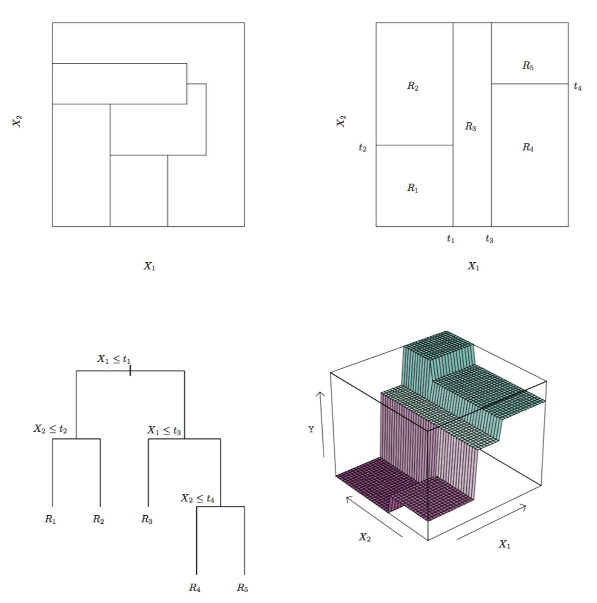{width="60%" fig-align="center"}

## An Example with 5 Regions {.smaller}

-   **Top Left**: A partition of two-dimensional feature space that could not result from recursive binary splitting.

  

-   **Top Right**: The output of recursive binary splitting on a two-dimensional example.

  

-   **Bottom Left**: A tree corresponding to the partition in the top right panel.

  

-   **Bottom Right**: A perspective plot of the prediction surface corresponding to that tree.

## Tree Pruning {.smaller}

-   The process described above may produce good predictions on the training set, but is likely to [overfit]{.maroon} the data, leading to poor test set performance.

  - This can happen when the resulting decision tree is too complex (e.g. only one observation per region)

  

:::{.fragment}
-   A smaller tree with fewer splits (that is, fewer regions $R_1,R_2,\ldots,R_J$) might lead to lower variance and better interpretation at the cost of a little bias.
::: 

:::{.fragment}
  

-   Intuitively, our goal is to select a subtree that leads to the [lowest test error rate]{.maroon} 

-   However, estimating the cross-validation error for every possible subtree is not feasible, since the number of possible subtrees is large
:::  

:::{.fragment}
::: {style="text-align: center;"}
**We need a way to select a small set of subtrees for consideration.**
:::
::: 

## Tree Pruning {.smaller}

-   A common strategy is to grow a very large tree $T_0$, and then *prune it back* in order to obtain a subtree. We use the [**cost complexity pruning**]{.maroon}, a.k.a. [**weakest link pruning**]{.maroon}.

-   We consider a sequence of trees indexed by a nonnegative tuning parameter $\alpha$. For each value of $\alpha$ find a subtree $T\subset T_0$ such that

$$\sum_{m=1}^{|T|}\sum_{i:x_i\in R_m}(y_i-\bar y_{R_m})^2+\alpha|T|,$$

is minimized. Here $|T|$ indicates the number of leaf nodes of the tree $T$.

-   The tuning parameter $\alpha$ controls a trade-off between the subtree’s complexity and its fit to the training data.
-   $\alpha=0$ gives $T_0$.

## Tree Pruning {.smaller}

-   It turns out that as we increase $\alpha$ from 0, branches get pruned from the tree in a nested and predictable fashion, so obtaining the whole sequence of subtrees as a function of $\alpha$ is easy.

  

-   We can select a value of $\alpha$ using a validation set or using cross-validation.

  

-   We then return to the full data set and obtain the subtree corresponding to $\alpha$.

## Algorithm for Building a Regression Tree {.smaller}

**Algorithm: Building a Regression Tree**

1.  Use recursive binary splitting to grow a large tree on the training data, stopping only when each terminal node has fewer than some minimum number of observations.

2.  Apply cost complexity pruning to the large tree in order to obtain a sequence of best subtrees, as a function of $\alpha$.

3.  Use $K$-fold cross-validation to choose $\alpha$. That is, divide the training observations into $K$ folds. For each $k=1,\ldots,K$:

  (a) Repeat Steps 1 and 2 on all but the $k$th fold of the training data.

  (b) Evaluate the mean squared prediction error on the data in the left-out $k$th fold, as a function of $\alpha$.

  Average the results for each value of $\alpha$, and pick $\alpha$ to minimize the average error.

4.  Return the subtree from Step 2 that corresponds to the chosen value of $\alpha$.

## Baseball Example {.smaller}

-   First, we randomly divided the data set in half, yielding 132 observations in the training set and 131 observations in the test set.

  

-   We then built a large regression tree on the training data and varied $\alpha$ to create subtrees with different numbers of terminal nodes.

  

-   Finally, we performed six-fold cross-validation in order to estimate the cross-validated MSE of the trees as a function of $\alpha$.

## Hitters data set {.smaller}

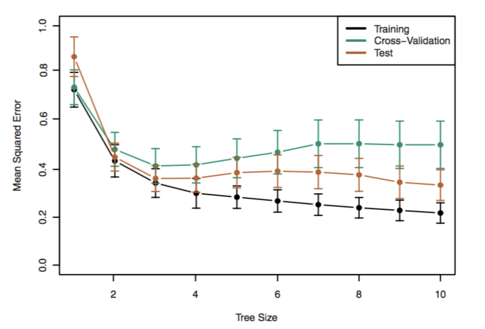{width="60%" fig-align="center"}

## Hitters data set: the unpruned tree {.smaller}

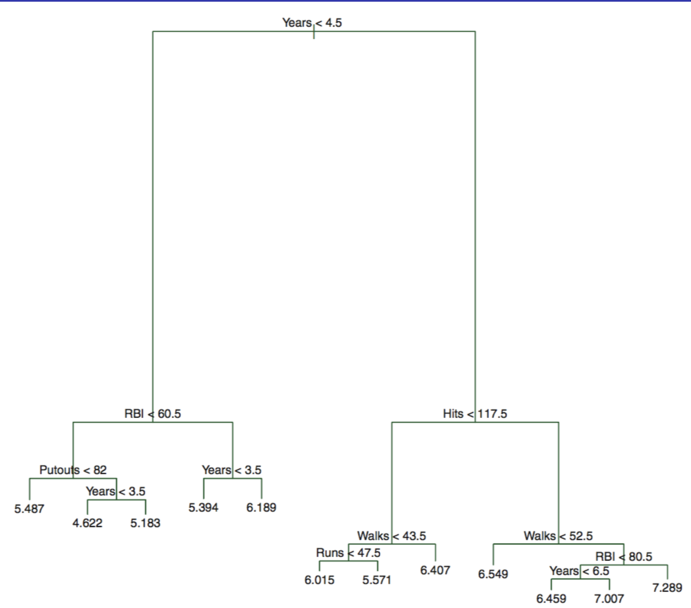{width="60%" fig-align="center"}

## Hitters data set: the pruned tree {.smaller}

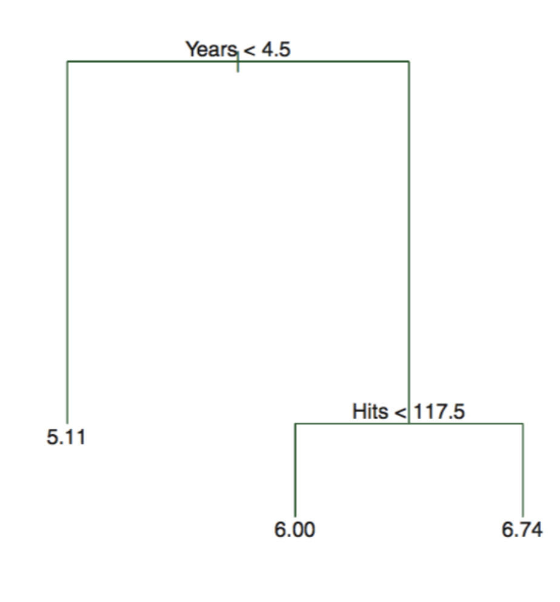{width="60%" fig-align="center"}

## Classification Trees {.smaller}

-   A classification tree is very similar to a regression tree, except that it is used to predict a qualitative response rather than a quantitative one.

  

-   For a classification tree, we predict that each observation belongs to the most commonly occurring class of training observations in the region to which it belongs.

  

-   Just as in the regression setting, we use [recursive binary splitting]{.maroon} to grow a classification tree.

  

-   But, RSS cannot be used as a criterion for making the binary splits. **What metric should we use instead?**

## Metrics used for classification trees {.smaller}

-   A natural alternative to RSS is the [**0-1 misclassification error rate**]{.maroon}. For region $R_m$ with $K$ classes of labels: for $k\in\{1,\ldots,K\}$,

$$\hat p_{mk}=\frac{1}{|R_m|}\sum_{i:x_i\in R_m}\mathbf 1\{y_i=k\}$$

:::{.fragment}
-   The misclassification error rate in region $R_m$ is

$$1-\max_{k\in\{1,\ldots,K\}}\hat p_{mk}.$$
::: 

:::{.fragment}
-   However misclassification error is not sufficiently sensitive for the change of $\hat p_{mk}$, hence not suitable for finding the splits for **building** classification trees.
::: 

## Choosing a Good Split {.smaller}

Consider the following data. Let’s split on width.

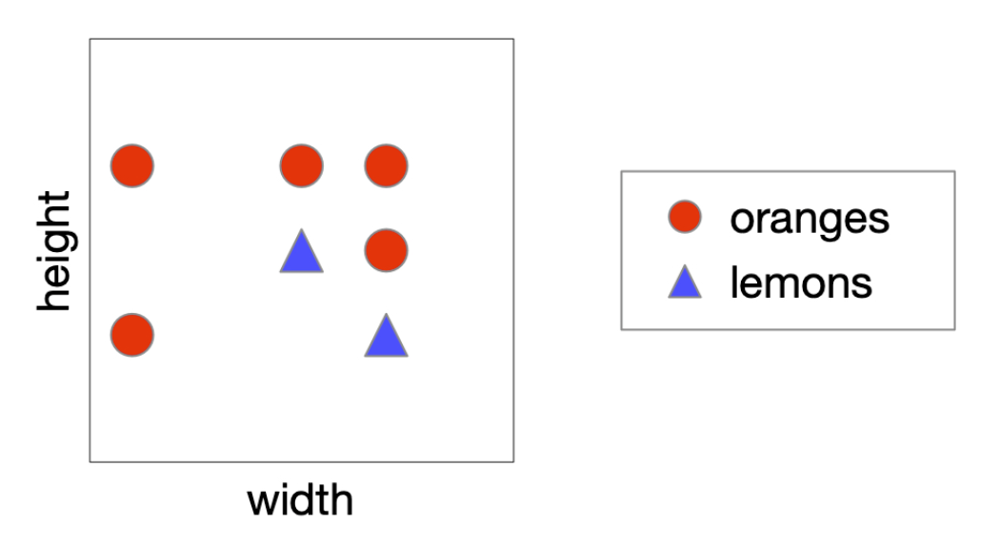{width="60%" fig-align="center"}

## Choosing a Good Split {.smaller}

Recall: classify by majority.

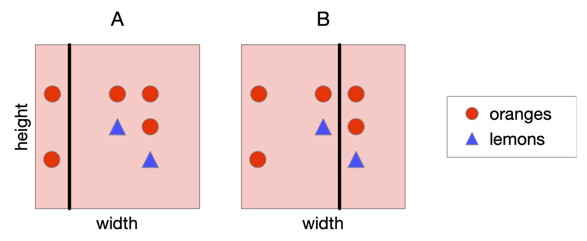{width="60%" fig-align="center"}

A and B have the same misclassification rate, so which is the best split? Vote!

## Choosing a Good Split {.smaller}

{width="60%" fig-align="center"}

Case A feels like a better split, because the left-hand region is very certain about whether the fruit is an orange.

Can we quantify this?

## Quantifying Uncertainty {.smaller}

-   The [**entropy**]{.maroon} of a discrete random variable is a number that quantifies the [**uncertainty**]{.maroon} inherent in its possible outcomes. 

  

- The mathematical definition of entropy that we give in a few slides may seem arbitrary, but it can be motivated axiomatically.
    -   If you’re interested, check: Information Theory by Robert Ash. 

  

- To explain entropy, consider flipping two different coins.

## We Flip Two Different Coins {.smaller}

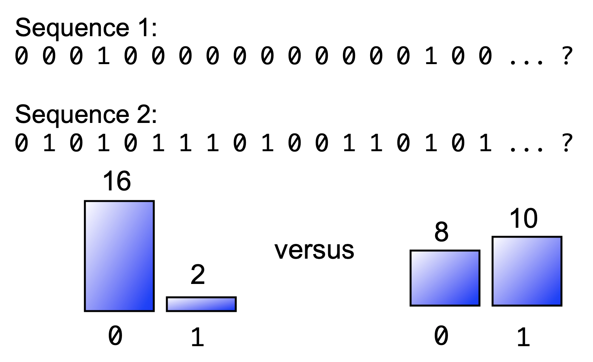{width="60%" fig-align="center"}

## Quantifying Uncertainty {.smaller}

-   The entropy of a loaded coin with probability $p$ of heads is given by

$$-p\log_2(p)-(1-p)\log_2(1-p)$$

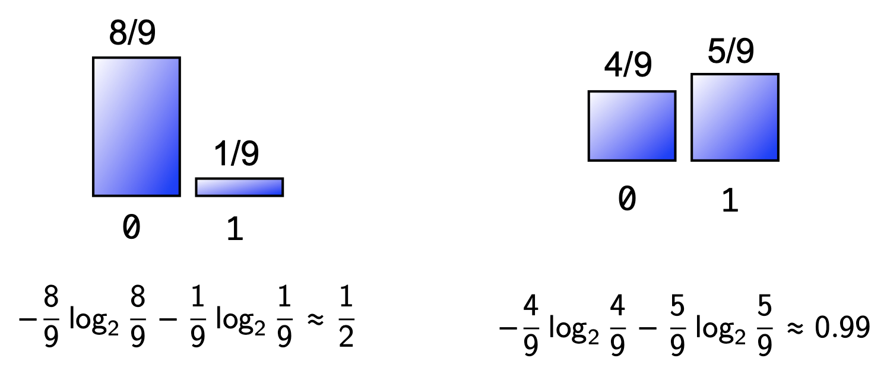{width="60%" fig-align="center"}

-   Notice: the coin whose outcomes are more certain has a lower entropy.
-   In the extreme case $p=0$ or $p=1$, we were certain of the outcome before observing. So, we gained no certainty by observing it, i.e., entropy is 0.

## Revisiting Our Original Example {.smaller}

Let’s compute the entropies associated with Split B.

{width="60%" fig-align="center"}

:::{.incremental}
-   Left branching: $\hat p_{\mathrm{orange}}=3/4$ and $\hat p_{\mathrm{lemon}}=1/4$. Its entropy is $-\frac34\log_2\frac34-\frac14\log_2\frac14\approx0.81$.
-   Right branching: $\hat p_{\mathrm{orange}}=2/3$ and $\hat p_{\mathrm{lemon}}=1/3$. Its entropy is $-\frac23\log_2\frac23-\frac13\log_2\frac13\approx0.92$
-   The summation of entropies is 1.73.
:::

## Revisiting Our Original Example {.smaller}

What is the information gain of split A? Very informative!

{width="60%" fig-align="center"}

:::{.incremental}
-   Left branching: $\hat p_{\mathrm{orange}}=1$ and $\hat p_{\mathrm{lemon}}=0$. Its entropy is 0.
-   Right branching: $\hat p_{\mathrm{orange}}=3/5$ and $\hat p_{\mathrm{lemon}}=2/5$. Its entropy is $-\frac35\log_2\frac35-\frac25\log_2\frac25\approx0.97$
-   The summation of entropies is 0.97. So we have less uncertainty for the second split. Uncertainty can also be understood as [**node purity**]{.maroon}.
:::

## Deviance and Gini index {.smaller}

-   For a region $R_m$, an entropy based metric is called [**Deviance**]{.maroon}, and is given by

$$-\sum_{k=1}^{K}\hat p_{mk}\log\hat p_{mk},$$

-   Another popular metric is [**Gini index**]{.maroon}, defined by

$$\sum_{k=1}^{K}\hat p_{mk}(1-\hat p_{mk}),$$

a measure of total variance across the $K$ classes.

:::{.fragment}
-   Both Deviance and Gini index are small if all of the $\hat p_{mk}$’s are close to zero or one. They are measures of [**node purity**]{.maroon} – a small value indicates that a node contains observations that most of them come from a single, dominant class.
:::

## Misclassification error rate, Gini index and Deviance {.smaller}

-   It turns out that Gini index and Deviance are quite similar numerically.

  

-   On the one hand, for **building** a classification tree, either Gini index or Deviance can be used for finding best splits, since they are more sensitive to node purity than the misclassification error rate.

  

-   On the other hand, all Gini index, Deviance and misclassification error can be used for **pruning** the tree, but the misclassification error is preferable if classification accuracy is the final goal.

## Heart Data {.smaller}

-   These data contain a binary outcome HD for 303 patients who presented with chest pain.

  

-   An outcome value of Yes indicates the presence of heart disease based on an angiographic test, while No means no heart disease.

  

-   There are 13 features including Age, Sex, Chol (a cholesterol measurement), Thal (maximum heart rate achieved) and other heart and lung function measurements.

  

-   Cross-validation yields a tree with six terminal nodes.

## Heart Data: the unpruned fitted decision tree. {.smaller}

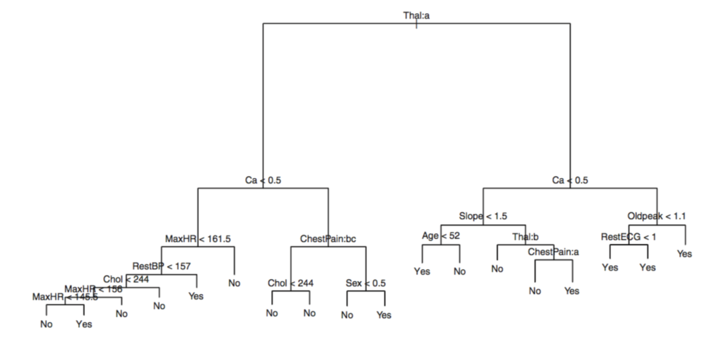{width="60%" fig-align="center"}

## Heart Data {.smaller}

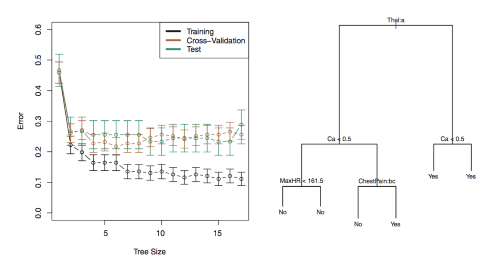{width="60%" fig-align="center"}

Left: Cross-validation error, training, and test error, for different sizes of the pruned tree. 

Right: The pruned tree corresponding to the minimal CV error.

## Trees Versus Linear Models {.smaller}

-   The linear model says

$$f(X)=\beta_0+\sum_{j=1}^{p}\beta_jX_j,$$

whereas the regression tree says

$$f(X)=\sum_{m=1}^{J}c_m\mathbf1\{X\in R_m\}.$$

:::{.incremental}
-   If $f(X)\approx X^\top\beta$, then linear regression will likely work well.

-   If instead there is a highly non-linear and complex relationship between $X$ and $Y$, then decision trees performs better.

-   The relative performances of tree-based and classical approaches can be assessed by estimating the test error, using either cross-validation or the validation set approach.
::: 

## Advantages and Disadvantages of Trees {.smaller}

-   Trees are self-explanatory. In fact, they are even easier to explain than linear regression!

-   Some people believe that decision trees more closely mimic human decision-making.

-   Trees can easily handle qualitative features without the need to create dummy variables.

  

:::{.fragment}
-   But, trees generally do not have the same predictive power as other regression and classification approaches.

-   Relatedly, trees could be very non-robust. In other words, a small change in the data can lead to a drastically different estimated tree.
::: 

  

:::{.fragment}
-   Nevertheless, by aggregating many trees (via bagging, random forests, and boosting), the predictive performance can be substantially improved.
::: 

# Bootstrap

## Bootstrap

-   Bootstrap is a widely used [**resampling**]{.maroon} (of the available data) approach!

  

-   It can be used to assess the uncertainty of basically **any** statistical procedure.

  - For instance, it can be used to estimate the standard errors of the estimated coefficients of a linear model.
  - Much more generally, it can even estimate the whole distribution of the estimated coefficients of a linear model.

  

-   Its validity is backed up by a very general theory!

## An example {.smaller}

-   Suppose that we wish to invest 10K dollars in two financial assets that yield returns of $X$ and $Y$, respectively, where $X$ and $Y$ are random quantities.

  

-   For any $\alpha\in[0,1]$, we will invest a fraction $\alpha$ of our money in $X$, and will invest the remaining $(1-\alpha)$ in $Y$.

$$[\alpha X+(1-\alpha)Y]\times10{,}000$$

-   We wish to choose $\alpha$ to minimize the total risk, or variance, of our investment, that is,

$$\min_{\alpha\in[0,1]}\operatorname{Var}(\alpha X+(1-\alpha)Y).$$

## An example {.smaller}

-   One can show that the value of $\alpha$ that minimizes the risk is given by

$$\alpha=\frac{\sigma_Y^2-\sigma_{XY}}{\sigma_X^2+\sigma_Y^2-2\sigma_{XY}},$$

where $\sigma_Y^2=\operatorname{Var}(Y)$, $\sigma_X^2=\operatorname{Var}(X)$ and $\sigma_{XY}=\operatorname{Cov}(X,Y)$.

:::{.fragment}
-   If we have past observations $(x_1,y_1),\ldots,(x_{100},y_{100})$, we can estimate $\alpha$ by

$$\hat\alpha=\frac{\hat\sigma_Y^2-\hat\sigma_{XY}}{\hat\sigma_X^2+\hat\sigma_Y^2-2\hat\sigma_{XY}}.$$
::: 

:::{.fragment}
-   How to estimate the variance of the estimator $\hat\alpha$?
::: 

## An Oracle Approach {.smaller}

If we know the distribution of $X$ and $Y$ (usually unknown in reality), we can estimate the variance of the estimator $\hat\alpha$ by the following strategy.

-   We simulate 100 paired observations of $X$ and $Y$ and compute

$$\hat\alpha=\frac{\hat\sigma_Y^2-\hat\sigma_{XY}}{\hat\sigma_X^2+\hat\sigma_Y^2-2\hat\sigma_{XY}}.$$

-   We repeat this procedure 1000 times, and get $\hat\alpha_1,\ldots,\hat\alpha_{1000}$.
-   We estimate $\operatorname{Var}(\hat\alpha)$ by

$$\frac{1}{1000-1}\sum_{r=1}^{1000}(\hat\alpha_r-\bar\alpha)^2,\qquad\text{where}\quad\bar\alpha=\frac1{1000}\sum_{r=1}^{1000}\hat\alpha_r.$$

**Question:** Is this feasible in practice?

## Bootstrap {.smaller}

-   The bootstrap approach re-samples from the [**original data set**]{.maroon} to mimic the process of obtaining new data sets in order to quantifty the uncertainty of a given procedure.

  

-   Specifically, for a specified B (for instance, B = 1000) number of repetitions, we repeatedly sample **the same amount of observations** from the original data set **with replacement**.

  

-   As a result, data set from bootstrap might contain some observations more than once, or zero time.

## Simple illustration of Bootstrap {.smaller}

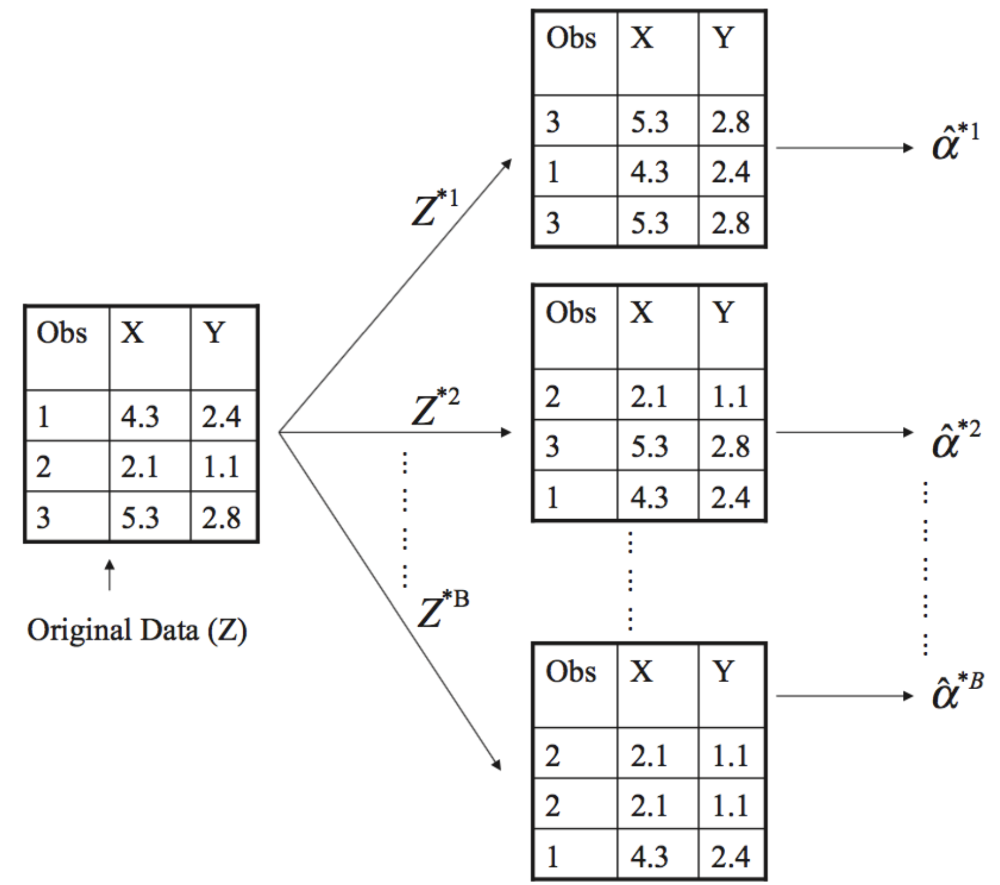{width="60%" fig-align="center"}

## Bootstrap {.smaller}

Now let us apply bootstrap to estimate $\operatorname{Var}(\hat\alpha)$:

-   We denote the first bootstrap data set by $Z^{*1}$, and use $Z^{*1}$ to construct the estimate of $\alpha$, denoted by $\hat\alpha^{*1}$.

  

-   This procedure is repeated $B$ (say, $B=1000$): specifically we simulate $B$ different bootstrap data sets, $Z^{*1},\ldots,Z^{*B}$ and $B$ corresponding estimates $\hat\alpha^{*1},\ldots,\hat\alpha^{*B}$.

  

-   We estimate $\operatorname{Var}(\hat\alpha)$ by the sample variance of $\hat\alpha^{*1},\ldots,\hat\alpha^{*B}$:

$$\frac1{B-1}\sum_{b=1}^{B}(\hat\alpha^{*b}-\bar\alpha^*)^2,\qquad\text{where}\quad\bar\alpha^*=\frac1B\sum_{b=1}^{B}\hat\alpha^{*b}.$$

## Example {.smaller}

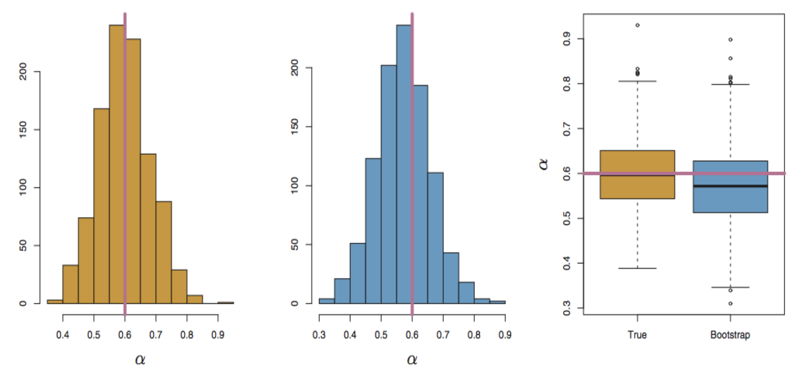{width="60%" fig-align="center"}

Left: The histogram of estimates of $\alpha$ obtained by generating 1,000 simulated data sets from the true population.

Center: The histogram of estimates of $\alpha$ obtained from 1,000 bootstrap samples from a single data set.

Right: Boxplots for estimates of $\alpha$ displayed in the left and center panels.

## Bootstrap for quantifying the uncertainty of the OLS estimator {.smaller}

Given the data $D=\{(x_1,y_1),\ldots,(x_n,y_n)\}$, the OLS gives

$$\hat\beta=(X^\top X)^{-1}X^\top y.$$

Statistical property of $\hat\beta\in\mathbb R^p$ consists of

-   its mean
-   its covariance
    -   Recall that analyses of $\hat\beta$ such as its mean and covariance are only available under linear model assumption.
-   its higher moments
-   its whole distribution

Bootstrap can be used to estimate **all above**!

## Bootstrap for quantifying the uncertainty of the OLS estimator {.smaller}

Given the data $D=\{(x_1,y_1),\ldots,(x_n,y_n)\}$, the OLS gives

$$\hat\beta=(X^\top X)^{-1}X^\top y.$$

For $b=1,\ldots,B$,

1.  obtain the bootstrap sample $D^b=(X^b,y^b)$
2.  compute $\hat\beta^b=(X^{b\top}X^b)^{-1}X^{b\top}y^b$.

Now for $\hat\beta_j$, the bootstrap estimates $\hat\beta_j^1,\ldots,\hat\beta_j^B$ serve as “samples” of $\hat\beta_j$.

## Bootstrap for quantifying the uncertainty of the OLS estimator {.smaller}

For instance,

-   the mean of $\hat\beta_j$ can be estimated by $\frac1B\sum_{b=1}^{B}\hat\beta_j^b.$

-   the variance of $\hat\beta_j$ can be estimated by $\frac1{B-1}\sum_{b=1}^{B}\left(\hat\beta_j^b-\frac1B\sum_{b=1}^{B}\hat\beta_j^b\right)^2.$

  

-   You can also estimate quantiles of the distribution of $\hat\beta_j$.
-   In fact, you can estimate the whole distribution of $\hat\beta_j$.

## Summary

- **Decision Trees:** Partition the feature space into regions, making predictions using the mean response (regression) or majority class (classification).

- **Building Trees:** Recursive binary splitting uses RSS for regression and measures of node purity (Gini index or deviance) for classification.

- **Pruning:** Large trees can overfit. Cost-complexity pruning uses a tuning parameter $\alpha$, typically selected using cross-validation, to balance complexity and predictive performance.

- **Strengths and Limitations:** Trees are interpretable and capture non-linear relationships, but can be unstable and have lower predictive accuracy than other methods.

- **Bootstrap:** Resampling observations [with replacement]{.maroon} allows us to approximate the sampling distribution of an estimator and quantify its uncertainty (e.g., standard errors and variance).

**Announcements**: Next week is reading week! 

**After Reading Week**: More tree based methods and midterm

