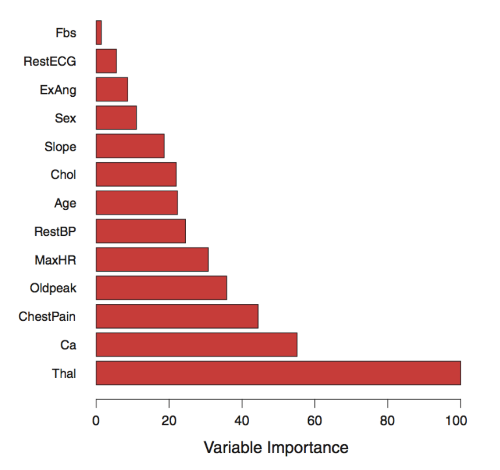
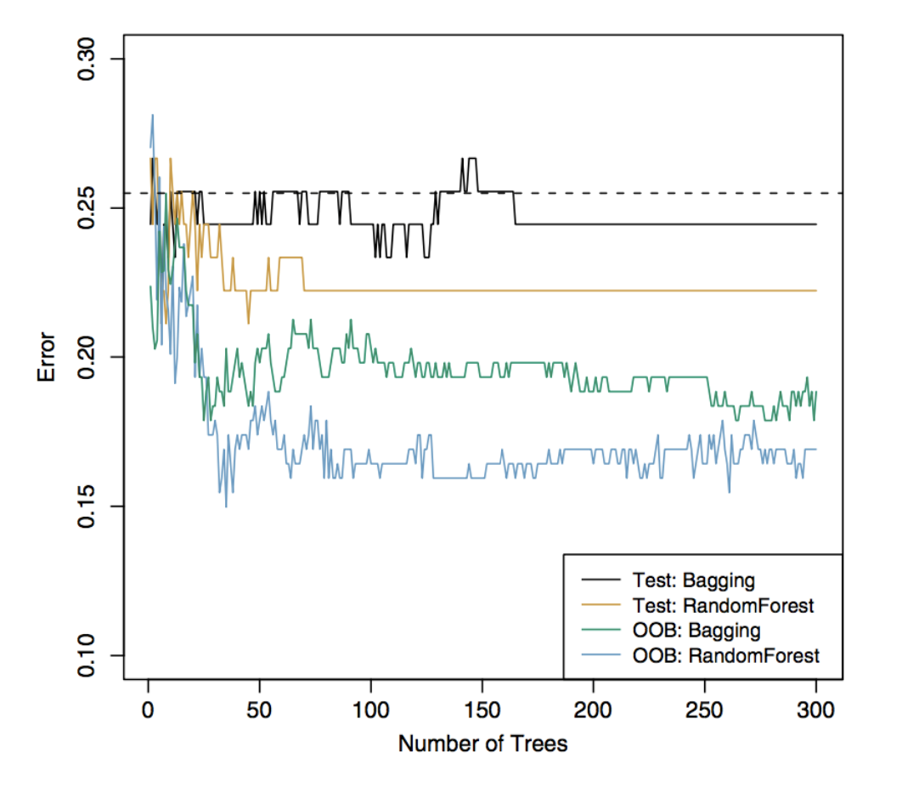
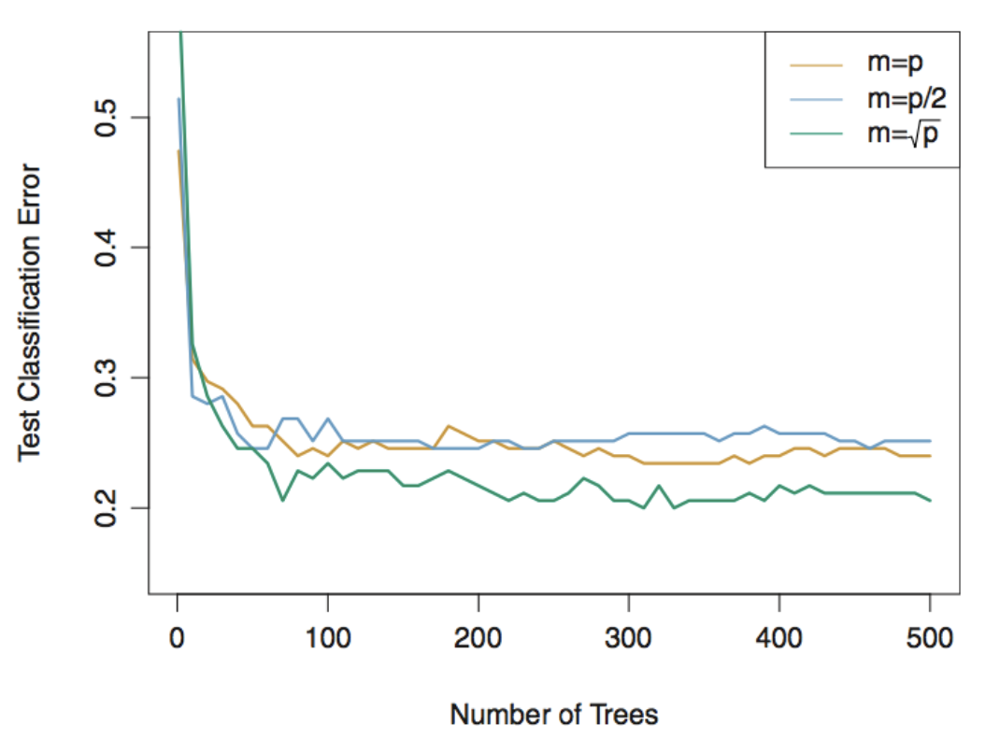
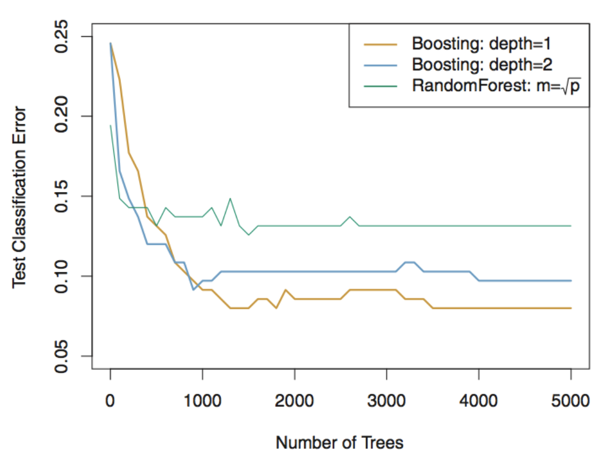

## Review on simple decision trees

-   Can be used for both regression and classification

  

-   Self-explanatory

  

-   Recursive binary splitting to build the tree

  

-   Could be deeply grown trees, with large variance (i.e. prone to overfitting)

  

-   Pruning via cost complexity to reduce variance of tree at the expense of some bias

## Learning Outcomes

By the end of this lecture, you should be able to:

- Explain how bagging uses bootstrap sampling and averaging to reduce the variance of decision trees.

- Describe how out-of-bag (OOB) error is used to estimate prediction error.

- Explain how to measure variable importance 

- Describe how random forests extend bagging

- Explain how boosting builds trees sequentially and identify its main tuning parameters.

- Compare bagging, random forests, and boosting in terms of how trees are constructed and predictions are combined.

## Bagging

[**Bootstrap aggregation**]{.maroon}, or [**bagging**]{.maroon}, is a general-purpose procedure for reducing the variance of a statistical learning method.

  

::: {style="text-align: center;"}
Two heads are better than one!
:::

  

We introduce it here because it is particularly useful and frequently used in the context of decision trees.

## Why bagging? The idea of bagging.

Given a set of $N$ independent estimates $\hat\beta^{(1)},\ldots,\hat\beta^{(N)}$ of $\beta$, suppose

$$
\left|\mathbb{E}\left[\hat\beta^{(i)}\right]-\beta\right|\leq b,
\qquad \operatorname{Var}(\hat\beta^{(i)})=\sigma^2,
\qquad \forall i=1,\ldots,N.
$$

Then the averaged estimate

$$
\bar\beta:=\frac{1}{N}\sum_{i=1}^N\hat\beta^{(i)}
$$

satisfying

$$
\left|\mathbb{E}[\bar\beta]-\beta\right|\leq b,
\qquad \operatorname{Var}(\bar\beta)=\frac{\sigma^2}{N}.
$$

In other words, averaging a set of **independent** random variables reduces the variance, meanwhile does not incur extra bias.

## Bagging

To apply bagging to regression trees, if we had $B$ independent training sets, then we simply construct $B$ regression trees using each of the training set, and average the resulting predictions in the end.

  

:::{.fragment}
Since we only have one training set, we [**bootstrap**]{.maroon} the same amount of data $B$ times from the training set **with replacement**
::: 

  

:::{.fragment}
We train a decision tree by using the $b$th bootstrap data and get the prediction $\hat f^{*b}(x)$ at a point $x$. Bagging averages all the predictions

$$
\hat f_{\mathrm{bag}}(x)=\frac{1}{B}\sum_{b=1}^B\hat f^{*b}(x).
$$
::: 

## Bagging Trees

The fitted decision trees on bootstrap data sets are grown deep, and need not be pruned. Hence each individual tree has **high variance**, but **low bias**. Averaging these trees reduces the variance.

  
  

Bagging can be also applied to classification trees. For a given test observation, we can record the class predicted by each of the $B$ trees, and take a majority vote.

## Out-of-Bag Error Estimation

There is a simple way to estimate the test error of a bagged model, without the need to perform cross-validation or the validation set approach.

  

For each bootstrap data set,

  -   It only contains, on average, around 2/3 of the original observations (try Exercise 2 from Chapter 5 in the textbook!).
  -   The remaining 1/3 is not used to fit the decision tree, and is referred to as the [**out-of-bag (OOB) observations**]{.maroon}.
  -   We predict the OOB observations by using the fitted decision tree.

## Out-of-Bag Error Estimation

For each observation $i$, we can pool its predictions across all $B$ bootstrap data sets where $i$ belongs to the OOB observations.

  - For regression, we average
  - For classification, we vote by majority

  
  

We compute the MSE / misclassification error between predictions and the true responses over all observations.

## Variable Importance Measures

Bagging typically reduces variance (i.e. improve accuracy) over prediction using a single decision tree.

  
  

However, it can be difficult to interpret the resulting model.

  
  

One can obtain an overall summary of the importance of each predictor using the RSS (for bagging regression trees) or the Gini index (for bagging classification trees).

## Variable Importance Measures

In the case of bagging regression trees, we can record the total amount that the RSS is decreased due to splits over a given predictor, averaged over all $B$ trees. 

  

In bagging classification trees, we replace RSS by the Gini index.

  

:::{.fragment}
A large value of decreased RSS (or Gini index) indicates an important predictor.

  

A graphical representation of variable importance is easy to draw.
::: 

## Heart Data

{width="70%" fig-align="center"}

Variable importance is computed using the mean decrease in Gini index, and expressed relative to the maximum.

## Summary on bagging

-   Bagging simply averages multiple decision trees

  

-   Bias does not increase

  

-   Variance is reduced

  - [**How much is variance reduced?**]{.maroon}

## Random Forests

**Bagging is affected by the correlation among decision trees!** 

  - If one predictor is particularly strong, many trees will repeatedly split on it, making their predictions similar.
  - ex. if one tree predicts too high, then the others will also tend to predict too high when trees are highly correlated
  
  

[**Random forests**]{.maroon} provide an improvement over bagged trees by *decorrelating* the trees. This increases the variance reduction when we average the trees. 

  - reducing the correlation makes averaging more effective because the trees are less likely to make the same mistakes.

## Random Forests

As in bagging, we build a number of decision trees on bootstrap training samples.

  

But for building these decision trees, each time a split in a tree is considered, a **random selection** of $m < p$ predictors is chosen as split candidates from the full set of $p$ predictors.

  

:::{.fragment}
A fresh selection of $m$ predictors is taken **at each split**, and a common choice of $m$ is $m \approx \sqrt{p}$.

  

Random forest with $m=p$ is just bagging!
::: 

## Why does Random Forest Reduce Correlations?

Suppose that there is one very strong predictor in the data set, along with a number of other moderately strong predictors.

  

Among all single decision trees, most of them will use this strong predictor in the top split. All of the single trees will look quite similar and could have high correlation.

  

Random forests reduce the correlation by randomly selecting a subset of the predictors in each split of building each single tree. Indeed, on average many splits will not even consider the strong predictor.

## Heart Data

{width="60%" fig-align="center"}

The test error (black and orange) is shown as a function of $B$. Random forests were applied with $m=\sqrt p$. The dashed line indicates the test error resulting from a single classification tree. The green and blue traces show the OOB error, which is considerably lower by chance.

## Gene Expression Data

-  We applied random forests to a high-dimensional biological data set consisting of expression measurements of 4,718 genes measured on tissue samples from 349 patients.

-   There are around 20,000 genes in humans, and individual genes have different levels of activity, or expression, in particular cells, tissues, and biological conditions.

-   Each of the patient samples has a qualitative label with 15 different levels: either normal or one of 14 different types of cancer.

  

:::{.fragment}
-   We use random forests to predict cancer type based on the 500 genes that have the largest variance in the training set.

-   We randomly divided the observations into a training and a test set, and applied random forests to the training set for three different values of the number of splitting variables $m$.
::: 

## Gene Expression Data

{width="60%" fig-align="center"}

The test errors are displayed as functions of the number of trees ($B$). Random forests ($m<p$) lead to a slight improvement over bagging ($m=p$). A single classification tree has an error rate of 45.7%.

## Boosting

- Like bagging, [**boosting**]{.maroon} is a general approach that can be applied to many statistical learning methods for regression and classification. We focus on the context of decision trees.

- Bagging (and random forest) involves creating multiple copies of the original training data set using bootstrap, fitting a separate decision tree to each copy, and then combining all of the trees in order to create a single predictive model.

  

Boosting works both similarly and also differently

  - Boosting combines a large number of decision trees
  - The trees in boosting are grown **sequentially**: each tree is grown using information from previously grown trees
  - Boosting does not involve bootstrap sampling; instead each tree is fitted on a modified version of the original data set.

## Boosting Algorithm for Regression

1.  Set $\hat f(x)=0$ and $r_i=y_i$ for all $i$ in the training set.

2.  For $b=1,2,\ldots,B$, repeat:

    (a) Fit a tree $\hat f^b$ with $d$ splits ($d+1$ terminal nodes) to the training data $(X,r)$.

    (b) Update $\hat f$ by adding in a shrunken version of the new tree:

    $$\hat f(x)\leftarrow\hat f(x)+\lambda\hat f^b(x).$$

    (c) Update the residuals,

    $$r_i\leftarrow r_i-\lambda\hat f^b(x_i).$$

3.  Output the boosted model,

$$\hat f(x)=\sum_{b=1}^B\lambda\hat f^b(x).$$

## Boosting

-   Unlike fitting a single large decision tree to the data, which might lead to overfitting, the boosting approach instead **learns slowly**.

  

-   Given the current model, we fit a decision tree to the **residuals** from the model. We then add this new decision tree into the fitted function and update the residuals.

  

-   Each of these trees can be rather small, with just a few terminal nodes, determined by the parameter $d$ in the algorithm.

  

-   By fitting small trees to the residuals, we slowly improve $\hat f$ in areas where it does not perform well. The step size $\lambda$ further slows down the learning process.

## Tuning parameters for Boosting

-   **The number of trees** $B$. Unlike bagging and random forests, boosting can overfit if $B$ is too large, although this overfitting tends to occur slowly if at all. We use cross-validation to select $B$.

  

:::{.fragment}
-   **The shrinkage parameter (step size)** $\lambda$, a small positive number. This controls the rate at which boosting learns. Typical values are 0.01 or 0.001.
::: 

  

:::{.fragment}
-   **The number of splits** $d$ in each tree, which controls the complexity of the boosted ensemble. Often $d=1$ works well, in which case each tree is a [**stump**]{.maroon}, consisting of a single split and resulting in an additive model.
::: 

## Gene Expression Data

{width="60%" fig-align="center"}

For both boosting trees, $\lambda=0.01$. Depth-1 trees slightly outperform depth-2 trees and random forests. But these differences are within their standard errors, making none of the difference significant.

## Summary

-   Decision trees are simple and interpretable models for regression and classification.

-   However their prediction accuracy is often not competitive with other regression / classification methods.

-   Bagging, random forests and boosting can improve prediction accuracy of trees. They work by growing many trees on the training data and then combining the predictions of the resulting trees.

-   The latter two methods, **random forests and boosting**, are among the state-of-the-art methods for supervised learning. However their results can be difficult to interpret.

**Announcements:** Midterm on Wednesday in EX 200 during class time (11:10am - 12:50pm).

**Next Week:** Support Vector Machines